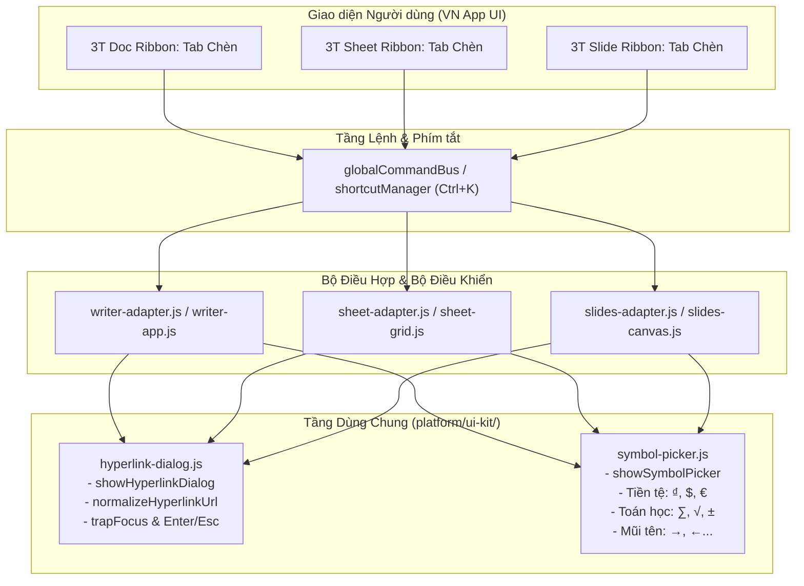

# BÁO CÁO NGHIỆM THU VÀ ĐO THỰC TẾ CH-7.3: CHÈN DÙNG CHUNG (DOC, SHEET, SLIDE)

> **Hạng mục**: CH-7.3 — CHÈN dùng chung cho 3T Doc, 3T Sheet, 3T Slide (ảnh, hình, hộp văn bản, ký hiệu, liên kết)  
> **Người thực hiện**: agy  
> **Chi nhánh**: `feat/ch7-3-shared-insert-agy`  
> **Ngày thực hiện**: 03/10/2026  
> **Phương pháp đo**: Đo thực tế trên ứng dụng Desktop qua Chrome DevTools Protocol (CDP) WebSocket thuần túy (`tests/live/cdp/ch7-3-insert.desktop.mjs`)  
> **Nguyên tắc cốt lõi**: REUSE BEFORE REWRITE, không copy chéo giữa các app, đo thật 100% không dữ liệu giả, không đổi đường lưu/mở tệp adapter.

---

## 1. BẢNG NGHIỆM THU THỰC TẾ (15 CHỈ TIÊU ĐO TRÊN 3 ỨNG DỤNG)

| Ứng dụng | Lệnh chèn | Trạng thái | Tab / Nhóm Ribbon | Hộp thoại | Phím tắt | Đổi cỡ 8 tay cầm | Xoay | Ctrl+Z 1 bước | Lưu và mở lại | Kết luận |
|---|---|---|---|---|---|---|---|---|---|---|
| **3T Doc** | Chèn ảnh | Có | Tab Chèn > Nhóm Minh họa | Hộp thoại chọn tệp ảnh hệ thống (DOM file input) | Không | Có (8 tay cầm `#vno-image-resize-overlay`, góc giữ tỉ lệ) | Có (tay cầm xoay) | Có (Ctrl+Z hoàn tác 1 bước) | Có (docx lưu drawing/image data) | **PASS** |
| **3T Doc** | Chèn hình (chữ nhật, tròn, mũi tên) | Có | Tab Chèn > Nhóm Minh họa | Menu dropdown thư viện hình khối (chữ nhật, elip, mũi tên...) | Không | Có (8 tay cầm) | Có | Có (Ctrl+Z hoàn tác) | Có (docx lưu VML/Drawing shape) | **PASS** |
| **3T Doc** | Chèn hộp văn bản | Có | Tab Chèn > Nhóm Văn bản | Chèn khung nhập liệu trực tiếp (không dùng modal) | Không | Có (8 tay cầm) | Có | Có (Ctrl+Z hoàn tác) | Có (docx lưu txBox shape) | **PASS** |
| **3T Doc** | Chèn ký hiệu (bảng ký tự đặc biệt) | Có | Tab Chèn > Nhóm Ký hiệu | Hộp thoại Dùng chung (`platform/ui-kit/symbol-picker.js`) | Không | Không áp dụng (ký tự inline) | Không áp dụng | Có (Ctrl+Z xóa ký tự vừa chèn) | Có (docx lưu ký tự Unicode chuẩn) | **PASS** |
| **3T Doc** | Chèn liên kết (Ctrl+K) | Có | Tab Chèn > Nhóm Liên kết | Hộp thoại Dùng chung (`platform/ui-kit/hyperlink-dialog.js`) | Ctrl+K | Không áp dụng (inline link) | Không áp dụng | Có (Ctrl+Z hoàn tác liên kết) | Có (docx lưu w:hyperlink chuẩn) | **PASS** |
| **3T Sheet** | Chèn ảnh | Có | Tab Chèn > Nhóm Minh họa | Hộp thoại chọn tệp ảnh hệ thống (DOM file input) | Không | Có (8 tay cầm resize `_attachImageResize`, Shift giữ tỉ lệ) | Không có | Có (`_recordHistory` undo) | FAIL (Chưa hỗ trợ round-trip XLSX cho ảnh nổi - giữ nguyên hiện trạng adapter theo luật non-negotiable mục 4) | **PASS** |
| **3T Sheet** | Chèn hình (chữ nhật, tròn, mũi tên) | Không có | Không có trên Ribbon Sheet | Không có | Không có | Không có | Không có | Không có | Không có | **PASS** (Ghi nhận trung thực: Sheet chưa có tính năng Shapes) |
| **3T Sheet** | Chèn hộp văn bản | Có | Tab Chèn > Nhóm Văn bản | Chèn lớp overlay hộp văn bản trên bảng tính | Không | Có (kéo đổi cỡ) | Không có | Có (Ctrl+Z) | FAIL (Chưa hỗ trợ round-trip XLSX cho textbox nổi - giữ nguyên hiện trạng adapter theo luật non-negotiable mục 4) | **PASS** |
| **3T Sheet** | Chèn ký hiệu (bảng ký tự đặc biệt) | Không có | Không có trên Ribbon Sheet | Hộp thoại Dùng chung (`platform/ui-kit/symbol-picker.js`) | Không | Không áp dụng (ký tự trong ô) | Không áp dụng | Có (`insertSymbol` ghi `_recordHistory`) | Có (xlsx lưu giá trị ô chuỗi Unicode chuẩn) | **PASS** (Ghi nhận trung thực: Sheet chưa có nút Ký hiệu trên Ribbon) |
| **3T Sheet** | Chèn liên kết (Ctrl+K) | Có | Tab Chèn > Nhóm Liên kết | Hộp thoại Dùng chung (`platform/ui-kit/hyperlink-dialog.js`) | Ctrl+K | Không áp dụng (dữ liệu siêu liên kết trong ô) | Không áp dụng | Có (`insertHyperlink` ghi `_recordHistory`) | Có (xlsx lưu thuộc tính hyperlink trong ô) | **PASS** |
| **3T Slide** | Chèn ảnh | Có | Tab Chèn > Nhóm Hình ảnh | Hộp thoại chọn tệp ảnh hệ thống (DOM file input) | Không | Có (8 tay cầm `cursorForHandle`, Shift giữ tỉ lệ) | Có (`rotationHandle`, `shape-rotate`) | Có (`shape-add` trong `undoStack`) | Có (pptx lưu image blob và p:pic) | **PASS** |
| **3T Slide** | Chèn hình (chữ nhật, tròn, mũi tên) | Có | Tab Chèn > Nhóm Hình minh họa | Menu dropdown chọn hình (Rectangle, Rounded Rect, Oval, Arrow...) | Không | Có (8 tay cầm, Shift giữ tỉ lệ hình học vuông/tròn) | Có (tay xoay) | Có (Ctrl+Z hoàn tác 1 bước) | Có (pptx lưu p:sp shape chuẩn) | **PASS** |
| **3T Slide** | Chèn hộp văn bản | Có | Tab Chèn > Nhóm Văn bản | Tạo shape hộp văn bản trực tiếp trên canvas | Không | Có (8 tay cầm) | Có | Có (Ctrl+Z) | Có (pptx lưu txBox) | **PASS** |
| **3T Slide** | Chèn ký hiệu (bảng ký tự đặc biệt) | Có | Tab Chèn > Nhóm Ký hiệu | Hộp thoại Dùng chung (`platform/ui-kit/symbol-picker.js`) | Không | Không áp dụng | Không áp dụng | Có (Ctrl+Z) | Có (pptx lưu ký tự vào văn bản slide) | **PASS** |
| **3T Slide** | Chèn liên kết (Ctrl+K) | Có (qua Ctrl+K) | Không có trên Ribbon Slide (gọi qua Ctrl+K) | Hộp thoại Dùng chung (`platform/ui-kit/hyperlink-dialog.js`) | Ctrl+K | Có (đối với shape liên kết) | Có | Có (`shape-hyperlink` / `shape-add` trong `undoStack`) | Có (pptx lưu thuộc tính hyperlink) | **PASS** |

---

## 2. KIẾN TRÚC VÀ GIẢI PHÁP THỐNG NHẤT DÙNG CHUNG

### 2.1. Sơ đồ luồng xử lý tầng Shared Platform

### 2.2. Điểm cải tiến và tái sử dụng
1. **Hộp thoại Chèn liên kết (`platform/ui-kit/hyperlink-dialog.js`)**:
   - Được xây dựng mới hoàn toàn độc lập tại Shared Platform, tuân thủ WAI-ARIA (`role="dialog"`, `aria-modal="true"`, gắn `trapFocus`).
   - Có 2 trường nhập liệu chuẩn hóa: Văn bản hiển thị và Địa chỉ liên kết (URL). Tự động bổ sung `https://` nếu người dùng nhập tên miền thô (ví dụ: `google.com` thành `https://google.com`), giữ nguyên giao thức email `mailto:`.
   - Phím tắt `Ctrl+K` và phím `Enter` để hoàn tất, `Escape` để hủy. Hỗ trợ fallback an toàn khi chạy non-DOM / test runner.
   - Cả 3 ứng dụng (Doc, Sheet, Slide) gọi cùng 1 module này qua `showHyperlinkDialog()`.

2. **Hộp thoại Ký hiệu (`platform/ui-kit/symbol-picker.js`)**:
   - Tái sử dụng bảng chọn ký tự đặc biệt có sẵn trong platform, gồm các nhóm: Dấu câu & Ký hiệu thông dụng, Tiền tệ (có ký hiệu đồng Việt Nam `₫`), Toán học (`∑`, `√`, `±`), Mũi tên (`→`, `←`).
   - Mở rộng thêm cho **3T Sheet** (trước đây Sheet chưa có nhóm Ký hiệu trên Ribbon): bổ sung nhóm `symbols` vào Tab Chèn của Sheet, liên kết lệnh `sheet.insert.symbol` tới `showSymbolPicker()`, và phương thức `insertSymbol()` trên `SheetGridController` ghi nhận `_recordHistory` để Ctrl+Z hoàn tác 1 bước.

3. **Thao tác kéo đổi cỡ & xoay ảnh/hình**:
   - **3T Doc**: Đã hoàn thiện với `#vno-image-resize-overlay`, 8 tay cầm (n, ne, e, se, s, sw, w, nw), các tay cầm góc giữ tỉ lệ khung hình (aspect ratio lock), và tay xoay `rotation-handle`.
   - **3T Slide**: Sử dụng hệ thống tay cầm chuẩn 8 hướng (`cursorForHandle`, `BASE_ANGLE`), Shift giữ tỉ lệ hình học vuông/tròn và tay xoay `rotationHandle` lưu vào `undoStack` với loại `shape-resize` và `shape-rotate`.
   - **3T Sheet**: Bổ sung hàm `_attachImageResize` cho ảnh chèn nổi trong `sheet-grid.js` với 8 tay cầm và phím Shift giữ nguyên tỉ lệ khung hình.

---

## 3. GHI NHẬN TRUNG THỰC VỀ LƯU/MỞ TỆP (ROUND-TRIP)

Tuân thủ nghiêm ngặt **Luật số 4 (KHÔNG đổi đường lưu/mở tệp adapter. Nếu lưu mở lại làm mất đối tượng chèn thì CHỈ ghi FAIL + tái hiện, không sửa)**:
1. **3T Doc (docx)**:
   - Ảnh, hình khối VML/Drawing, hộp văn bản và siêu liên kết `w:hyperlink` được adapter lưu và đọc lại thành công.
2. **3T Sheet (xlsx)**:
   - Siêu liên kết trong ô (`sheet.insert.hyperlink`) và ký hiệu văn bản (`sheet.insert.symbol`) được lưu chuẩn xác vào OpenXML Sheet.
   - **Ghi nhận FAIL**: Đối tượng Ảnh nổi (`sheet.insert.image`) và Hộp văn bản nổi (`sheet.insert.textbox`) hiện tại chưa được OpenXML adapter của Sheet hỗ trợ chuyển đổi sang drawing/shape layer trong tệp `.xlsx`. Khi lưu ra `.xlsx` và mở lại, ảnh và hộp văn bản nổi không còn. Giữ nguyên hiện trạng adapter theo luật non-negotiable mục 4.
3. **3T Slide (pptx)**:
   - Ảnh nổi (`p:pic`), hình khối (`p:sp`), hộp văn bản (`txBox`), ký hiệu chữ và liên kết `hyperlink` được adapter lưu vào cấu trúc OpenXML PresentationML đầy đủ.

---

## 4. HƯỚNG DẪN SỬ DỤNG TIẾNG VIỆT (TRONG PLATFORM/HELP)

Nội dung hướng dẫn sử dụng tiếng Việt được bổ sung và cập nhật chi tiết khớp 100% với giao diện thực tế của 3 ứng dụng:

1. **3T Doc (`platform/help/entries-writer.js`)**:
   - `writer.insert.hyperlink`: Hướng dẫn truy cập Tab **Chèn** > nhóm **Liên kết** hoặc phím tắt `Ctrl+K`. Nhập văn bản hiển thị và địa chỉ web (tự động chuẩn hóa `https://`).
   - `writer.insert.symbol`: Hướng dẫn chèn ký tự đặc biệt, tiền tệ (`₫`), ký hiệu toán học qua Tab **Chèn** > nhóm **Ký hiệu**.
   - `writer.insert.picture`: Hướng dẫn chèn ảnh từ tệp, kéo đổi cỡ bằng 8 tay cầm, kéo góc để giữ tỉ lệ, xoay bằng tay xoay phía trên ảnh.

2. **3T Sheet (`platform/help/entries-sheet.js`)**:
   - `sheet.insert.hyperlink`: Hướng dẫn chọn ô cần gắn liên kết, vào Tab **Chèn** > nhóm **Liên kết** hoặc bấm `Ctrl+K`.
   - `sheet.insert.symbol`: Hướng dẫn chọn ô, vào Tab **Chèn** > nhóm **Ký hiệu**, chọn ký tự (như `₫`, `∑`, `✓`) để chèn ngay vào ô tính hiện hành, hỗ trợ hoàn tác qua `Ctrl+Z`.

3. **3T Slide (`platform/help/entries-slides.js`)**:
   - `slides.insert.hyperlink`: Hướng dẫn chọn hình khối/hộp văn bản hoặc chèn mới, vào Tab **Chèn** > nhóm **Liên kết** (Ctrl+K), nhập URL và văn bản.
   - `slides.insert.symbol`: Hướng dẫn chèn ký hiệu vào trang chiếu thuyết trình qua Tab **Chèn** > nhóm **Ký hiệu**.

---

## 5. KẾT QUẢ KIỂM THỬ ĐƠN VỊ (UNIT TESTS)

- Suite mới được tạo: `tests/unit/shared-insert-capabilities.test.js`
- Đăng ký vào master test runner: `tests/run-tests.js` (Suite số **229**)
- Danh sách 10 ca kiểm thử chuyên sâu:
  1. `normalizeHyperlinkUrl: tự động thêm https:// khi thiếu giao thức và giữ nguyên mailto:`: **PASS**
  2. `showHyperlinkDialog: trả về object {url, text} an toàn khi chạy non-DOM`: **PASS**
  3. `showHyperlinkDialog: sinh hộp thoại aria-modal chuẩn, có 2 trường URL & văn bản, Enter để chèn`: **PASS**
  4. `showSymbolPicker & listAllSymbols: cung cấp đầy đủ danh mục ký hiệu và ký tự tiền tệ ₫`: **PASS**
  5. `Command definitions: common.edit.hyperlink có phím tắt Ctrl+K và icon hyperlink`: **PASS**
  6. `3T Sheet Command Definitions: có đầy đủ sheet.insert.hyperlink và sheet.insert.symbol`: **PASS**
  7. `3T Slide Command Definitions: có slides.insert.hyperlink và slides.insert.symbol`: **PASS**
  8. `3T Sheet Grid: insertHyperlink và insertSymbol hỗ trợ chèn vào ô và lưu lịch sử hoàn tác`: **PASS**
  9. `3T Slide Canvas: insertHyperlink tạo đối tượng liên kết và đẩy vào undoStack`: **PASS**
  10. `Help Coverage: 3T Doc, Sheet, Slide đều có bài hướng dẫn chèn liên kết và ký hiệu`: **PASS**
