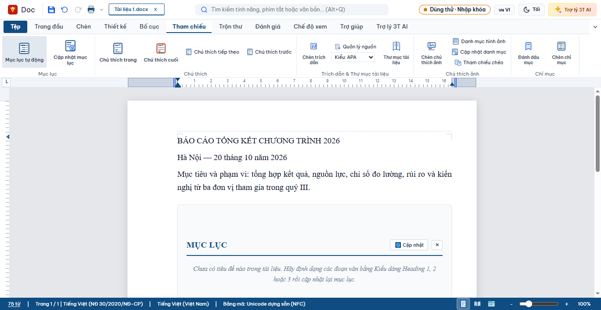
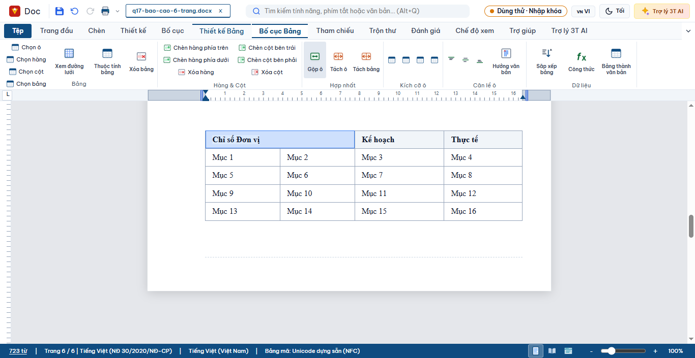
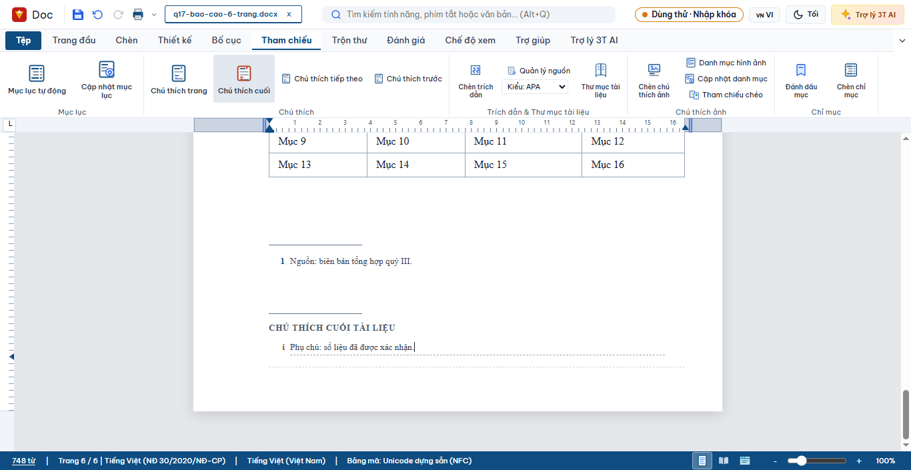
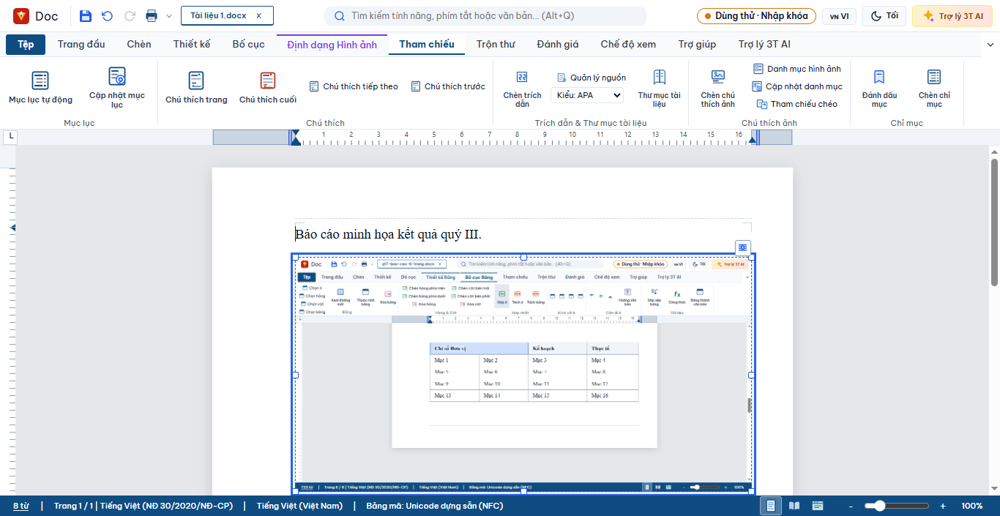
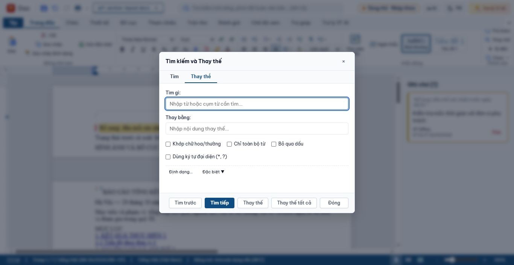
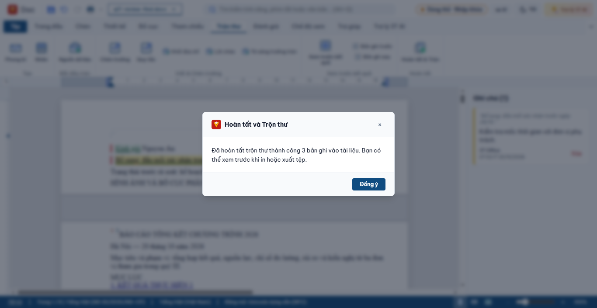

# Q17 — Soạn báo cáo dài trong VN Writer (20/10/2026)

## Kết quả và môi trường

- Nhánh/worktree: `codex/queue-19-10`, `E:\VNOffice-codex-queue`; `git merge main` báo `Already up to date`.
- `CODEX-COMMON-RULES.md` không có ở gốc worktree. Đọc `AGENTS.md`, `docs/EXPLORE-WRITER-20-10.md`, `docs/EXPLORE-SHEET-2026-10-20.md` và các mẫu CDP Q13 được chỉ định.
- Khởi chạy desktop bằng `launchApp("writer", { filePath })`; mỗi lượt dùng `VNO_CDP_LOCALAPPDATA` riêng. Nhập liệu, chọn ribbon, mở menu và tạo vùng chọn bằng CDP chuột/bàn phím. Lưu DOCX qua `_contentForExport()` + `save_document_in_place(..., 'writer', path, null)`; ảnh/CSV dùng `DOM.setFileInputFiles`.
- Word COM chạy ẩn, chỉ đọc. Không dùng điều khiển OS. Không sửa source ứng dụng trong lượt audit; chỉ thêm harness audit, bổ sung số đo vào script Word read-only và ghi tài liệu/chứng cứ.

## Nhật ký thao tác thực tế

PASS/FAIL dưới đây là kết quả quan sát được. NOT RUN/BLOCKED được tách riêng ở bảng sau.

| # | Thao tác bằng chuột/bàn phím hoặc kiểm tra độc lập | Kết quả |
|---:|---|---|
| 1 | Khởi chạy Writer desktop trong profile CDP mới | PASS |
| 2 | Nhập tiêu đề báo cáo có dấu | PASS |
| 3 | Nhập ngày lập báo cáo | PASS |
| 4 | Nhập mục tiêu/phạm vi báo cáo | PASS |
| 5 | Mở Tham chiếu và chèn mục lục tự động trước các chương | PASS — khối mục lục xuất hiện |
| 6 | Áp dụng Heading 1 cho sáu chương bằng phím tắt | PASS — DOCX có 6 Heading 1 |
| 7 | Áp dụng Heading 2 cho sáu mục con | PASS — DOCX có tổng 12 Heading 1/2 |
| 8 | Cập nhật mục lục sau khi thêm đề mục | PASS trong phiên; mục lục có tên chương |
| 9 | Lưu DOCX báo cáo qua đường dẫn thật | PASS |
| 10 | Đóng phiên, mở DOCX trong phiên desktop mới | PASS |
| 11 | Word COM chỉ đọc đếm số trang báo cáo ban đầu | PASS — 6 trang |
| 12 | Word COM chỉ đọc đếm Heading và mục lục động ban đầu | PASS — 12 heading, 1 TOC |
| 13 | Thêm một tiêu đề Heading 3 | PASS — DOCX sau đó có 13 heading |
| 14 | Mở danh sách đa cấp, chọn kiểu 1 / 1.1 / 1.1.1 và nhập hai dòng | FAIL — DOCX không có `w:numPr`; danh sách không được lưu thành cấu trúc đánh số |
| 15 | Chèn bảng qua lưới kích thước 4 cột × 5 hàng | PASS — Word COM xác nhận 5×4 |
| 16 | Điền tiêu đề và 16 ô dữ liệu | PASS — văn bản các ô hiện trong bảng |
| 17 | Kéo chọn và gộp hai ô đầu hàng | PASS — hàng đầu còn 3 ô; ô đầu có `colSpan=2` |
| 18 | Bật tùy chọn hàng tiêu đề bảng | PASS — Word COM xác nhận `HeadingFormat=true`, lặp lại khi bảng dài trang |
| 19 | Chèn chú thích cho bảng | PASS — `Bảng 1: Bảng tổng hợp chỉ số` |
| 20 | Chèn chú thích cuối trang | PASS — Word COM xác nhận 1 footnote |
| 21 | Chèn chú thích cuối tài liệu | PASS — Word COM xác nhận 1 endnote |
| 22 | Lưu nhóm bảng/chú thích và mở lại phiên CDP mới | PASS — giữ bảng 5 hàng, ô gộp, 13 heading |
| 23 | Word COM đọc lại nhóm bảng/chú thích | PASS — bảng 5×4, hàng lặp, footnote=1, endnote=1 |
| 24 | Chèn ngắt mục sang trang kế tiếp | PASS — DOCX có 2 section |
| 25 | Bật Trang đầu khác biệt trong Tùy chọn mục | PASS — Word COM section đầu `DifferentFirstPageHeaderFooter=-1` |
| 26 | Bật Trang chẵn và lẻ khác nhau trong Tùy chọn mục | FAIL — trạng thái adapter có cờ, nhưng Word COM báo `OddAndEvenPagesHeaderFooter=false` |
| 27 | Sau ngắt mục, mở Thiết lập trang, chọn Chiều ngang cho mục mới | FAIL — CDP chọn `landscape`, nhưng Word COM đọc `[1,0]`: mục đầu ngang, mục mới vẫn dọc |
| 28 | Lưu/mở lại nhóm bố cục | PASS — 2 section, orientation `[1,0]`; cờ trang đầu được giữ |
| 29 | Chèn ảnh PNG cục bộ bằng `DOM.setFileInputFiles` | PASS — ảnh 1366×321.8 hiển thị vừa vùng in |
| 30 | Chọn ảnh và mở nút nhanh Ngắt dòng | PASS — menu hiển thị các chế độ cùng dòng, Vuông, Khít, Sau/Trước văn bản, Trên và dưới |
| 31 | Áp dụng chế độ Vuông | PASS — ảnh có `float:left` và `data-vnoWrap` được đặt |
| 32 | Chèn chú thích ảnh | PASS — “Hình 1: Minh họa kết quả tổng hợp” |
| 33 | Lưu/mở lại DOCX ảnh trong phiên mới | PASS — 1 ảnh và 1 chú thích còn nguyên |
| 34 | Word COM đọc DOCX ảnh | PASS — 1 trang, 1 hình nổi |
| 35 | Bật Theo dõi thay đổi và nhập phần bổ sung bằng bàn phím | PASS — DOCX đọc lại có 1 revision |
| 36 | Kéo chọn câu bổ sung để neo nhận xét | PASS — CDP xác nhận vùng chọn chính xác |
| 37 | Tạo nhận xét bằng hộp nhập và lưu DOCX | PASS — Word COM đọc lại có 1 comment |
| 38 | Mở Trang đầu → Thay thế | PASS — hộp Tìm kiếm và Thay thế hiển thị |
| 39 | Kiểm tra tùy chọn định dạng khi tìm/thay | PASS — có nút Định dạng và lọc Đậm/Nghiêng/Màu |
| 40 | Kiểm tra regex/ký tự đại diện | PASS một phần — regex không có; có tùy chọn “Dùng ký tự đại diện (*, ?)” |
| 41 | Tạo CSV cục bộ với 3 người nhận | PASS — các cột `HoTen`, `Email`, `DonVi`; ba bản ghi |
| 42 | Mở Nguồn dữ liệu, gắn CSV vào ô file bằng CDP, lưu nguồn | PASS — adapter nhận 3 bản ghi/3 trường |
| 43 | Chèn trường `HoTen` tại vị trí con trỏ | PASS — có một merge field trong tài liệu |
| 44 | Bật Xem trước kết quả và chuyển sang bản ghi sau | PASS — menu/trạng thái bản ghi 1 rồi 2 |
| 45 | Mở Hoàn tất và Trộn, chọn tạo tài liệu mới/toàn bộ bản ghi | PASS — thông báo “đã hoàn tất … 3 bản ghi” |
| 46 | Đọc lại DOCX đầu ra sau khi trộn | BLOCKED — thông báo hoàn tất báo 3 bản ghi; CDP không thấy cửa sổ/tệp kết quả để lưu và đối chiếu |
| 47 | Mở xem trước bằng Ctrl+F2 | BLOCKED — không xuất hiện overlay trong 180 giây |
| 48 | Mở Tệp → In trong Backstage | BLOCKED — `#vno-backstage-print-total-pages` không xuất hiện trong 180 giây |
| 49 | Chọn Xuất PDF từ Backstage | BLOCKED — backend gọi hộp lưu tệp desktop ngoài WebView; CDP không điều khiển được; không tạo PDF trong profile |
| 50 | Kiểm tra số trang PDF và phông nhúng | NOT RUN — không có PDF đầu ra |

## Đối chiếu round-trip và sai khác cần xử lý

- DOCX ban đầu: Word COM `pages=6`, `headings=12`, `tablesOfContents=1`.
- Sau khi chỉnh sửa và lưu nhóm bảng: Word COM `pages=6`, `headings=13`, `tables=1`, `tableRows=5`, `tableColumns=4`, `tableHeaderRepeats=true`, `footnotes=1`, `endnotes=1`, nhưng `tablesOfContents=0`. XML DOCX ban đầu có `fldChar=3`/`instrText=1`; DOCX nhóm bảng không còn field TOC (`fldChar=0`, `instrText=0`). Nội dung mục lục tĩnh còn thấy, field cập nhật tự động đã mất sau lưu.
- Sau ngắt mục và chọn hướng ngang khi con trỏ ở cuối mục mới: Word COM `pages=7`, `sections=2`, `sectionOrientations=[1,0]`; hướng ngang bị áp vào section đầu, section mới vẫn dọc. Trang đầu khác biệt chỉ bật ở section 1; chẵn/lẻ toàn tài liệu vẫn `false`. Báo cáo vì vậy không còn đúng mục tiêu sáu trang sau khi thêm phân đoạn.
- Sau nhóm nhận xét: Word COM `comments=1`, `revisions=1`, `pages=7`; table/notes còn nguyên; TOC vẫn `0`.
- Regex, định dạng số trong bảng, số trang chẵn/lẻ, đầu/chân trang có nội dung riêng, và round-trip của tài liệu đã trộn chưa được chứng minh.

## Ảnh chứng cứ

Ảnh sáu chương và các bản trạng thái nằm trong cùng thư mục chứng cứ.

## Gate và handoff

- Không sửa source ứng dụng; do đó không có bài FAIL-trước/PASS-sau hay commit sửa lỗi sản phẩm. Các lỗi mục lục, danh sách, section orientation, preview và PDF được giữ nguyên làm findings, không báo PASS.
- Harness CDP: `tests/live/cdp/q17-writer-long-report.desktop.mjs`, `q17-writer-feature-groups.desktop.mjs`, `q17-writer-layout-image.desktop.mjs`, `q17-writer-image-caption.desktop.mjs`, `q17-writer-review-find.desktop.mjs`, `q17-writer-mailmerge.desktop.mjs`, `q17-writer-preview.desktop.mjs`, `q17-writer-print-pdf.desktop.mjs`; Word COM chỉ đọc: `q17-writer-word-readonly.ps1`.
- `npm test`: PASS — 3771/3771.
- `node scripts/audit-0610/i18n_parity.mjs`: PASS — VI=3110, EN=3110, missing=0.
- `python scripts/audit-0610/verify_checklist_evidence.py --all --no-fix`: PASS — 0 dòng hạ; Writer 279, Sheet 217, Slides 269.
- `python -m pytest tests -q -k "writer or docx or ooxml"`: PASS — 342 passed, 759 deselected (365.08s).
- Next action: chuyển findings TOC/list, chẵn-lẻ, preview/PDF thành phiếu sửa/điều tra riêng; không coi các mục FAIL/BLOCKED ở trên là đạt.
