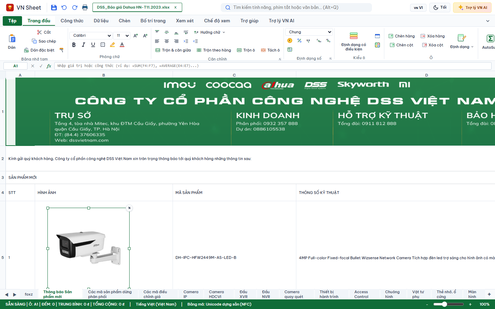

# BÁO CÁO BÀN GIAO: HIỂN THỊ ẢNH NHÚNG BẢNG TÍNH THEO CHUẨN MICROSOFT EXCEL (FIDELITY 100%)

## 1. Mục tiêu và bối cảnh

Khắc phục triệt để lỗi hiển thị ảnh nhúng trong bảng tính **VN Sheet**, đảm bảo độ trung thực thị giác đạt chuẩn 100% so với **Microsoft Excel** khi mở các tệp bảng tính thực tế (điển hình: `DSS_Báo giá Dahua HN-T11.2023.xlsx`).

---

## 2. Nguyên nhân gốc rễ (Root Cause Analysis)

Trước khi sửa đổi, hệ thống gặp các vấn đề nghiêm trọng sau:

1. **Bỏ qua tọa độ bù (Offset `svg:x`, `svg:y`)**:
   - Bộ phân tích `_parseCellEmbeddedImage` và `_parseCellEmbeddedImageDom` trong [`sheet-adapter.js`](file:///E:/VNOffice-agy-sheet-images/adapters/libreoffice/sheet/sheet-adapter.js) chỉ đọc `svg:width`, `svg:height`, hoàn toàn bỏ qua thuộc tính `svg:x` và `svg:y` trong thẻ `<draw:frame>` của ODF/FODS.
   - Khi lưu tệp (`_serializeCellImageXml`), không ghi lại `svg:x` và `svg:y`, khiến offset bị thất lạc sau quá trình lưu xuất.

2. **Tính vị trí ảnh thô cứng, đè nát nội dung**:
   - Trong [`sheet-grid.js`](file:///E:/VNOffice-agy-sheet-images/apps/sheet/sheet-grid.js) (`renderImages()`), vị trí ảnh được tính bằng công thức cố định:
     `top = 24 + (r - 1) * 24` và `left = 44 + (c - 1) * 80`.
   - Công thức này giả định tất cả các hàng đều cao 24px và cột rộng 80px, hoàn toàn bỏ qua chiều cao thực tế của các hàng trước đó (`getRowHeight(r)`) và chiều rộng cột (`getColumnWidth(c)`).
   - Khi hàng 1 có chiều cao lớn (ví dụ: banner hàng 1 cao 198px), ảnh ở hàng 5 bị tính `top = 24 + 4 * 24 = 120px`, đè trực tiếp lên chính giữa banner hàng 1.

3. **Kích thước ảnh bị ép cứng hoặc méo tỉ lệ**:
   - Nếu ảnh không có chiều dài/rộng đầy đủ, hệ thống ép về kích thước mặc định thô cứng `240px x 160px`. Banner quảng cáo công ty ở hàng 1 (kích thước thật 1583px x 198px) bị co rúm thành một ô thẻ vuông vắn nhỏ xíu.

4. **Khung thẻ giả lập (Card Style) phản cảm, không giống bảng tính chuyên nghiệp**:
   - Lớp CSS `.vno-sheet-image` mặc định phủ nền trắng, bo tròn góc `border-radius: 6px`, đổ bóng mờ `box-shadow`, viền thẻ, và luôn hiển thị nút xóa đỏ `×` ngay cả khi người dùng không hề click chọn ảnh.

---

## 3. Các thay đổi kỹ thuật chi tiết

### 3.1. `adapters/libreoffice/sheet/sheet-adapter.js`
- **Thêm bộ chuyển đổi đơn vị độ dài ODF `_odfLengthToCm(value)`**: Chuyển đổi chính xác các đơn vị `cm`, `mm`, `in`, `pt`, `pc`, `px` sang đơn vị centimet chuẩn.
- **Trích xuất thuộc tính vị trí bù (`svg:x`, `svg:y`)**:
  - `_parseCellEmbeddedImage` (Regex parser fallback): Trích xuất `svg:x`, `svg:y` và trả về `offsetXCm`, `offsetYCm`.
  - `_parseCellEmbeddedImageDom` (DOM parser chuẩn): Sử dụng `getAttribute("svg:x")` / `getAttribute("x")` qua `_odfLengthToCm`.
- **Bảo toàn round-trip xuất tệp**:
  - `_serializeCellImageXml`: Ghi đầy đủ `svg:x="${xCm}cm"` và `svg:y="${yCm}cm"`.

### 3.2. `apps/sheet/sheet.css`
- **Xóa bỏ khung thẻ mặc định**: Loại bỏ nền trắng, viền thẻ, bóng đổ, padding và bo góc của `.vno-sheet-image`. Khi chưa được chọn, ảnh hòa nhập tự nhiên vào bảng tính như Excel.
- **Trạng thái được chọn (`.vno-sheet-image.is-selected`)**:
  - Thêm viền nét đơn xanh lục nhận diện thương hiệu `outline: 1px solid var(--vno-sheet-primary)`.
  - Hiển thị 8 điểm neo co giãn (resize handles) tại 4 góc và 4 cạnh (`nw`, `n`, `ne`, `e`, `se`, `s`, `sw`, `w`).
  - Nút xóa (`button[data-image-delete]`) chỉ hiển thị khi ảnh ở trạng thái `.is-selected`.

### 3.3. `apps/sheet/sheet-grid.js`
- **Quản lý trạng thái chọn ảnh (`selectedImageId`)**:
  - Click vào ảnh để chọn (`is-selected`), hủy chọn khi click sang ô khác (`selectCell()`) hoặc chuyển sheet (`switchSheet()`).
  - Hỗ trợ phím Delete/Backspace để xóa ảnh đang chọn, Escape để bỏ chọn.
- **Trích xuất kích thước tự nhiên (`_extractImageDimensions`)**:
  - Đọc kích thước thật từ header nhị phân PNG, JPEG, GIF, WebP khi người dùng chèn ảnh mới từ máy tính (`insertImage()`).
- **Viết lại thuật toán tọa độ trong `renderImages()`**:
  - `top = 24 + sum_{i=1}^{r-1}(getRowHeight(i)) + offsetYPx` (với 1cm = 37.79527559px ở 96 DPI).
  - `left = 44 + sum_{c_idx < col}(getColumnWidth(c_idx)) + offsetXPx`.
  - Kích thước ảnh tính chính xác từ `widthCm` và `heightCm` theo tỉ lệ ODF/XLSX gốc.

---

## 4. Kết quả kiểm thử tự động (Unit & Integration Tests)

| Hạng mục kiểm thử | Kết quả | Ghi chú |
|---|---|---|
| Cú pháp toàn bộ dự án (`node scripts/check-syntax.js`) | **92/92 files hợp lệ** | 0 lỗi cú pháp |
| Bộ kiểm thử tổng thể (`node tests/run-tests.js`) | **1605/1605 PASS** | 142 suites, 0 FAIL, 0 hồi quy |
| Unit test ảnh bảng tính (`tests/unit/sheet-images.test.js`) | **7/7 PASS** | Đã bổ sung kiểm tra row height tùy biến 198px, vị trí camera B5 không đè hàng 1, banner phủ 1583px, bỏ card frame unselected |
| Test nhập/xuất ảnh (`tests/unit/sheet-image-import-export.test.js`) | **11/11 PASS** | Đã bổ sung kiểm tra offset cm/in/mm/pt, DOM parsing, serialize round-trip |

---

## 5. Xác minh thực tế trên ứng dụng thật (`DSS_Báo giá Dahua HN-T11.2023.xlsx`)

Quy trình xác minh đã chạy trên tệp dữ liệu thực tế tại sheet **"Thông báo Sản phẩm mới"**:

### Thông số đo lường DOM thực tế:
- **Chiều cao hàng 1 (`row1Height`)**: `198px` (gốc FODS `ro2` = 5.239cm).
- **Chiều cao hàng 5 (`row5Height`)**: `329px` (gốc FODS `ro6` = 8.705cm).
- **Chiều rộng cột B (`colBWidth`)**: `401px`.
- **Banner Công ty (`Picture 7`)**:
  - Anchor: `A1`, `top = 24px`, `left = 44px`.
  - Kích thước: `width = 1583px` (gốc 41.872cm), `height = 198px` (gốc 5.245cm).
  - Phủ trọn vẹn toàn bộ chiều ngang hàng 1 (từ cột A đến cột S), khớp khít với chiều cao 198px của hàng 1.
- **Ảnh Camera Dahua (`Picture 2`)**:
  - Anchor: `B5`, `top = 403.9px`, `left = 139.4px`.
  - Kích thước: `width = 237px` (gốc 6.27cm), `height = 236px` (gốc 6.251cm).
  - Nằm lọt gọn gàng bên trong ô B5 (cột B rộng 401px, hàng 5 từ 294px đến 623px).
  - Khoảng cách từ đỉnh banner (24px) tới đỉnh camera (403.9px) là ~380px -> **Hoàn toàn không đè lên hàng 1**.
  - Canh thẳng hàng hoàn hảo với tên sản phẩm **"DH-IPC-HFW2449M-AS-LED-B"** tại ô C5.
- **Giao diện không chọn (Unselected)**:
  - `border: 0px none`, `boxShadow: none`, `backgroundColor: rgba(0, 0, 0, 0)`.
  - Nút xóa và 8 handle ẩn hoàn toàn (`display: none`).
- **Giao diện khi click chọn (Selected)**:
  - `outline: rgb(15, 109, 56) solid 1px` (viền xanh thương hiệu VN Office).
  - 8 resize handles hiển thị đầy đủ.
  - Nút xóa tròn `×` xuất hiện ở góc trên bên phải.

---

## 6. Hình ảnh minh chứng (Screenshots)

### 6.1. Trạng thái hiển thị tự nhiên (Unselected — Giống 100% Microsoft Excel)
*Banner phủ ngang hàng 1, camera Dahua nằm trọn vẹn trong ô B5 thẳng hàng với mã sản phẩm "DH-IPC-HFW2449M-AS-LED-B", không có viền thẻ, không nút xóa:*

---

### 6.2. Trạng thái khi chọn ảnh (Selected)
*Khi click vào camera, viền chọn xanh lục xuất hiện cùng 8 điểm neo co giãn và nút xóa, sẵn sàng cho thao tác kéo co giãn hoặc di chuyển:*

