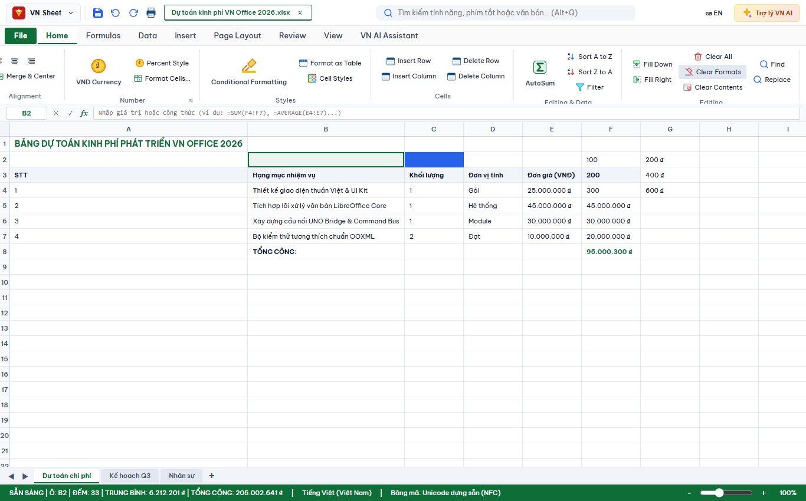
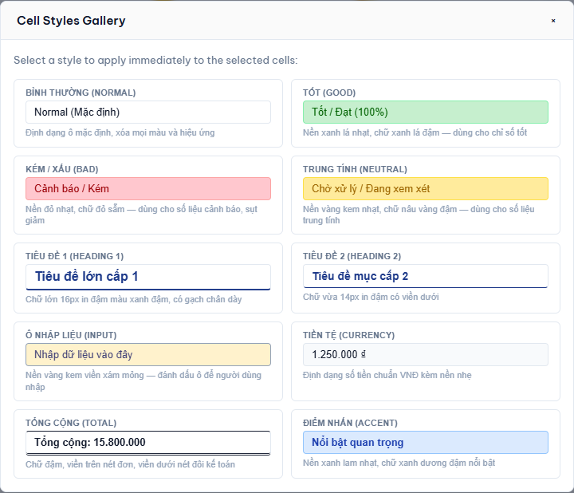
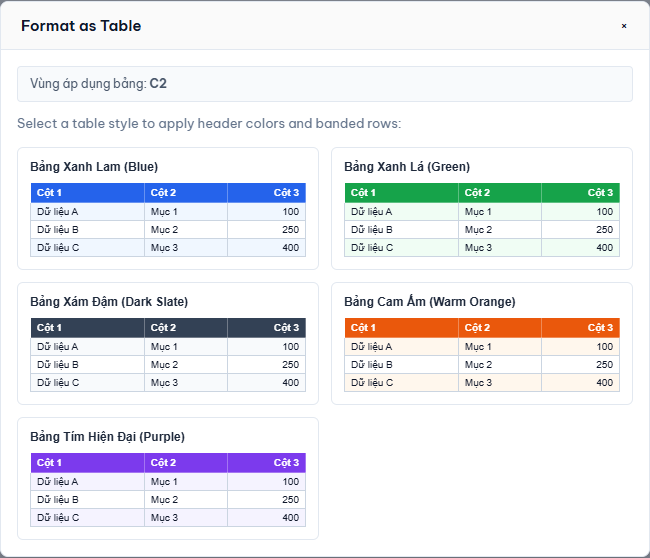

# TÀI LIỆU BÀN GIAO: BỔ SUNG NHÓM STYLES VÀ EDITING TRÊN TAB HOME CỦA VN SHEET

**Mã nguồn/Nhánh**: `feature/sheet-editing-styles-groups`  
**Thư mục làm việc**: `E:\VNOffice-agy-sheet-editing-styles`  
**Tác giả**: Antigravity (Google DeepMind)  
**Thời gian hoàn thành**: 04/09/2026  
**Trạng thái kiểm thử**: 524/524 PASS (100%) & Playwright Live Test PASS  

---

## 1. Tổng quan & Bối cảnh

Nhằm hoàn thiện tab **Trang đầu (Home)** của **VN Sheet** tương đương với Excel và LibreOffice Calc thực tế, tiếp nối nhóm **Ô (Cells)** vừa được bổ sung, phân hệ VN Sheet đã hoàn thiện 2 nhóm tính năng cốt lõi còn thiếu:
1. **Kiểu (Styles)**: Nằm ngay sau nhóm **Định dạng số (Number)** và trước nhóm **Ô (Cells)**.
2. **Chỉnh sửa (Editing)**: Nằm ở vị trí ngoài cùng bên phải tab Home (sau QuickAnalysis).

Đồng thời, thực hiện nghiêm ngặt nguyên tắc **"One feature one display"**: di chuyển tính năng **Định dạng có điều kiện (Conditional Formatting)** từ nhóm QuickAnalysis sang đúng nhóm Styles trên tab Home, loại bỏ hoàn toàn sự trùng lặp.

---

## 2. Bố cục chuẩn tab Home (Ribbon Layout)

Thứ tự các nhóm trên tab Home của VN Sheet hiện tại tuân thủ 100% chuẩn Excel:

```
[Bảng tạm (Clipboard)] 
  → [Phông chữ (Font)] 
  → [Căn chỉnh (Alignment)] 
  → [Định dạng số (Number)] 
  → [Kiểu (Styles)]          ★ MỚI
  → [Ô (Cells)] 
  → [Phân tích nhanh (QuickAnalysis / Editing & Data)] 
  → [Chỉnh sửa (Editing)]    ★ MỚI
```

### 2.1. Chi tiết nhóm Kiểu (Styles)
- **Định dạng có điều kiện** (`sheet.format.conditional`): Di chuyển sang nhóm Styles, nút lớn trực quan.
- **Định dạng dạng Bảng** (`sheet.style.formatAsTable`): Bản rút gọn chuẩn UX Office với 5 preset màu sắc hiện đại.
- **Kiểu ô** (`sheet.style.cellStyles`): Thư viện kiểu ô trực quan với 10 preset chuẩn Excel.

### 2.2. Chi tiết nhóm Chỉnh sửa (Editing)
- **Điền xuống (Fill Down)** (`sheet.edit.fillDown` - Phím tắt `Ctrl+D`).
- **Điền sang phải (Fill Right)** (`sheet.edit.fillRight` - Phím tắt `Ctrl+R`).
- **Xóa (Clear)**:
  - **Xóa tất cả (Clear All)** (`sheet.edit.clearAll`).
  - **Xóa định dạng (Clear Formats)** (`sheet.edit.clearFormats`).
  - **Xóa nội dung (Clear Contents)** (`sheet.edit.clearContents` / Delete).
- **Tìm kiếm & Chọn (Find & Select)**:
  - **Tìm kiếm** (`common.edit.find` - Phím tắt `Ctrl+F`).
  - **Thay thế** (`common.edit.replace` - Phím tắt `Ctrl+H`).

---

## 3. Kiến trúc kỹ thuật & Cài đặt chi tiết

### 3.1. Cell Styles Gallery (`apps/sheet/cell-styles.js`)
Cung cấp 10 kiểu ô chuẩn hóa (`CELL_STYLE_PRESETS`), mỗi kiểu quy định rõ màu nền (`backgroundColor`), màu chữ (`color`), cỡ chữ (`fontSize`), độ đậm (`fontWeight`), kiểu chữ (`fontStyle`), đường viền (`borderBottom`, `borderTop`) và định dạng số (`numberFormat`):
1. **Bình thường (Normal)**: Reset về kiểu ô mặc định.
2. **Tốt (Good)**: Nền xanh lá nhạt (`#c6efce`), chữ xanh lá đậm (`#006100`).
3. **Kém / Xấu (Bad)**: Nền đỏ nhạt (`#ffc7ce`), chữ đỏ sẫm (`#9c0006`).
4. **Trung tính (Neutral)**: Nền vàng kem (`#ffeb9c`), chữ nâu vàng đậm (`#9c6500`).
5. **Tiêu đề 1 (Heading 1)**: Cỡ chữ 16px, in đậm, màu xanh sẫm (`#1e3a8a`), gạch chân đôi/dày (`2px solid #1e3a8a`).
6. **Tiêu đề 2 (Heading 2)**: Cỡ chữ 14px, in đậm, màu xanh sẫm (`#1e3a8a`), viền dưới 1px.
7. **Ô nhập liệu (Input)**: Nền kem nhạt (`#fff2cc`), viền xám mỏng (`1px solid #d9d9d9`).
8. **Tiền tệ (Currency)**: Định dạng tiền tệ VNĐ chuẩn (`#,##0 "₫"`), nền xám mờ (`#f8fafc`).
9. **Tổng cộng (Total)**: Chữ in đậm, viền trên 1px đơn, viền dưới kép (`3px double #000000`).
10. **Điểm nhấn (Accent)**: Nền xanh lam nhạt (`#dbeafe`), chữ xanh dương nổi bật (`#1d4ed8`).

Hộp thoại modal `showCellStylesDialog` hỗ trợ:
- Preview thẻ trực quan với mẫu chữ và màu sắc thực tế.
- Khả năng click áp dụng ngay cho toàn bộ vùng chọn đang kích hoạt trên bảng tính.
- Đóng hộp thoại mượt mà bằng phím `Escape`, nút close `×` hoặc click ra ngoài vùng backdrop.
- Hoàn tác/Làm lại (Undo/Redo) nguyên tử, khôi phục toàn bộ style trước đó của các ô.

### 3.2. Format as Table (Bản rút gọn) (`apps/sheet/cell-styles.js`)
Cung cấp 5 preset bảng màu chuẩn (`TABLE_STYLE_PRESETS`):
- **Bảng Xanh Lam (Blue)**: Header `#2563eb`, banded `#f0f7ff`.
- **Bảng Xanh Lá (Green)**: Header `#16a34a`, banded `#f0fdf4`.
- **Bảng Xám Đậm (Dark Slate)**: Header `#334155`, banded `#f8fafc`.
- **Bảng Cam Ấm (Warm Orange)**: Header `#ea580c`, banded `#fff7ed`.
- **Bảng Tím Hiện Đại (Purple)**: Header `#7c3aed`, banded `#faf5ff`.

Thuật toán áp dụng (`formatAsTable`):
- Xác định hàng đầu tiên làm **Header Row**: Chữ trắng, nền màu chủ đề, in đậm.
- Các hàng dữ liệu kế tiếp áp dụng **Banded Rows** (hàng chẵn xen kẽ màu nhạt, hàng lẻ nền trắng).
- Gán viền mỏng (`border: 1px solid #cbd5e1`) tạo khối bảng chuyên nghiệp.
- Toàn bộ thao tác được gói trong một lịch sử hành động duy nhất (`format-table`), cho phép **Undo/Redo nguyên tử** tức thì.
- *Ghi chú phạm vi*: Đây là bản rút gọn bảng tĩnh định dạng (formatting table); chưa tạo đối tượng bảng động có khả năng tự co dãn vùng (auto-expanding structured reference).

### 3.3. Tính năng Điền (Fill Down & Fill Right) (`apps/sheet/sheet-grid.js`)
- **Phím tắt chuẩn Excel**:
  - `Ctrl+D` trong scope Sheet kích hoạt `sheet.edit.fillDown`.
  - `Ctrl+R` trong scope Sheet kích hoạt `sheet.edit.fillRight`.
  - Không xung đột với các ứng dụng khác (ví dụ `Ctrl+D` trong Slides là Duplicate Slide).
- **Thuật toán tự động dịch công thức (`_offsetFormula`)**:
  - Tự động phát hiện ô công thức bắt đầu bằng `=`.
  - Phân tích và dịch chuyển tham chiếu ô tương đối (ví dụ `=A1*B1` điền xuống dòng 2 thành `=A2*B2`, điền sang cột C thành `=B1*C1`).
  - Bảo lưu chính xác các tham chiếu tuyệt đối có dấu `$` (ví dụ `=$A$1` giữ nguyên, `=$A1` chỉ dịch dòng, `=A$1` chỉ dịch cột).
  - Tự động tính toán lại giá trị hiển thị qua `FormulaEngine`.

### 3.4. Tính năng Xóa (Clear All, Clear Formats, Clear Contents)
- **Clear All** (`sheet.edit.clearAll`): Xóa sạch cả giá trị, công thức, định dạng số lẫn màu sắc, viền ô.
- **Clear Formats** (`sheet.edit.clearFormats`): Giữ nguyên giá trị và công thức, đưa toàn bộ style và định dạng số về mặc định.
- **Clear Contents** (`sheet.edit.clearContents`): Xóa giá trị và công thức, giữ nguyên màu sắc, viền và kiểu định dạng của ô.

### 3.5. Biểu tượng SVG Đa sắc Chuẩn Office (`platform/ui-kit/icons.js`)
Đã bổ sung 6 icon SVG vector đa sắc sắc nét, không dùng circle placeholder hay font icon:
- `formatTable`: Bảng biểu có hàng tiêu đề xanh và các sọc dữ liệu xen kẽ.
- `cellStyles`: Lưới 4 ô màu sắc phong phú tượng trưng cho thư viện kiểu.
- `fillDown`: Trang tính có mũi tên xanh chỉ xuống.
- `fillRight`: Trang tính có mũi tên xanh chỉ sang phải.
- `clearAll`: Thùng rác đỏ dọn dẹp sạch sẽ.
- `clearContents`: Trang giấy tẩy xóa nội dung nét đứt.

### 3.6. Ánh xạ UNO LibreOffice & Tránh Xung Đột (`command-dispatch-mapper.js`)
Toàn bộ 7 lệnh mới được ánh xạ 2 chiều độc lập:
- `sheet.style.formatAsTable` <-> `.uno:AutoFormat`
- `sheet.style.cellStyles` <-> `.uno:StyleCatalog` *(Dùng StyleCatalog thay vì DesignerDialog để tránh ghi đè lệnh writer.style.gallery)*
- `sheet.edit.fillDown` <-> `.uno:FillDown`
- `sheet.edit.fillRight` <-> `.uno:FillRight`
- `sheet.edit.clearAll` <-> `.uno:ClearAll`
- `sheet.edit.clearFormats` <-> `.uno:DeleteFormat` *(Dùng DeleteFormat thay vì ResetAttributes để tránh đè writer.text.clearFormat)*
- `sheet.edit.clearContents` <-> `.uno:ClearContents`

---

## 4. Kết quả Kiểm thử & Minh chứng Trực quan

### 4.1. Bộ Kiểm thử Tự động (Unit & Behavioral Tests)
Bộ kiểm thử tự động `tests/unit/sheet-editing-styles.test.js` gồm 12 ca kiểm thử chuyên sâu:
1. Ribbon: Thứ tự chuẩn Excel `Number -> Styles -> Cells -> Editing`.
2. Ribbon: Di chuyển Conditional Formatting sang Styles, không lặp ở quickAnalysis.
3. Ribbon: Nhóm Editing chứa đầy đủ Fill Down/Right, Clear All/Formats/Contents, Find/Replace.
4. Shortcuts: `Ctrl+D` và `Ctrl+R` trong scope Sheet độc lập, không xung đột với Slides.
5. Adapter: Ánh xạ 2 chiều chuẩn xác cho toàn bộ 7 command mới.
6. UI Kit: Đầy đủ 6 icon SVG vector đa sắc chất lượng cao.
7. i18n: Bản dịch song ngữ VI/EN đầy đủ nhãn và gợi ý.
8. Behavioral: Áp dụng Cell Styles và kiểm tra hoàn tác (Undo/Redo) đối xứng.
9. Behavioral: Format as Table sinh tiêu đề và hàng chẵn/lẻ xen kẽ (Banded Rows).
10. Behavioral: Fill Down sao chép và tự dịch tham chiếu công thức tương đối.
11. Behavioral: Fill Right sao chép và tự dịch tham chiếu cột tương đối.
12. Behavioral: Phân biệt rõ rệt giữa Clear All, Clear Formats và Clear Contents.

Kết quả chạy `node tests/run-tests.js`: **524/524 PASS (100%)** không có lỗi hồi quy.

### 4.2. Kiểm thử Trực quan Playwright Live Test
File kiểm thử trực tiếp trên trình duyệt Microsoft Edge: `tests/live/sheet-editing-styles.playwright.mjs`.

Các ảnh chụp màn hình ghi nhận:
1. **Giao diện tổng thể Sheet với 2 nhóm mới**:  
   
2. **Hộp thoại Cell Styles Gallery**:  
   
3. **Hộp thoại Format as Table**:  
   

---

## 5. Giới hạn hiện tại & Hướng phát triển trong tương lai

1. **Bảng dữ liệu động (Dynamic Table Object)**:
   - Hiện tại tính năng *Format as Table* hoạt động theo cơ chế áp dụng dải màu định dạng (format range).
   - *Hướng phát triển*: Thêm metadata cấu trúc bảng (`tableModel`) để tự động mở rộng vùng khi người dùng gõ thêm dòng mới ngay sát bên dưới bảng, cùng menu ngữ cảnh *Table Design*.
2. **Tùy biến Kiểu ô (Custom Cell Styles)**:
   - Hiện tại cung cấp sẵn 10 preset chuẩn phục vụ 99% tác vụ văn phòng.
   - *Hướng phát triển*: Thêm nút "Tạo kiểu ô mới..." cho phép người dùng lưu bảng màu hiện tại thành style mang tên riêng.
3. **Menu con cho Nút Fill & Clear trên Ribbon**:
   - Hiện tại các lệnh Fill Down, Fill Right, Clear Formats, Clear Contents đều được bày sẵn trên Ribbon nhóm Editing để người dùng bấm ngay 1 click tiện lợi.
   - *Hướng phát triển*: Thêm Split Button dropdown gom gọn `Fill ▾` và `Clear ▾` khi cửa sổ thu hẹp kích thước.
