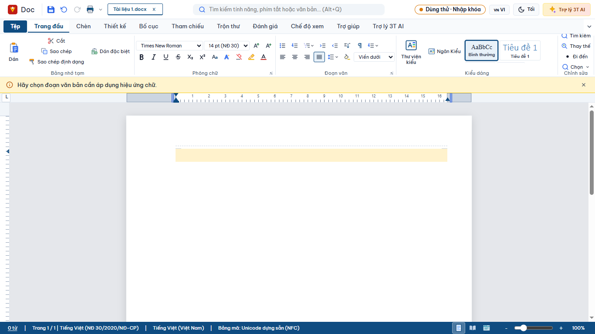
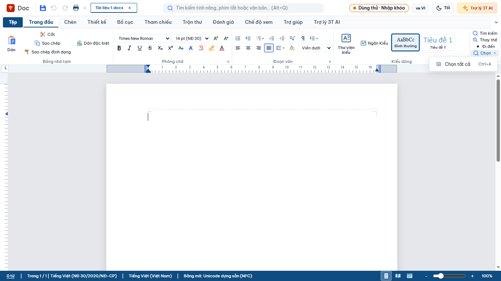
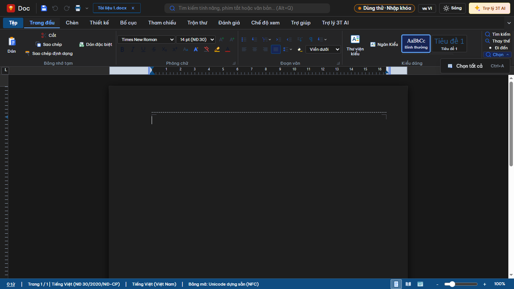
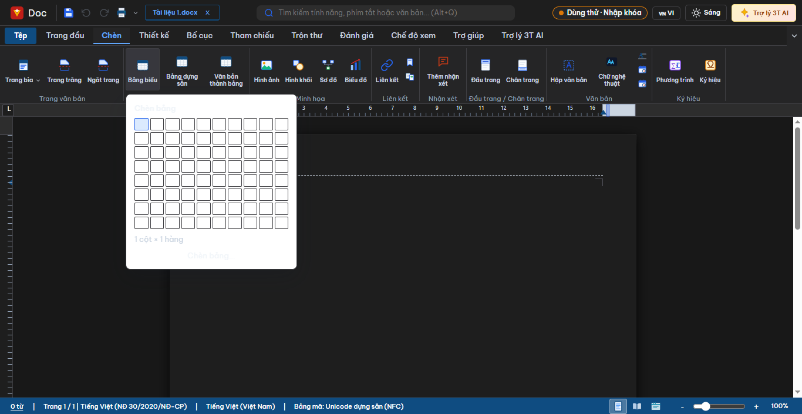
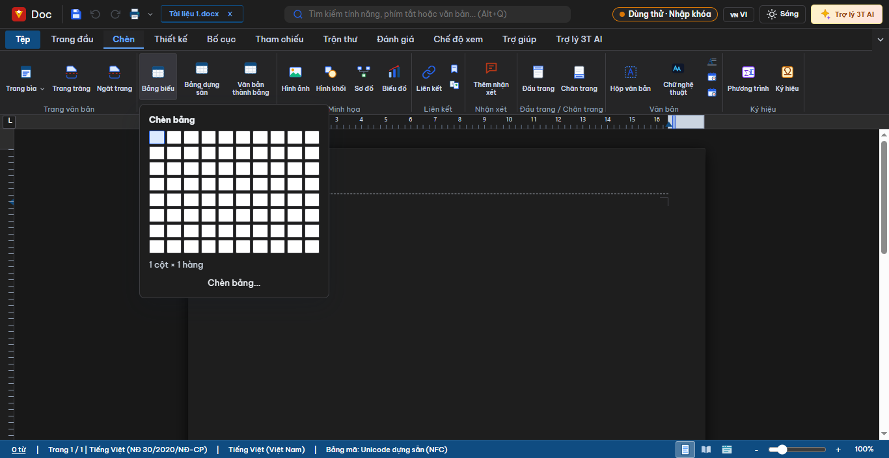
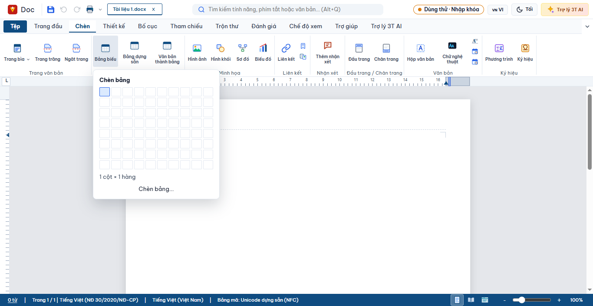
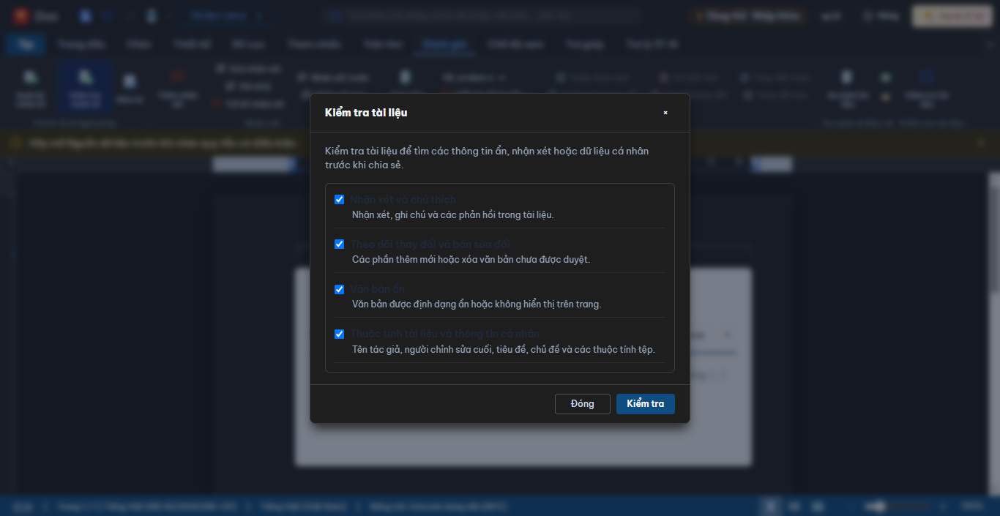
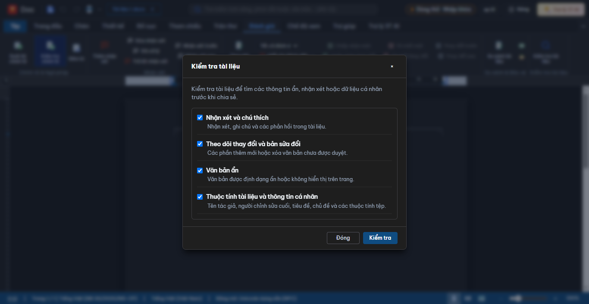
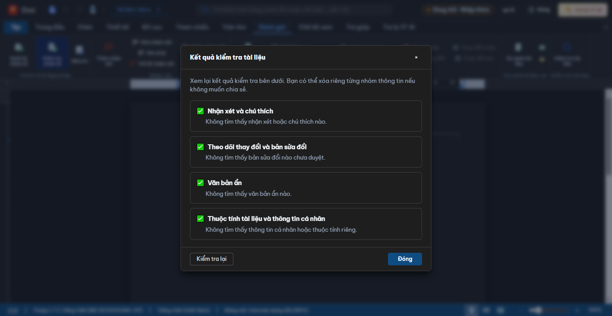

# Q37 — Quét hộp thoại Writer, 21/10/2026

## Phạm vi và phương pháp

Đối chiếu `apps/writer/writer-ribbon.js`, `platform/ribbon/ribbon-host.js`, `platform/ui-kit/components.js`, `platform/commands/command-definitions.js` và điều hướng Tệp trong `platform/shell/app-shell.js`. Mở bằng chuột CDP qua `app_session_server.mjs`; ảnh chụp ở 1366×768 cho giao diện sáng/tối, và 1280×720 cho hộp thoại cao. Đã xem ảnh gốc và các contact sheet trong `docs/assets/q37-ui/`.

`CODEX-COMMON-RULES.md` không có trong worktree. Đã đọc các báo cáo UI Review 20, 21 và 22/10; không lặp lại các màn hình đã được ghi trong đó. Đợt này tập trung vào các hộp thoại/menu Writer và các trang Tệp còn trong phạm vi. Báo cáo phân biệt phần đã mở trực tiếp với kiểm kê nguồn chưa mở được; không suy diễn là đã kiểm tra trực quan.

## Kiểm kê nút mở UI từ ribbon và menu Tệp

| Vị trí / lệnh | Loại UI theo mã nguồn | Kết quả Q37 |
|---|---|---|
| Trang đầu: `writer.para.multilevelList`, `writer.list.restartNumbering`, `writer.para.lineSpacing`, `writer.edit.select` | Menu thả xuống | Đã mở menu đa cấp, đánh số, giãn dòng và Chọn; ảnh sáng/tối. Chọn bị footer che trước sửa, sau sửa đã mở được. |
| Trang đầu: `writer.format.fontDialog`, `writer.format.paragraphDialog`, `writer.edit.goTo` | Hộp thoại | Đã mở Font, Paragraph, Go To; sáng/tối. Paragraph chụp thêm 1280×720. |
| Trang đầu: `writer.style.gallery`, `writer.styles.pane` | Gallery / panel | Đã mở Style Gallery; Styles Pane đã được xem ở UI Review 20/10. Navigation Pane Q37 được mở từ Chế độ xem bằng `writer.view.navigationPane`. |
| Chèn: `writer.insert.coverPage` | Menu thả xuống → thư viện | Đã mở menu Trang bìa và thư viện trang bìa; sáng/tối, thư viện chụp thêm 1280×720. |
| Chèn: `writer.table.insert`, `writer.table.quickTables`, `writer.table.fromText` | Lưới chọn kích thước / thư viện / hộp thoại | Đã mở lưới Chèn bảng sáng/tối và gallery Bảng dựng sẵn sáng/tối. “Văn bản thành bảng” mở hộp thoại sáng/tối; ở tài liệu trống báo rõ cần chọn văn bản. Lưới Chèn bảng tối sửa màu nền trong Q37 (xem commit/ảnh). |
| Chèn: `common.edit.hyperlink`, `writer.insert.bookmark`, `writer.insert.crossReference` | Hộp thoại | Đã mở Chèn liên kết sáng/tối, Đánh dấu tối và Tham chiếu chéo tối. Tham chiếu chéo báo rõ chưa có tiêu đề/đánh dấu. |
| Chèn: `writer.comment.insert` | Panel/hộp thoại trạng thái | Khi chưa chọn văn bản hiện hộp “Chưa chọn văn bản” và hướng dẫn bôi đen đoạn trước khi thêm nhận xét; ảnh tối. Không mở panel rỗng. |
| Chèn: `writer.shape.insert`, `writer.diagram.insert`, `writer.chart.insert`, `writer.insert.equation`, `writer.insert.symbol` | Gallery / hộp thoại | Đã mở Hình khối, Sơ đồ, Biểu đồ, Phương trình, Ký hiệu; ảnh sáng cho tất cả, Phương trình có thêm ảnh tối. |
| Thiết kế: `writer.design.themeGallery`, `writer.page.watermark`, `writer.page.color`, `writer.page.border` | Thư viện / hộp thoại | Đã mở cả bốn UI; sáng/tối. |
| Bố cục: `writer.page.setupDialog`, `writer.page.margins`, `writer.page.orientation`, `writer.page.size` | Hộp thoại Thiết lập trang | Các lệnh trang gọi cùng hộp thoại; đã được xem trong UI Review 20/10, không mở lại. |
| Bố cục: `writer.page.columns`, `writer.layout.breaks`, `writer.layout.sectionOptions`, `writer.para.lineSpacingLayout`, `writer.format.paragraphDialog` | Hộp thoại / menu | Đã mở Columns, Ngắt, Tùy chọn mục và menu giãn dòng Bố cục. Paragraph launcher dùng cùng hộp thoại Paragraph ở Trang đầu. |
| Bố cục / Chế độ xem: `writer.view.selectionPane`, `writer.view.navigationPane`, `writer.view.zoomDialog`, `common.macro.manager` | Panel / hộp thoại | Đã mở Selection Pane, Navigation Pane, Zoom và Macro Manager; sáng/tối. |
| Đánh giá: `writer.trackChanges.showMarkup` | Menu thả xuống lồng | Đã mở Hiển thị đánh dấu và submenu; sáng/tối. |
| Tệp: `common.file.print` | Hộp thoại in | Đã mở và xem sáng/tối. Kích thước 1100×720, vừa trong cửa sổ 1366×768. |
| Tệp: `backstage.exportConvert`, `backstage.recent`, `writerDocumentProperties.backstage` | Trang Tệp | Đã mở Xuất và chuyển đổi, Tệp gần đây, Thông tin; sáng/tối. |
| Ribbon ngữ cảnh Ảnh/Bảng: `pictureFormat`, `tableDesign`, `tableLayout` | Nhiều nút có thể mở gallery/hộp thoại/panel | NOT RUN: tài liệu thử nghiệm mới không có ảnh hoặc bảng được chọn; không thể mở tab ngữ cảnh mà không đổi nội dung fixture. |

### Danh sách nguồn bổ sung — chưa mở trực tiếp trong Q37

Các lệnh dưới đây hiện trên ribbon và theo cấu hình/command handler có thể mở hộp thoại, picker, gallery hoặc panel. Chúng được kê đủ theo nhóm nơi đặt; Q37 chưa khẳng định đã xem từng UI.

| Tab / nhóm | Các lệnh cần rà soát | Phân loại từ khai báo/handler; trạng thái |
|---|---|---|
| Chèn / Bảng biểu | `writer.table.insert`, `writer.table.quickTables`, `writer.table.fromText` | Đã mở cả ba, xem bảng phía trên. |
| Chèn / Minh họa | `writer.image.insert`, `writer.shape.insert`, `writer.diagram.insert`, `writer.chart.insert` | Hình khối/Sơ đồ/Biểu đồ đã mở. Bộ chọn ảnh hệ điều hành NOT RUN (không mở hộp thoại OS theo quy tắc CDP). |
| Chèn / Liên kết | `common.edit.hyperlink`, `writer.insert.bookmark`, `writer.insert.crossReference` | Đã mở cả ba; xem bảng phía trên. |
| Chèn / Ghi chú, Đầu trang-Chân trang, Văn bản, Ký hiệu | `writer.comment.insert`, `writer.header.insert`, `writer.footer.insert`, `writer.insert.textbox`, `writer.insert.wordart`, `writer.format.dropCap`, `writer.insert.dateTime`, `writer.insert.quickParts`, `writer.insert.equation`, `writer.insert.symbol` | Nhận xét/Ký hiệu/Phương trình đã xem. Đầu trang, Chân trang, Hộp văn bản, Chữ nghệ thuật, Chữ đầu đoạn, Ngày-Giờ và Khối dựng sẵn NOT RUN vì thao tác có thể chèn/thay đổi nội dung tài liệu. |
| Tham chiếu | `writer.reference.tocInsert`, `writer.reference.sourcesManage`, `writer.reference.citationInsert`, `writer.reference.bibliographyInsert`, `writer.reference.captionInsert`, `writer.reference.tofInsert`, `writer.reference.indexMark`, `writer.reference.indexInsert` | Đã mở Mục lục, Quản lý nguồn/Thêm nguồn, Chèn trích dẫn, Chú thích ảnh, Danh mục hình ảnh, Đánh dấu mục và Chèn chỉ mục. Thư mục tài liệu và các lệnh chú thích trang không chạy do chúng chèn nội dung trực tiếp. |
| Trộn thư | `writer.mailings.envelopes`, `writer.mailings.labels`, `writer.mailMerge.open`, `writer.mailMerge.insertField`, `writer.mailMerge.ifRule`, `writer.mailMerge.addressBlock`, `writer.mailMerge.greetingLine` | Đã mở Phong bì, Nhãn, Nguồn dữ liệu và nhập CSV thủ công. Quy tắc không có nguồn báo rõ phải mở Nguồn dữ liệu trước. Chèn trường/khối địa chỉ/lời chào/hoàn tất trộn NOT RUN vì phụ thuộc dữ liệu hoặc chèn nội dung. |
| Đánh giá | `writer.review.wordCount`, `writer.review.compare`, `writer.review.combine`, `writer.review.restrictEditing`, `writer.file.inspectDocument`, các lệnh chú thích | Đã mở Đếm từ, Hạn chế chỉnh sửa, Kiểm tra tài liệu và kết quả kiểm tra. So sánh/Gộp cần bộ chọn tệp; các lệnh khác phụ thuộc comment hoặc thay đổi theo dõi nên NOT RUN. |
| Chế độ xem | `writer.view.navigationPane`, `writer.view.selectionPane`, `writer.view.zoomDialog`, `common.macro.manager` | Navigation Pane, Selection Pane, Zoom và Macro Manager đã mở. `common.macro.recordToggle` không phải cửa sổ mới. |
| Menu Tệp | `common.file.new`, `common.file.open`, `common.file.save`, `common.file.saveAs`, `common.file.exportPdf`, `backstage.account`, `backstage.about`, `backstage.options`, `backstage.close` | Thao tác chọn tệp / hộp thoại / trang; không mở trong lượt này. Save as dev đã được ghi bị chặn tại UI Review trước. |

Ngoài các dropdown liệt kê ở trên, các `type: "select"` như kiểu đánh số dòng, ngắt từ, khoảng trước/sau đoạn, kiểu trích dẫn, chế độ theo dõi thay đổi là điều khiển chọn trực tiếp, không tạo hộp thoại. Nút nhóm thu gọn không hiển thị ở viewport 1366×768 nên không tính là popover đã được mở. Các tab Ribbon Q37 đã đối chiếu theo phần mô tả UI Review trước đó.

## Kiểm tra thao tác và trạng thái

- Menu “Chọn”: trước sửa CDP click vào nút không mở menu vì hit target ở footer ribbon (`button` y=143..165, footer bắt đầu y=154). Sau sửa nút nằm y=137..153; click mở `Chọn tất cả / Ctrl+A`, chọn mục bằng chuột đóng menu. Mũi tên xuống rồi Enter thực thi mục và đóng menu. Escape đóng menu; trong một lượt nhấn Tab, focus chuyển vào vùng soạn thảo nhưng menu vẫn còn trong DOM. Hành vi Tab được ghi nhận là lỗi keyboard mức trung bình; chưa sửa trong Q37.
- Zoom: giá trị âm `-5`, rỗng, `0`, `501` đều bị từ chối với thông báo “Nhập số nguyên từ 10 đến 500.” và hộp thoại giữ nguyên. Giá trị mặc định hiển thị 100%.
- Menu/hộp thoại đã mở: menu đóng bằng Escape; Enter xác nhận mục “Chọn tất cả”. Các nút/giá trị mặc định được kiểm tra trong các dialog nêu trên; không gửi lệnh lưu/xuất/in ra hệ điều hành.
- Không gặp nút tràn khỏi cửa sổ hay chữ bị cắt trong các UI đã xem. Print disabled trong lúc danh sách máy in/preview đang tải; preview hiện trạng thái đang dựng trang. Selection Pane trống không có nội dung hướng dẫn khi tài liệu chưa có đối tượng.
- Lưới Chèn bảng ở dark trước sửa có nền trắng nhưng chữ tiêu đề/nút là `rgb(241,245,249)`; sau sửa nền popup theo token dark là `rgb(30,30,30)`, tiêu đề và nút vẫn rõ. Các ô chọn lưới giữ nền sáng để thấy ranh giới. Gallery Bảng dựng sẵn cũng có thẻ nền trắng khi dark; ghi nhận mức thấp.
- Hạn chế chỉnh sửa, Phong bì, Nhãn, Nguồn dữ liệu, Quản lý nguồn, Thêm nguồn, Đếm từ, Kiểm tra tài liệu và các UI khác đã xem đều vừa khung 1366×768. Nguồn dữ liệu, Quy tắc trộn và đánh dấu mục có trạng thái rỗng/hướng dẫn dễ hiểu.

## Lỗi và kết luận giao diện

| Mức | Phát hiện | Kết luận |
|---|---|---|
| Thấp | Style Gallery hiển thị lẫn tên/nhãn tiếng Anh như “Styles Gallery”, “Title”, “Heading 1”, “Quote”. | Ghi nhận; không sửa i18n/Help trong đợt quét. |
| Thấp | Theme Gallery có nền trắng khi ứng dụng ở giao diện tối. | Ghi nhận; cần quyết định/phiếu giao diện riêng. |
| Thấp | Columns, Watermark, Page Border có một số nhãn tiếng Anh hoặc thuật ngữ tiếng Anh trong ngoặc. | Ghi nhận; không sửa i18n/Help. |
| Thấp | Selection Pane trống không có empty state khi chưa có đối tượng. | Ghi nhận; không thay đổi nội dung/tính năng. |
| Thấp | Gallery Bảng dựng sẵn dùng thẻ trắng trong giao diện tối. | Ghi nhận; chữ trên thẻ vẫn đọc được, chưa sửa. |
| Đã sửa | Nhãn nhóm trong dialog Kiểm tra tài liệu dark bị fallback sang chữ tối (`rgb(30,41,59)`) trên nền tối. | Đổi token chữ trong dialog và kết quả sang `--vno-text-primary`; sau sửa màu nhãn `rgb(241,245,249)`, đọc rõ trong ảnh. Commit riêng `3d689061`. |
| Trung bình | Tab chuyển focus khỏi menu “Chọn” nhưng menu vẫn mở trong DOM. | Ghi nhận; chưa sửa vì handler đã khai báo đóng bằng Tab và cần điều tra riêng nguyên nhân runtime. |
| Đã sửa | Nút “Chọn” bị footer ribbon che khiến không mở được menu ở 1366×768. | Sửa 8 dòng CSS, commit riêng `21fbfa4c`; ảnh trước/sau phía dưới. |
| Đã sửa | Lưới Chèn bảng ở dark dùng fallback nền trắng dưới chữ sáng. | Đổi hai biến nền sang `--vno-bg-window`; CSS đo trước fail (`#fff`/text sáng), sau pass (`rgb(30,30,30)`/text sáng). Commit riêng `13b3e9ba`. |

### Ảnh sửa lỗi menu Chọn

| Trước | Sau — sáng | Sau — tối |
|---|---|---|
|  |  |  |

### Ảnh sửa lỗi lưới Chèn bảng

| Trước — tối | Sau — tối | Sau — sáng |
|---|---|---|
|  |  |  |

### Ảnh sửa lỗi màu nhãn Kiểm tra tài liệu

| Trước — tối | Sau — tối | Kết quả sau — tối |
|---|---|---|
|  |  |  |

## Giao diện đã xem

Mỗi ảnh được dẫn bên dưới đã được mở và xem; riêng các ảnh 1280×720 và trạng thái lỗi Zoom cũng được xem trực tiếp. Có 15 dialog/panel/gallery nền tảng × 2 theme, 9 menu ribbon × 2 theme, 4 ảnh responsive 1280×720, 4 trạng thái kiểm tra Zoom, 8 ảnh Tệp (Xuất, Gần đây, Thông tin, In), 3 trạng thái menu Chọn, 19 ảnh UI Chèn, 13 ảnh Tham chiếu, 8 ảnh Trộn thư, 9 ảnh Đánh giá và 2 smoke screenshot Sheet/Slides. Một số lệnh chỉ có ảnh một theme như ghi rõ trong bảng.

| Màn hình | Ảnh đã xem | Kết luận |
|---|---|---|
| Font; Paragraph (1366 và 1280); định nghĩa danh sách đa cấp | `assets/q37-ui/screens/q37-ui-font-*`, `q37-ui-paragraph-*`, `q37-ui-multilevel-*` | Đạt về vừa khung; không thấy chữ/nút bị cắt. |
| Thư viện trang bìa (1366 và 1280); Style Gallery; Theme Gallery | `q37-ui-cover-gallery-*`, `q37-ui-cover-1280-*`, `q37-ui-style-gallery-*`, `q37-ui-theme-gallery-*` | Thư viện trang bìa có vùng cuộn; Style Gallery trộn tiếng Anh; Theme Gallery nền trắng ở dark. |
| Zoom (giá trị bình thường và 4 input sai); Go To; Macro Manager | `q37-ui-zoom-*`, `q37-invalid-zoom-*`, `q37-ui-goto-*`, `q37-ui-macro-*` | Đạt; bốn input sai được chặn đúng thông báo. |
| Navigation Pane; Selection Pane | `q37-ui-navigation-pane-*`, `q37-ui-selection-pane-*` | Navigation đạt; Selection Pane thiếu trạng thái rỗng. |
| Columns; Watermark; Page Color; Page Border | `q37-ui-columns-*`, `q37-ui-watermark-*`, `q37-ui-page-color-*`, `q37-ui-page-border-*` | Vừa khung; một số nhãn lẫn tiếng Anh. |
| Menu Đa cấp, Tùy chọn đánh số, Giãn dòng Trang đầu, Chọn, Trang bìa, Ngắt, Tùy chọn mục, Giãn dòng Bố cục, Hiển thị đánh dấu | `assets/q37-ui/menus/q37-menu-*-light.png` và `*-dark.png` | Đạt về kích thước/độ tương phản trong ảnh; menu Chọn chỉ đạt sau CSS fix. |
| Chèn bảng/lưới kích thước; gallery Bảng dựng sẵn; Chuyển văn bản thành bảng; Chèn liên kết; Đánh dấu; Tham chiếu chéo; Nhận xét; Phương trình; Ký hiệu; Hình khối; Sơ đồ; Biểu đồ | `assets/q37-ui/insert/q37-insert-*.png` | Đã xem toàn bộ ảnh trong thư mục. Lưới Chèn bảng dark có ảnh trước/sau; theme có trong tên từng ảnh. |
| Tham chiếu: Quản lý nguồn/Thêm nguồn/Chèn trích dẫn/Chú thích ảnh/Danh mục hình ảnh/Mục lục/Chỉ mục | `assets/q37-ui/reference/q37-reference-*.png` | Dialog sáng/tối đã xem; lệnh không mở dialog có trạng thái hướng dẫn trong ảnh sáng. |
| Trộn thư: Phong bì/Nhãn/Nguồn dữ liệu/CSV thủ công/Quy tắc | `assets/q37-ui/mailings/q37-mailings-*.png` | Phong bì, Nhãn, Nguồn dữ liệu sáng/tối; CSV thủ công tối; Quy tắc báo thiếu nguồn. |
| Đánh giá: Đếm từ/Hạn chế chỉnh sửa/Kiểm tra tài liệu/Kết quả | `assets/q37-ui/review/q37-review-*.png` | Đếm từ và Hạn chế chỉnh sửa sáng/tối; Kiểm tra và kết quả có ảnh sáng/tối trước/sau lỗi màu. |
| Tệp: Xuất và chuyển đổi; Tệp gần đây; Thông tin; In | `assets/q37-ui/file/q37-file-*-light.png` và `*-dark.png` | Đạt về căn lề/vừa khung; Print còn trạng thái tải máy in/preview như mô tả trên. |
| Smoke Sheet và Slides sau CSS dùng chung | `assets/q37-ui/q37-smoke-sheet.png`, `q37-smoke-slides.png` | Đạt: hai app khởi động và ribbon/canvas hiển thị ở 1366×768. |

## Thay đổi, commit và gate

- Thay đổi: `platform/shell/shell.css`, 8 dòng; chỉ thu gọn bốn nút nhỏ trong nhóm Editing của Writer để chúng nằm trên footer. Không đổi command, Help, i18n hay hành vi lệnh.
- Commit riêng: `21fbfa4c fix(writer): keep select dropdown above group footer`.
- Thay đổi thứ hai: `apps/writer/writer-table-size-picker.js`, 2 fallback màu; commit riêng `13b3e9ba fix(writer): use theme surface in table size picker`.
- Thay đổi thứ ba: `apps/writer/document-inspector-dialog.js`, 2 token chữ; commit riêng `3d689061 fix(writer): use theme text in inspector labels`.
- CDP trước sửa: click ở giữa nút bị footer nhận, menu 0 — FAIL. Sau sửa: nút mở menu, menu 1; click và Enter đóng menu — PASS. Ảnh trước/sau ở trên.
- CDP Chèn bảng trước sửa dark: popup `rgb(255,255,255)`, chữ `rgb(241,245,249)` — FAIL tương phản. Sau sửa dark: popup `rgb(30,30,30)`, chữ sáng — PASS; ảnh trước/sau ở trên.
- CDP Kiểm tra tài liệu trước sửa dark: nhãn `rgb(30,41,59)` — FAIL. Sau sửa: nhãn trong dialog và kết quả `rgb(241,245,249)` — PASS; ảnh trước/sau ở trên.
- `npm test`: PASS 3789/3789.
- `node scripts/audit-0610/i18n_parity.mjs`: PASS, VI=3148, EN=3148, missing=0; 20 chuỗi identical/brand/font keys được công cụ cảnh báo như hiện trạng.
- `python scripts/audit-0610/verify_checklist_evidence.py --all --no-fix`: PASS, 0 dòng hạ (279 Word, 217 Excel, 269 PowerPoint).
- `python -m pytest tests -q -k "writer or dialog or ribbon"`: PASS 339 passed, 780 deselected, 350.19s.
- Smoke CDP sau thay đổi CSS dùng chung: Writer, Sheet, Slides đã khởi động lần lượt, chụp ảnh ở 1366×768 và đóng app từng phiên. Ảnh Writer menu Chọn ở trên; Sheet/Slides trong thư mục ảnh.
- Checklist generator: NOT RUN (không sửa `command-definitions.js` hoặc chuỗi i18n).

## Hạn chế và việc tiếp nối

Kiểm kê mã đã bao phủ các lệnh mở UI, nhưng chưa trực tiếp mở một số picker/thao tác Chèn, lệnh Tham chiếu cần chèn vào tài liệu, lệnh Trộn thư cần dữ liệu, một số lệnh Đánh giá cần tệp/fixture, các tab ngữ cảnh Ảnh/Bảng và toàn bộ menu Tệp. Các mục này được đánh dấu NOT RUN ở bảng trên, không tính là đã xem. `CODEX-COMMON-RULES.md` không hiện diện trong worktree. Không có sửa nội dung Help/i18n hoặc thay đổi tính năng.

---

## Q40 — Hồi quy Writer và phản hồi lệnh, 21/10/2026

### Kết quả và ảnh

- Sửa lỗi nền ô lưới Chèn bảng còn trắng trong dark mode. Bài `q40-writer-q37-table-grid.desktop.mjs`: hiện tại **4/4 PASS**; khi chạy trên nội dung trước commit `13b3e9ba`, **2/4 FAIL** ở dark mode.
- Bài hồi quy Chọn: hiện tại **4/4 PASS**; khi tạm lấy `platform/shell/shell.css` trước `21fbfa4c`, **0/4 PASS** (menu không mở do footer nhận click).
- Bài hồi quy Kiểm tra tài liệu: hiện tại **4/4 PASS**; khi tạm lấy `document-inspector-dialog.js` trước `3d689061`, **0/4 PASS** do nhãn không theo token chữ chính.
- Khi bấm Lời chào ngay sau Khối địa chỉ mà chưa có nguồn dữ liệu, trạng thái cũ bị lặp nên không có phản hồi mới. Trạng thái nay nói rõ mục đang thiếu. CDP: trước **0/4**, sau **4/4 PASS**. Thêm khóa VI/EN; không đổi nội dung tài liệu.
- Menu Chọn xử lý Tab/Shift+Tab, Esc và Enter: **8/8 PASS**. Bổ sung hồi quy cho menu Giãn dòng và Đường viền bảng: **8/8 PASS**; khi tạm hoàn nguyên `platform/ui-kit/components.js` về trước fix Q37, **6/8 FAIL** (Tab, Shift+Tab và Enter không đóng menu/khôi phục focus; Escape vẫn hoạt động). Theme Gallery không tái hiện lỗi nền tối: **4/4 PASS**, không sửa source.

### Giao diện đã xem

Mọi màn hình ghi dưới đây đã được chụp và mở để kiểm tra chữ, màu, khung, thanh trạng thái và cuộn. Ảnh Q40 nằm trong `assets/q40-ui/`.

| Màn hình | Ảnh đã xem | Kết luận |
|---|---|---|
| Dropdown Chọn, 1366×768 và 1280×720, sáng/tối | `q40-writer-q37-select-*-before.png`, `q40-writer-q37-select-*-after.png` | Menu mở trên footer, không bị che; đạt. |
| Lưới Chèn bảng, 1366×768 và 1280×720, sáng/tối | `q40-writer-q37-table-grid-*-before.png`, `q40-writer-q37-table-grid-*-after.png` | Lưới và khung theo màu giao diện; dark mode trước sửa bị trắng, sau sửa đạt. |
| Hộp Kiểm tra tài liệu, 1366×768 và 1280×720, sáng/tối | `q40-writer-q37-inspector-*-before.png`, `q40-writer-q37-inspector-*-after.png` | Nhãn trước sửa tối khó đọc trên nền tối; sau sửa rõ và vừa khung. |
| Menu Giãn dòng và Đường viền bảng, 1366×768/1280×720, sáng/tối | `q40-writer-line-spacing-*-before.png`, `q40-writer-line-spacing-*-after.png`, `q40-writer-table-borders-*-before.png`, `q40-writer-table-borders-*-after.png` | Ảnh trước ghi menu đã mở; ảnh sau ghi menu đóng và focus trở lại nút kích hoạt sau Tab/Shift+Tab/Esc/Enter. Không thấy cắt hoặc tràn. |
| Gallery Kiểu bảng, Gallery Chủ đề, Ngăn chọn, Trộn thư | `q40-writer-table-gallery-*`, `q40-writer-theme-*`, `q40-writer-selection-*`, `q40-writer-mailmerge-*` | Gallery bảng cuộn trong vùng làm việc; Theme Gallery không lỗi; pane có trạng thái rỗng dễ đọc; thông báo trộn thư hiện ở thanh trạng thái, không tràn. |
| Smoke Writer, Sheet, Slides 1366×768, sáng/tối | `q40-smoke-*-1366x768-*.png` | Ba app khởi động; ribbon, vùng làm việc và thanh trạng thái hiển thị. Trang Writer được cuộn theo chiều dọc, không coi phần giấy ngoài viewport là lỗi. |

### Kiểm thử và kiểm kê lệnh

- Writer ribbon runtime: **230 lệnh**; sau sửa `SILENT_FALSE=0`, `NO_HANDLER=0`, `THREW=0`. Các `NO_VISIBLE_EFFECT` còn lại gồm control chọn phông/cỡ áp dụng tại vị trí chèn, picker hệ điều hành, thao tác cần nội dung/đối tượng hoặc trạng thái đã giống yêu cầu; chúng không phải lệnh pending không có handler.
- Backlog có các mục pending Morph, Cửa sổ mới và hai lệnh menu ngữ cảnh Sheet. Morph nay báo rõ; Cửa sổ mới có phản hồi giới hạn desktop/browser. Hai lệnh Sheet không có trong `command-definitions.js`/UI được audit nên chưa mở được. Ba audit runtime ghi nhận `SILENT_FALSE=0`, `NO_HANDLER=0`, `THREW=0` trên các lệnh đã chạy; các nút/menu chưa mở được không được tính là đã kiểm thử. Không xóa nút.
- `CODEX-COMMON-RULES.md` không có trong worktree; các quy tắc giao diện theo yêu cầu trong phiếu.
