# BÁO CÁO RÀ SOÁT VÀ TỐI ƯU THANH RIBBON VN WRITER (TICKET D14)

**Thời gian thực hiện**: 06/10/2026  
**Ứng dụng**: VN Writer (3T Doc)  
**Phương pháp kiểm thử**: CDP Chrome DevTools Protocol (`tests/live/cdp/session.mjs`, `Emulation.setDeviceMetricsOverride`)  
**Kết quả Gate**: 100% PASS (2809/2809 unit tests pass, 0 scrollbar trên mọi tab ở cả 4 tổ hợp độ phân giải và zoom).

---

## 1. BẢNG SO SÁNH TRƯỚC VÀ SẢN KHI TỐI ƯU (BEFORE vs AFTER)

| Hạng mục | Trước khi sửa (BEFORE) | Sau khi sửa (AFTER) | Trạng thái |
| :--- | :--- | :--- | :---: |
| **Thanh cuộn Ribbon (Scrollbars)** | Có nguy cơ tràn và xuất hiện thanh cuộn ngang khi màn hình bị thu nhỏ hoặc ở 125% zoom. | **0 thanh cuộn (0px overflow)** trên 100% các tab ở cả 4 tổ hợp: 1366x768@100%, 1366x768@125%, 1920x1080@100%, 1920x1080@125%. | **PASS** |
| **Co giãn linh hoạt (Adaptive Scaling)** | `overflow-x` để `auto`, khi thu hẹp trình duyệt hiện thanh cuộn. | 3 cấp độ thu gọn tự động (Nút lớn -> Nút icon -> Dropdown nhóm mở rộng flyout), kết hợp `overflow-x: hidden` bảo đảm không bao giờ cuộn. | **PASS** |
| **Icon nút lệnh (Semantic Icons)** | 49 nút bị rớt về icon chấm tròn fallback mặc định `<circle cx="12" cy="12" r="4"/>`. | **100% nút có icon Vector sắc nét chuẩn MS Word**, mapped đầy đủ 49 keyword trong `resolveIcon` (`platform/ui-kit/components.js`). | **PASS** |
| **Thứ tự & Nhãn nhóm / Tab** | Nhãn tab và nhóm chưa đồng bộ hoàn toàn với quy chuẩn Microsoft Office tiếng Việt. | **Tất cả các Tab và Nhóm chuẩn hóa 100% tiếng Việt chuẩn Word**: Trang đầu, Chèn, Thiết kế, Bố cục, Tham chiếu, Trộn thư, Đánh giá, Chế độ xem, Trợ giúp, Trợ lý 3T AI. | **PASS** |
| **Command ID & Hành vi** | Giữ nguyên 100% command ID, không đổi bất kỳ mã lệnh nào. | **100% Command ID giữ nguyên**, 0 silent NO-OPs (mọi nút pending gọi `showPendingFeatureNotice`). | **PASS** |

---

## 2. SƠ ĐỒ BỐ TRÍ CÁC TAB VÀ NHÓM CHỨC NĂNG (RIBBON STRUCTURE)

```mermaid
flowchart TD
    subgraph RibbonWriter ["VN Writer Ribbon Tabs"]
        direction LR
        HomeTab["Trang đầu"]
        InsertTab["Chèn"]
        DesignTab["Thiết kế"]
        LayoutTab["Bố cục"]
        RefTab["Tham chiếu"]
        MailTab["Trộn thư"]
        ReviewTab["Đánh giá"]
        ViewTab["Chế độ xem"]
        HelpTab["Trợ giúp"]
        AITab["Trợ lý 3T AI"]
    end

    HomeTab --> G_Clip["Bảng nhớ tạm\n(Paste, Cut, Copy, Format Painter)"]
    HomeTab --> G_Font["Phông chữ\n(Font, Size, Bold, Italic, Color...)"]
    HomeTab --> G_Para["Đoạn văn\n(Bullet, Number, Align, Spacing...)"]
    HomeTab --> G_Style["Kiểu dáng\n(Quick Styles Gallery)"]
    HomeTab --> G_Edit["Chỉnh sửa\n(Find, Replace, Select)"]

    InsertTab --> G_Page["Trang văn bản\n(Cover Page, Blank Page, Page Break)"]
    InsertTab --> G_Table["Bảng biểu\n(Insert Table, Convert Text to Table)"]
    InsertTab --> G_Illus["Minh họa\n(Image, Shape, Diagram, Chart)"]
    InsertTab --> G_Link["Liên kết\n(Hyperlink, Bookmark, Cross-Ref)"]
    InsertTab --> G_Header["Đầu trang / Chân trang\n(Header, Footer, Page Number)"]
    InsertTab --> G_Text["Văn bản\n(Text Box, WordArt, DropCap, Date)"]
    InsertTab --> G_Sym["Ký hiệu\n(Equation, Symbol)"]

    LayoutTab --> G_PageSetup["Thiết lập trang\n(Margins, Orientation, Size, Columns)"]
    LayoutTab --> G_Para2["Đoạn văn\n(Indent, Line Spacing)"]
    LayoutTab --> G_Bg["Nền & Viền trang\n(Watermark, Page Color, Border)"]

    RefTab --> G_TOC["Mục lục\n(Insert TOC, Update TOC)"]
    RefTab --> G_Foot["Chú thích\n(Footnote, Endnote)"]
    RefTab --> G_Cite["Trích dẫn & Thư mục tài liệu\n(Citations, Sources)"]
    RefTab --> G_Cap["Chú thích ảnh\n(Insert Caption, TOF)"]

    MailTab --> G_Create["Tạo\n(Envelopes, Labels)"]
    MailTab --> G_Start["Bắt đầu trộn\n(Start Mail Merge, Data Source)"]
    MailTab --> G_Fields["Viết & Chèn trường\n(Insert Merge Field)"]
    MailTab --> G_Prev["Xem trước kết quả\n(Preview, Record Nav)"]
    MailTab --> G_Finish["Hoàn tất\n(Finish & Merge)"]

    ReviewTab --> G_Proof["Chính tả & Ngữ pháp\n(Spellcheck, Word Count)"]
    ReviewTab --> G_Comment["Ghi chú\n(Comments, Resolve, Delete)"]
    ReviewTab --> G_Track["Theo dõi thay đổi\n(Track Changes, Accept, Reject)"]

    ViewTab --> G_Views["Dạng xem\n(Read, Print Layout, Web Layout)"]
    ViewTab --> G_Show["Hiển thị\n(Ruler, Gridlines)"]
    ViewTab --> G_Zoom["Thu phóng\n(Zoom In, Zoom Out, 100%, Page Width)"]
    ViewTab --> G_Window["Cửa sổ\n(New Window)"]
    ViewTab --> G_Macro["Macro\n(Record Macro, Macro Manager)"]
```

---

## 3. THỐNG KÊ ĐO LƯỜNG OVERFLOW THEO PHÂN GIẢI QUA CDP

Tất cả các tab đo đạc trực tiếp qua CDP WebView2 Remote Debugging tại 4 tổ hợp phân giải:

| Tab Ribbon | 1366x768 @ 100% | 1366x768 @ 125% | 1920x1080 @ 100% | 1920x1080 @ 125% | Kết quả |
| :--- | :---: | :---: | :---: | :---: | :---: |
| **Trang đầu (Home)** | 0px | 0px | 0px | 0px | **PASS** |
| **Chèn (Insert)** | 0px | 0px | 0px | 0px | **PASS** |
| **Thiết kế (Design)** | 0px | 0px | 0px | 0px | **PASS** |
| **Bố cục (Layout)** | 0px | 0px | 0px | 0px | **PASS** |
| **Tham chiếu (References)** | 0px | 0px | 0px | 0px | **PASS** |
| **Trộn thư (Mailings)** | 0px | 0px | 0px | 0px | **PASS** |
| **Đánh giá (Review)** | 0px | 0px | 0px | 0px | **PASS** |
| **Chế độ xem (View)** | 0px | 0px | 0px | 0px | **PASS** |
| **Trợ giúp (Help)** | 0px | 0px | 0px | 0px | **PASS** |
| **Trợ lý 3T AI (AI)** | 0px | 0px | 0px | 0px | **PASS** |

---

## 4. BẰNG CHỨNG HÌNH ẢNH GIAO DIỆN (SCREENSHOTS)

Các ảnh chụp màn hình bằng CDP đã được lưu trong `docs/screens-writer-ribbon-0610/` (mỗi ảnh < 200KB):

- `ribbon-tab-home.jpg` — Tab Trang đầu
- `ribbon-tab-insert.jpg` — Tab Chèn
- `ribbon-tab-design.jpg` — Tab Thiết kế
- `ribbon-tab-layout.jpg` — Tab Bố cục
- `ribbon-tab-references.jpg` — Tab Tham chiếu
- `ribbon-tab-mailings.jpg` — Tab Trộn thư
- `ribbon-tab-review.jpg` — Tab Đánh giá
- `ribbon-tab-view.jpg` — Tab Chế độ xem
- `ribbon-tab-help.jpg` — Tab Trợ giúp
- `ribbon-tab-ai.jpg` — Tab Trợ lý 3T AI

---

## 5. QUY TRÌNH KIỂM TRA GATE VÀ NGUYÊN TẮC TUÂN THỦ

1. **Gate Tests**: `node tests/run-tests.js` đạt 2809/2809 PASS (0 FAIL).
2. **CDP Verification**: Đo đạc trực tiếp qua CDP WebView2 Remote Debugging endpoint, 0px overflow trên mọi tab.
3. **Giữ nguyên Command ID**: Tất cả các command ID cũ được bảo toàn 100%.
4. **Không có thao tác câm (Zero Silent NO-OPs)**: Các tính năng thuộc `docs/RIBBON-BACKLOG.md` khi click hiển thị thông báo `showPendingFeatureNotice` chuẩn.
