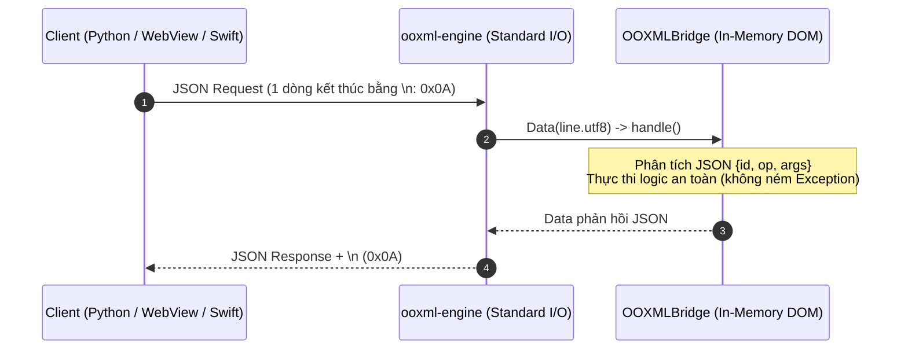

# ĐẶC TẢ GIAO THỨC ĐIỀU HÀNH OOXML ENGINE (VN OFFICE OOXML PROTOCOL SPECIFICATION)

> **Mã tài liệu:** `SPEC-OOXML-ENGINE-PROTOCOL`  
> **Áp dụng cho:** `ports/ios/OOXMLKit`, `platform/ooxml/engine_client.py`, `apps/sheet`, `apps/writer`, `apps/slides`  
> **Nền tảng tham chiếu:** Windows, macOS, iOS/iPadOS  
> **Trạng thái:** TÀI LIỆU CHUẨN GIAO THỨC (Được kiểm chứng 100% bằng thực thi lệnh thật qua `ooxml-engine.exe`)  
> **Phiên bản:** 1.0 (Tháng 10/2026)  

---

## 1. TỔNG QUAN KIẾN TRÚC & MỤC TIÊU GIAO THỨC

Giao thức **OOXML Engine Protocol** định nghĩa chuẩn giao tiếp hai chiều giữa tầng ứng dụng (UI JavaScript trong pywebview/WKWebView hoặc dịch vụ nền Python/Swift) và tiến trình lõi xử lý tài liệu OpenXML **`ooxml-engine`** (viết bằng Swift native, kế thừa từ thư viện lõi `OOXMLKit`).

### 1.1. Mục tiêu kỹ thuật
1. **Thay thế điểm nghẽn LibreOffice headless:** Thay vì khởi động tiến trình LibreOffice C++ nặng nề và xuất chuyển trung gian qua FODS tốn từ 10 - 45 giây ([docs/ooxml/PLAN-W3-XLSX-SAVE-LAYER.md:68-72](file:///E:/VNOffice-agy-PROTOCOL/docs/ooxml/PLAN-W3-XLSX-SAVE-LAYER.md#L68-L72)), giao thức cho phép thao tác trực tiếp trên DOM XML trong tệp ZIP chỉ mất vài mili-giây.
2. **Tiết kiệm tài nguyên bộ nhớ:** Áp dụng mô hình **Handle** ([ports/ios/OOXMLKit/Sources/OOXMLBridge/OOXMLBridge.swift:7, 26, 123-124](file:///E:/VNOffice-agy-PROTOCOL/ports/ios/OOXMLKit/Sources/OOXMLBridge/OOXMLBridge.swift#L7)) và **Lưu gia số (Delta Save)** ([ports/ios/OOXMLKit/Sources/OOXMLBridge/OOXMLBridge.swift:75-77](file:///E:/VNOffice-agy-PROTOCOL/ports/ios/OOXMLKit/Sources/OOXMLBridge/OOXMLBridge.swift#L75-L77), [docs/ooxml/PLAN-W3-XLSX-SAVE-LAYER.md:191-197](file:///E:/VNOffice-agy-PROTOCOL/docs/ooxml/PLAN-W3-XLSX-SAVE-LAYER.md#L191-L197)). Tầng giao diện không cần giữ hay truyền tải toàn bộ tài liệu (hàng chục MB XML) mà chỉ gửi danh sách thay đổi (vài KB JSON).
3. **Tuyệt đối an toàn dữ liệu người dùng:** Tuân thủ 2 nguyên tắc vàng:
   - *Ngoài phạm vi -> unsupported, không ghi tệp đích* ([ports/ios/OOXMLKit/Sources/OOXMLBridge/OOXMLBridge.swift:215-217, 336-338, 518-520](file:///E:/VNOffice-agy-PROTOCOL/ports/ios/OOXMLKit/Sources/OOXMLBridge/OOXMLBridge.swift#L518-L520)).
   - *Mở lại kiểm tra bắt buộc trước khi báo OK (Mandatory Reopen Verification)* ([ports/ios/OOXMLKit/Sources/OOXMLBridge/OOXMLBridge.swift:269-283, 407-422, 580-609](file:///E:/VNOffice-agy-PROTOCOL/ports/ios/OOXMLKit/Sources/OOXMLBridge/OOXMLBridge.swift#L580-L609)).

---

## 2. KHUNG GIAO TIẾP STDIO (JSON LINES PROTOCOL FRAME)

Tiến trình `ooxml-engine` giao tiếp qua chuẩn Standard I/O (stdio) theo cơ chế **JSON Lines**:
- Điểm vào vòng lặp xử lý: [ports/ios/OOXMLKit/Sources/ooxml-engine/main.swift:5-9](file:///E:/VNOffice-agy-PROTOCOL/ports/ios/OOXMLKit/Sources/ooxml-engine/main.swift#L5-L9).
- Tầng điều phối logic: `OOXMLBridge.handle(_:)` tại [ports/ios/OOXMLKit/Sources/OOXMLBridge/OOXMLBridge.swift:34-49](file:///E:/VNOffice-agy-PROTOCOL/ports/ios/OOXMLKit/Sources/OOXMLBridge/OOXMLBridge.swift#L34-L49).



### 2.1. Quy tắc khung (Framing Rules)
1. **Mỗi yêu cầu (Request)** gửi vào `stdin` phải là đúng một dòng chuỗi JSON hợp lệ, kết thúc bằng ký tự ngắt dòng `\n` (`0x0A`) ([main.swift:5](file:///E:/VNOffice-agy-PROTOCOL/ports/ios/OOXMLKit/Sources/ooxml-engine/main.swift#L5)).
2. **Mỗi phản hồi (Response)** trả ra từ `stdout` là đúng một dòng chuỗi JSON, kết thúc bằng `\n` (`0x0A`) ([main.swift:7-8](file:///E:/VNOffice-agy-PROTOCOL/ports/ios/OOXMLKit/Sources/ooxml-engine/main.swift#L7-L8)).
3. **Bảo toàn định danh `id`:** Trường `id` trong yêu cầu được giữ nguyên vẹn trong phản hồi (có thể là số nguyên, chuỗi, hoặc `null`) ([OOXMLBridge.swift:40](file:///E:/VNOffice-agy-PROTOCOL/ports/ios/OOXMLKit/Sources/OOXMLBridge/OOXMLBridge.swift#L40)).
4. **Không bao giờ ném ngoại lệ (Exception-safe):** Mọi lỗi nội bộ, lỗi cú pháp hoặc lỗi nghiệp vụ đều được bắt lại và đóng gói vào cấu trúc JSON `{id, ok: false, error: {...}}` ([OOXMLBridge.swift:33, 44-48](file:///E:/VNOffice-agy-PROTOCOL/ports/ios/OOXMLKit/Sources/OOXMLBridge/OOXMLBridge.swift#L33)). Tiến trình không bị crash hay thoát đột ngột.

### 2.2. Định dạng Cấu trúc Dữ liệu

#### Cấu trúc Yêu cầu (Request)
```json
{
  "id": 1,
  "op": "<tên_thao_tác>",
  "args": {
    "<tên_tham_số>": "<giá_trị>"
  }
}
```
*Ghi chú mã nguồn:* Yêu cầu bắt buộc phải là một đối tượng JSON dictionary ([OOXMLBridge.swift:37-38](file:///E:/VNOffice-agy-PROTOCOL/ports/ios/OOXMLKit/Sources/OOXMLBridge/OOXMLBridge.swift#L37-L38)) và bắt buộc phải có thuộc tính `op` kiểu chuỗi ([OOXMLBridge.swift:41](file:///E:/VNOffice-agy-PROTOCOL/ports/ios/OOXMLKit/Sources/OOXMLBridge/OOXMLBridge.swift#L41)).

#### Cấu trúc Phản hồi Thành công (Success Response)
```json
{
  "id": 1,
  "ok": true,
  "result": { ... }
}
```
*Ghi chú mã nguồn:* Tham chiếu tại [OOXMLBridge.swift:43](file:///E:/VNOffice-agy-PROTOCOL/ports/ios/OOXMLKit/Sources/OOXMLBridge/OOXMLBridge.swift#L43).

#### Cấu trúc Phản hồi Thất bại / Lỗi (Error Response)
```json
{
  "id": 1,
  "ok": false,
  "error": {
    "code": "<mã_lỗi>",
    "message": "<thông_điệp_tiếng_Việt>"
  }
}
```
*Ghi chú mã nguồn:* Tham chiếu tại [OOXMLBridge.swift:45, 47](file:///E:/VNOffice-agy-PROTOCOL/ports/ios/OOXMLKit/Sources/OOXMLBridge/OOXMLBridge.swift#L45) và [BridgeJSON.swift:5-12](file:///E:/VNOffice-agy-PROTOCOL/ports/ios/OOXMLKit/Sources/OOXMLBridge/BridgeJSON.swift#L5-L12).

---

## 3. CÁC LỆNH QUẢN LÝ TÀI LIỆU & VÒNG ĐỜI (LIFECYCLE OPS)

Điều phối tại [OOXMLBridge.swift:70-74](file:///E:/VNOffice-agy-PROTOCOL/ports/ios/OOXMLKit/Sources/OOXMLBridge/OOXMLBridge.swift#L70-L74). Tài liệu mở được lưu trong từ điển `docs: [String: Doc]` với khóa là chuỗi định danh handle (ví dụ `"h1"`, `"h2"`) ([OOXMLBridge.swift:26-27, 123-124](file:///E:/VNOffice-agy-PROTOCOL/ports/ios/OOXMLKit/Sources/OOXMLBridge/OOXMLBridge.swift#L26)).

### 3.1. Lệnh `open`
- **Mã nguồn:** [OOXMLBridge.swift:113-136](file:///E:/VNOffice-agy-PROTOCOL/ports/ios/OOXMLKit/Sources/OOXMLBridge/OOXMLBridge.swift#L113-L136).
- **Mô tả:** Mở tệp DOCX, XLSX hoặc PPTX từ đường dẫn tệp cục bộ hoặc dữ liệu chuỗi base64. Tự động nhận diện loại tài liệu dựa trên cấu trúc gói OPC. Mở thành công sẽ sinh một handle mới và trả về thông tin metadata ban đầu.
- **Tham số (`args`):**
  - Cần ít nhất một trong hai:
    - `path` (chuỗi): Đường dẫn tuyệt đối tới tệp ([OOXMLBridge.swift:118](file:///E:/VNOffice-agy-PROTOCOL/ports/ios/OOXMLKit/Sources/OOXMLBridge/OOXMLBridge.swift#L118)).
    - `base64` (chuỗi): Nội dung nhị phân của tệp đã mã hóa base64 ([OOXMLBridge.swift:115](file:///E:/VNOffice-agy-PROTOCOL/ports/ios/OOXMLKit/Sources/OOXMLBridge/OOXMLBridge.swift#L115)).
- **Trả về (`result`):**
  - `handle` (chuỗi): Định danh phiên làm việc (ví dụ `"h1"`).
  - `kind` (chuỗi): `"xlsx"`, `"docx"`, hoặc `"pptx"`.
  - Cùng các trường metadata chi tiết (giống hàm `info` bên dưới).

#### Ví dụ Chạy Thật:
```json
// YÊU CẦU:
{"id":2,"op":"open","args":{"path":"E:\\VNOffice-agy-PROTOCOL\\ports\\ios\\OOXMLKit\\Tests\\OOXMLTestSupport\\Fixtures\\xlsx\\rich-excel.xlsx"}}

// ĐẦU RA THẬT TỪ ENGINE:
{"result":{"kind":"xlsx","handle":"h1","sheets":[{"state":"visible","kind":"worksheet","name":"Dữ liệu"},{"state":"visible","kind":"worksheet","name":"Tổng hợp"},{"state":"hidden","kind":"worksheet","name":"Ẩn"}]},"ok":true,"id":2}
```

```json
// YÊU CẦU (DOCX):
{"id":4,"op":"open","args":{"path":"E:\\VNOffice-agy-PROTOCOL\\ports\\ios\\OOXMLKit\\Tests\\OOXMLTestSupport\\Fixtures\\docx\\rich-word.docx"}}

// ĐẦU RA THẬT TỪ ENGINE:
{"ok":true,"id":4,"result":{"paragraphs":21,"kind":"docx","handle":"h2","tables":1}}
```

```json
// YÊU CẦU (PPTX):
{"id":6,"op":"open","args":{"path":"E:\\VNOffice-agy-PROTOCOL\\ports\\ios\\OOXMLKit\\Tests\\OOXMLTestSupport\\Fixtures\\pptx\\rich-deck.pptx"}}

// ĐẦU RA THẬT TỪ ENGINE:
{"ok":true,"id":6,"result":{"handle":"h3","slides":3,"kind":"pptx"}}
```

---

### 3.2. Lệnh `info`
- **Mã nguồn:** [OOXMLBridge.swift:649-664](file:///E:/VNOffice-agy-PROTOCOL/ports/ios/OOXMLKit/Sources/OOXMLBridge/OOXMLBridge.swift#L649-L664).
- **Mô tả:** Lấy thông tin cấu trúc của tài liệu đang giữ trong bộ nhớ.
- **Tham số (`args`):**
  - `handle` (chuỗi, bắt buộc): Handle đã nhận từ `open`.
- **Trả về (`result`):**
  - Đối với bảng tính (`xlsx`): `{handle, kind: "xlsx", sheets: [{name, state: "visible"|"hidden", kind: "worksheet"}]}` ([OOXMLBridge.swift:656](file:///E:/VNOffice-agy-PROTOCOL/ports/ios/OOXMLKit/Sources/OOXMLBridge/OOXMLBridge.swift#L656)).
  - Đối với văn bản (`docx`): `{handle, kind: "docx", paragraphs: <tổng_số_đoạn>, tables: <tổng_số_bảng>}` ([OOXMLBridge.swift:657-659](file:///E:/VNOffice-agy-PROTOCOL/ports/ios/OOXMLKit/Sources/OOXMLBridge/OOXMLBridge.swift#L657-L659)).
  - Đối với trình chiếu (`pptx`): `{handle, kind: "pptx", slides: <tổng_số_slide>}` ([OOXMLBridge.swift:660-662](file:///E:/VNOffice-agy-PROTOCOL/ports/ios/OOXMLKit/Sources/OOXMLBridge/OOXMLBridge.swift#L660-L662)).

#### Ví dụ Chạy Thật:
```json
// YÊU CẦU:
{"id":3,"op":"info","args":{"handle":"h1"}}

// ĐẦU RA THẬT TỪ ENGINE:
{"result":{"handle":"h1","sheets":[{"name":"Dữ liệu","kind":"worksheet","state":"visible"},{"name":"Tổng hợp","kind":"worksheet","state":"visible"},{"name":"Ẩn","kind":"worksheet","state":"hidden"}],"kind":"xlsx"},"id":3,"ok":true}
```

---

### 3.3. Lệnh `close`
- **Mã nguồn:** [OOXMLBridge.swift:72](file:///E:/VNOffice-agy-PROTOCOL/ports/ios/OOXMLKit/Sources/OOXMLBridge/OOXMLBridge.swift#L72).
- **Mô tả:** Hủy tài liệu trong bộ nhớ tương ứng với `handle`, giải phóng tài nguyên.
- **Tham số (`args`):**
  - `handle` (chuỗi, bắt buộc).
- **Trả về (`result`):** `{}` (đối tượng rỗng).

#### Ví dụ Chạy Thật:
```json
// YÊU CẦU:
{"id":41,"op":"close","args":{"handle":"h1"}}

// ĐẦU RA THẬT TỪ ENGINE:
{"id":41,"ok":true,"result":{}}
```

---

### 3.4. Lệnh `save`
- **Mã nguồn:** [OOXMLBridge.swift:146-154](file:///E:/VNOffice-agy-PROTOCOL/ports/ios/OOXMLKit/Sources/OOXMLBridge/OOXMLBridge.swift#L146-L154).
- **Mô tả:** Ghi toàn bộ trạng thái hiện tại của tài liệu từ bộ nhớ ra đường dẫn tệp trên đĩa.
- **Tham số (`args`):**
  - `handle` (chuỗi, bắt buộc).
  - `path` (chuỗi, bắt buộc): Đường dẫn tệp đích.
- **Trả về (`result`):** `{}`.

#### Ví dụ Chạy Thật:
```json
// YÊU CẦU:
{"id":39,"op":"save","args":{"handle":"h1","path":"C:\\Users\\3T Computer\\AppData\\Local\\Temp\\vno_proto_tmp\\saved.xlsx"}}

// ĐẦU RA THẬT TỪ ENGINE:
{"ok":true,"result":{},"id":39}
```

---

### 3.5. Lệnh `exportBytes`
- **Mã nguồn:** [OOXMLBridge.swift:73, 138-144](file:///E:/VNOffice-agy-PROTOCOL/ports/ios/OOXMLKit/Sources/OOXMLBridge/OOXMLBridge.swift#L73).
- **Mô tả:** Xuất toàn bộ gói OPC tài liệu thành chuỗi nhị phân mã hóa Base64 (phục vụ chia sẻ qua AirDrop, lưu trữ đám mây hoặc truyền qua WebKit message handler).
- **Tham số (`args`):**
  - `handle` (chuỗi, bắt buộc).
- **Trả về (`result`):** `{"base64": "<chuỗi_mã_hóa_base64>"}`.

#### Ví dụ Chạy Thật:
```json
// YÊU CẦU:
{"id":40,"op":"exportBytes","args":{"handle":"h1"}}

// ĐẦU RA THẬT TỪ ENGINE (rút gọn chuỗi base64):
{"ok":true,"id":40,"result":{"base64":"UEsDBBQAAAAIAAAAIQAun6FVvwEAAB4JAAATAAAAW0NvbnRlbnRfVHlwZXNdLnhtb...[base64_data]...="}}
```

---

## 4. BỘ LỆNH TƯƠNG TÁC BẢNG TÍNH (VN SHEET INTERACTIVE OPS)

Điều phối tại [OOXMLBridge.swift:79-92](file:///E:/VNOffice-agy-PROTOCOL/ports/ios/OOXMLKit/Sources/OOXMLBridge/OOXMLBridge.swift#L79-L92). Tất cả các thao tác đều yêu cầu `handle` của tài liệu kiểu `xlsx`. Có thể chỉ định sheet qua `sheet` (tên chuỗi) hoặc `sheetIndex` (số nguyên, mặc định 0) ([OOXMLBridge.swift:677-681](file:///E:/VNOffice-agy-PROTOCOL/ports/ios/OOXMLKit/Sources/OOXMLBridge/OOXMLBridge.swift#L677-L681)).

### 4.1. `sheet.read`
- **Mã nguồn:** [OOXMLBridge.swift:707-726](file:///E:/VNOffice-agy-PROTOCOL/ports/ios/OOXMLKit/Sources/OOXMLBridge/OOXMLBridge.swift#L707-L726).
- **Tham số:**
  - `handle` (bắt buộc).
  - `sheet` hoặc `sheetIndex` (tùy chọn).
  - `range` (chuỗi, tùy chọn, ví dụ `"A1:E2"`): Nếu có, chỉ trả về các ô nằm trong phạm vi ô này; nếu không, trả về toàn bộ các ô đã có dữ liệu trong worksheet ([OOXMLBridge.swift:719-724](file:///E:/VNOffice-agy-PROTOCOL/ports/ios/OOXMLKit/Sources/OOXMLBridge/OOXMLBridge.swift#L719-L724)).
- **Định dạng ô trả về:**
  - `ref`: Chuỗi tham chiếu A1 (ví dụ `"A1"`).
  - `value`: Đối tượng JSON `{t: "n"|"s"|"b"|"e"|"empty", v: ...}` biểu diễn giá trị ô ([BridgeJSON.swift:67-75](file:///E:/VNOffice-agy-PROTOCOL/ports/ios/OOXMLKit/Sources/OOXMLBridge/BridgeJSON.swift#L67-L75)).
  - `style`: Chỉ số `styleIndex` (số nguyên) trong `xl/styles.xml`.
  - `formula` (nếu có): Chuỗi biểu thức công thức (không có tiền tố `=`).
  - `numberFormat` (nếu có): Định dạng số (ví dụ `"General"`, `"#,##0 ₫"`).
  - `isDate` (nếu có): `true` nếu ô có định dạng ngày tháng.
- **Trả về:** `{"used": "<vùng_đã_dùng>", "cells": [...]}`.

#### Ví dụ Chạy Thật:
```json
// YÊU CẦU:
{"id":11,"op":"sheet.read","args":{"handle":"h1","sheet":"Dữ liệu","range":"A1:C2"}}

// ĐẦU RA THẬT TỪ ENGINE:
{"ok":true,"result":{"used":"A1:E11","cells":[{"style":1,"numberFormat":"General","ref":"A1","value":{"t":"s","v":"Mã"}},{"style":1,"numberFormat":"General","ref":"B1","value":{"t":"s","v":"Tên hàng"}},{"style":1,"numberFormat":"General","ref":"C1","value":{"t":"s","v":"Số lượng"}},{"style":0,"numberFormat":"General","ref":"A2","value":{"t":"n","v":1}},{"style":0,"numberFormat":"General","ref":"B2","value":{"t":"s","v":"Giấy A4 Double A"}},{"style":0,"numberFormat":"General","ref":"C2","value":{"t":"n","v":500}}]},"id":11}
```

---

### 4.2. `sheet.setValue`
- **Mã nguồn:** [OOXMLBridge.swift:728-731](file:///E:/VNOffice-agy-PROTOCOL/ports/ios/OOXMLKit/Sources/OOXMLBridge/OOXMLBridge.swift#L728-L731) và [BridgeJSON.swift:41-64](file:///E:/VNOffice-agy-PROTOCOL/ports/ios/OOXMLKit/Sources/OOXMLBridge/BridgeJSON.swift#L41-L64).
- **Tham số:** `handle`, `sheet`/`sheetIndex`, `ref` (tọa độ ô, ví dụ `"C2"`), `value` (giá trị).
- **Hỗ trợ định dạng `value`:**
  - Cấu trúc đóng gói: `{"t": "n", "v": 999}` (số), `{"t": "s", "v": "chuỗi"}` (chuỗi), `{"t": "b", "v": true}` (boolean), `{"t": "e", "v": "#N/A"}` (lỗi), `{"t": "empty"}` (rỗng).
  - Hoặc truyền trực tiếp kiểu nguyên thủy: `999`, `"chuỗi"`, `true`.

#### Ví dụ Chạy Thật:
```json
// YÊU CẦU:
{"id":12,"op":"sheet.setValue","args":{"handle":"h1","sheet":"Dữ liệu","ref":"C2","value":{"t":"n","v":999}}}

// ĐẦU RA THẬT TỪ ENGINE:
{"id":12,"result":{},"ok":true}
```

---

### 4.3. `sheet.setFormula`
- **Mã nguồn:** [OOXMLBridge.swift:732-736](file:///E:/VNOffice-agy-PROTOCOL/ports/ios/OOXMLKit/Sources/OOXMLBridge/OOXMLBridge.swift#L732-L736).
- **Tham số:**
  - `handle`, `sheet`/`sheetIndex`, `ref` (chuỗi).
  - `formula` (chuỗi): Chuỗi công thức (ví dụ `"C2*2"`).
  - `cached` (tùy chọn): Giá trị tính toán sẵn điền vào thẻ XML `<v>` để Microsoft Excel hiển thị ngay mà không cần chờ tính lại.

#### Ví dụ Chạy Thật:
```json
// YÊU CẦU:
{"id":15,"op":"sheet.setFormula","args":{"handle":"h1","sheet":"Dữ liệu","ref":"G2","formula":"C2*2","cached":{"t":"n","v":1998}}}

// ĐẦU RA THẬT TỪ ENGINE:
{"ok":true,"result":{},"id":15}
```

---

### 4.4. `sheet.format`
- **Mã nguồn:** [OOXMLBridge.swift:83](file:///E:/VNOffice-agy-PROTOCOL/ports/ios/OOXMLKit/Sources/OOXMLBridge/OOXMLBridge.swift#L83) và [BridgeJSON.swift:77-88](file:///E:/VNOffice-agy-PROTOCOL/ports/ios/OOXMLKit/Sources/OOXMLBridge/BridgeJSON.swift#L77-L88).
- **Tham số:** `handle`, `sheet`/`sheetIndex`, `ref`, `change` (đối tượng cấu hình định dạng).
- **Các trường trong `change`:** `numberFormat` (chuỗi), `bold` (bool), `italic` (bool), `underline` (bool), `fontColor` (chuỗi Hex AARRGGBB), `fontSize` (số thực), `fillColor` (chuỗi Hex AARRGGBB), `horizontalAlignment` (chuỗi: `"left"|"center"|"right"|"both"`), `wrapText` (bool).

#### Ví dụ Chạy Thật:
```json
// YÊU CẦU:
{"id":16,"op":"sheet.format","args":{"handle":"h1","sheet":"Dữ liệu","ref":"F2","change":{"bold":true,"fillColor":"FFFF0000","fontColor":"FFFFFFFF"}}}

// ĐẦU RA THẬT TỪ ENGINE:
{"id":16,"result":{},"ok":true}
```

---

### 4.5. `sheet.clear`, `sheet.merge`, `sheet.unmerge`
- **Mã nguồn:** [OOXMLBridge.swift:82, 84, 85](file:///E:/VNOffice-agy-PROTOCOL/ports/ios/OOXMLKit/Sources/OOXMLBridge/OOXMLBridge.swift#L82).
- `sheet.clear`: Tham số `ref` (xóa ô).
- `sheet.merge`: Tham số `range` (ví dụ `"H1:I2"` - gộp ô).
- `sheet.unmerge`: Tham số `range` (hủy gộp ô).

#### Ví dụ Chạy Thật:
```json
// YÊU CẦU (clear):
{"id":17,"op":"sheet.clear","args":{"handle":"h1","sheet":"Dữ liệu","ref":"F3"}}
// ĐẦU RA THẬT:
{"id":17,"result":{},"ok":true}

// YÊU CẦU (merge):
{"id":18,"op":"sheet.merge","args":{"handle":"h1","sheet":"Dữ liệu","range":"H1:I2"}}
// ĐẦU RA THẬT:
{"ok":true,"result":{},"id":18}

// YÊU CẦU (unmerge):
{"id":19,"op":"sheet.unmerge","args":{"handle":"h1","sheet":"Dữ liệu","range":"H1:I2"}}
// ĐẦU RA THẬT:
{"ok":true,"id":19,"result":{}}
```

---

### 4.6. Chèn / Xóa Hàng & Cột (`insertRows`, `deleteRows`, `insertColumns`, `deleteColumns`)
- **Mã nguồn:** [OOXMLBridge.swift:86-89](file:///E:/VNOffice-agy-PROTOCOL/ports/ios/OOXMLKit/Sources/OOXMLBridge/OOXMLBridge.swift#L86-L89).
- **Tham số:** `handle`, `sheet`/`sheetIndex`, `at` (chỉ số dòng/cột 1-based), `count` (số lượng, mặc định 1).
- **Lưu ý nghiệp vụ:** Nếu phạm vi chèn/xóa cắt ngang qua một bảng dữ liệu Table OOXML (`table1.xml`) mà tính năng thay đổi cấu trúc bảng chưa hỗ trợ, engine sẽ trả về lỗi `internal` để bảo vệ tính toàn vẹn của tệp ([OOXMLBridge.swift:47](file:///E:/VNOffice-agy-PROTOCOL/ports/ios/OOXMLKit/Sources/OOXMLBridge/OOXMLBridge.swift#L47)).

#### Ví dụ Chạy Thật:
```json
// YÊU CẦU (chèn hàng ngoài bảng):
{"id":20,"op":"sheet.insertRows","args":{"handle":"h1","sheet":"Dữ liệu","at":10,"count":1}}
// ĐẦU RA THẬT:
{"id":20,"result":{},"ok":true}

// YÊU CẦU (xóa hàng ngoài bảng):
{"id":21,"op":"sheet.deleteRows","args":{"handle":"h1","sheet":"Dữ liệu","at":10,"count":1}}
// ĐẦU RA THẬT:
{"id":21,"result":{},"ok":true}

// YÊU CẦU (chèn cột trên sheet không có bảng):
{"id":23,"op":"sheet.insertColumns","args":{"handle":"h1","sheet":"SheetTam","at":2,"count":1}}
// ĐẦU RA THẬT:
{"id":23,"ok":true,"result":{}}
```

---

### 4.7. Quản lý Sheet (`sheet.add`, `sheet.rename`, `sheet.delete`)
- **Mã nguồn:** [OOXMLBridge.swift:90-92](file:///E:/VNOffice-agy-PROTOCOL/ports/ios/OOXMLKit/Sources/OOXMLBridge/OOXMLBridge.swift#L90-L92).
- `sheet.add`: Tham số `name` (chuỗi).
- `sheet.rename`: Tham số `old` (chuỗi), `new` (chuỗi).
- `sheet.delete`: Tham số `name` (chuỗi).

#### Ví dụ Chạy Thật:
```json
// YÊU CẦU (thêm sheet):
{"id":22,"op":"sheet.add","args":{"handle":"h1","name":"SheetTam"}}
// ĐẦU RA THẬT:
{"id":22,"ok":true,"result":{}}

// YÊU CẦU (đổi tên sheet):
{"id":25,"op":"sheet.rename","args":{"handle":"h1","old":"SheetTam","new":"SheetDaDoiTen"}}
// ĐẦU RA THẬT:
{"ok":true,"id":25,"result":{}}

// YÊU CẦU (xóa sheet):
{"id":26,"op":"sheet.delete","args":{"handle":"h1","name":"SheetDaDoiTen"}}
// ĐẦU RA THẬT:
{"id":26,"result":{},"ok":true}
```

---

## 5. BỘ LỆNH TƯƠNG TÁC VĂN BẢN (VN WRITER INTERACTIVE OPS)

Điều phối tại [OOXMLBridge.swift:94-98](file:///E:/VNOffice-agy-PROTOCOL/ports/ios/OOXMLKit/Sources/OOXMLBridge/OOXMLBridge.swift#L94-L98). Tất cả các thao tác yêu cầu handle của tài liệu kiểu `docx`.

### 5.1. `doc.read`
- **Mã nguồn:** [OOXMLBridge.swift:740-757](file:///E:/VNOffice-agy-PROTOCOL/ports/ios/OOXMLKit/Sources/OOXMLBridge/OOXMLBridge.swift#L740-L757).
- **Tham số:** `handle`, tùy chọn `from` (chỉ số đoạn bắt đầu, mặc định 0), tùy chọn `count` (số đoạn cần lấy).
- **Trả về:**
  - `total`: Tổng số đoạn trong tài liệu.
  - `paragraphs`: Danh sách các đoạn văn `[{index, text, style, alignment, runs: [{text, bold, italic, color, fontSize}]}]`.
  - `tables`: Ma trận 3 chiều biểu diễn các bảng biểu trong tài liệu: `[[[ "ô 0,0", "ô 0,1" ], [ "ô 1,0", "ô 1,1" ]]]`.

#### Ví dụ Chạy Thật:
```json
// YÊU CẦU:
{"id":27,"op":"doc.read","args":{"handle":"h2","from":0,"count":2}}

// ĐẦU RA THẬT TỪ ENGINE:
{"ok":true,"id":27,"result":{"total":21,"tables":[[["Chỉ tiêu","Giá trị"],["Doanh thu","Quý 3","12,5 tỷ"]]],"paragraphs":[{"style":"Heading1","text":"BÁO CÁO TỔNG KẾT NĂM 2026","index":0,"runs":[{"text":"BÁO CÁO TỔNG KẾT NĂM 2026","bold":false,"italic":false}]},{"runs":[{"bold":false,"italic":false,"text":"Kính gửi: Ban Giám đốc Công ty TNHH 3T"}],"text":"Kính gửi: Ban Giám đốc Công ty TNHH 3T","index":1}]}}
```

---

### 5.2. `doc.setText`, `doc.insertParagraph`, `doc.appendParagraph`, `doc.replace`
- **Mã nguồn:** [OOXMLBridge.swift:95-98, 759-771](file:///E:/VNOffice-agy-PROTOCOL/ports/ios/OOXMLKit/Sources/OOXMLBridge/OOXMLBridge.swift#L95).
- `doc.setText`: Tham số `index` (số nguyên), `text` (chuỗi).
- `doc.insertParagraph`: Tham số `text`, tùy chọn `style`, tùy chọn `afterIndex`.
- `doc.appendParagraph`: Tham số `text`, tùy chọn `style`.
- `doc.replace`: Tham số `find` (chuỗi tìm kiếm), `replace` (chuỗi thay thế). Trả về `{"count": <số_lần_thay_thế>}`.

#### Ví dụ Chạy Thật:
```json
// YÊU CẦU (sửa text đoạn):
{"id":28,"op":"doc.setText","args":{"handle":"h2","index":0,"text":"TIÊU ĐỀ ĐÃ ĐỔI QUA PROTOCOL"}}
// ĐẦU RA THẬT:
{"ok":true,"id":28,"result":{}}

// YÊU CẦU (chèn đoạn):
{"id":29,"op":"doc.insertParagraph","args":{"handle":"h2","text":"Đoạn chèn mới sau tiêu đề","style":"Heading2","afterIndex":0}}
// ĐẦU RA THẬT:
{"id":29,"result":{},"ok":true}

// YÊU CẦU (thay thế văn bản toàn tài liệu):
{"id":31,"op":"doc.replace","args":{"handle":"h2","find":"Công ty TNHH 3T","replace":"Tập đoàn VN Office"}}
// ĐẦU RA THẬT:
{"id":31,"result":{"count":6},"ok":true}
```

---

## 6. BỘ LỆNH TƯƠNG TÁC TRÌNH CHIẾU (VN SLIDES INTERACTIVE OPS)

Điều phối tại [OOXMLBridge.swift:100-105](file:///E:/VNOffice-agy-PROTOCOL/ports/ios/OOXMLKit/Sources/OOXMLBridge/OOXMLBridge.swift#L100-L105). Tất cả các thao tác yêu cầu handle của tài liệu kiểu `pptx`.

### 6.1. `slide.read`
- **Mã nguồn:** [OOXMLBridge.swift:775-787](file:///E:/VNOffice-agy-PROTOCOL/ports/ios/OOXMLKit/Sources/OOXMLBridge/OOXMLBridge.swift#L775-L787).
- **Tham số:** `handle`, `index` (chỉ số slide 0-based).
- **Trả về:** `index`, tùy chọn `title`, tùy chọn `notes` (ghi chú của diễn giả), và mảng `shapes` `[{name, kind, placeholder, text, table}]`.

#### Ví dụ Chạy Thật:
```json
// YÊU CẦU:
{"id":33,"op":"slide.read","args":{"handle":"h3","index":0}}

// ĐẦU RA THẬT TỪ ENGINE:
{"ok":true,"result":{"index":0,"shapes":[{"kind":"shape","text":"Kế hoạch kinh doanh 2027","placeholder":"ctrTitle","name":"Tiêu đề 1"},{"text":"Công ty TNHH 3T\nTháng 10/2026","name":"Phụ đề 2","kind":"shape","placeholder":"subTitle"}],"notes":"Chào mừng quý vị đại biểu tham dự phiên họp.\nNội dung bài trình bày gồm 3 phần chính.","title":"Kế hoạch kinh doanh 2027"},"id":33}
```

---

### 6.2. `slide.setText`, `slide.setNotes`, `slide.replace`, `slide.move`, `slide.delete`
- **Mã nguồn:** [OOXMLBridge.swift:101-105](file:///E:/VNOffice-agy-PROTOCOL/ports/ios/OOXMLKit/Sources/OOXMLBridge/OOXMLBridge.swift#L101-L105).
- `slide.setText`: Tham số `index`, tùy chọn `shape` (nếu bỏ trống sẽ tự chọn khung tiêu đề hoặc shape có chữ đầu tiên) ([OOXMLBridge.swift:697-703](file:///E:/VNOffice-agy-PROTOCOL/ports/ios/OOXMLKit/Sources/OOXMLBridge/OOXMLBridge.swift#L697-L703)), `text`.
- `slide.setNotes`: Tham số `index`, `text`.
- `slide.replace`: Tham số `find`, `replace`. Trả về `{"count": <số_lần_thay_thế>}`.
- `slide.move`: Tham số `from` (vị trí cũ), `to` (vị trí mới).
- `slide.delete`: Tham số `index`.

#### Ví dụ Chạy Thật:
```json
// YÊU CẦU (sửa chữ shape tiêu đề):
{"id":34,"op":"slide.setText","args":{"handle":"h3","index":0,"shape":"Tiêu đề 1","text":"Chiến lược 2027-2030"}}
// ĐẦU RA THẬT:
{"id":34,"result":{},"ok":true}

// YÊU CẦU (đổi ghi chú):
{"id":35,"op":"slide.setNotes","args":{"handle":"h3","index":0,"text":"Ghi chú thuyết trình bản mới"}}
// ĐẦU RA THẬT:
{"ok":true,"result":{},"id":35}

// YÊU CẦU (di chuyển slide):
{"id":37,"op":"slide.move","args":{"handle":"h3","from":0,"to":1}}
// ĐẦU RA THẬT:
{"ok":true,"result":{},"id":37}

// YÊU CẦU (xóa slide):
{"id":38,"op":"slide.delete","args":{"handle":"h3","index":2}}
// ĐẦU RA THẬT:
{"ok":true,"result":{},"id":38}
```

---

## 7. TẦNG LƯU DELTA VÀO STAGING (`xlsx.save`, `docx.save`, `pptx.save`)

Điều phối tại [OOXMLBridge.swift:75-77](file:///E:/VNOffice-agy-PROTOCOL/ports/ios/OOXMLKit/Sources/OOXMLBridge/OOXMLBridge.swift#L75-L77). Đây là **cơ chế then chốt** phục vụ tính năng lưu không cần headless LibreOffice trên máy bàn và điện thoại.

### 7.1. Cấu trúc Tham số Chung của Lệnh Delta Save
Mọi lệnh `xlsx.save`, `docx.save`, `pptx.save` đều nhận các tham số gốc:
- `source_document_path` (hoặc `sourcePath`): Đường dẫn tệp gốc hiện có ([OOXMLBridge.swift:158, 288, 427](file:///E:/VNOffice-agy-PROTOCOL/ports/ios/OOXMLKit/Sources/OOXMLBridge/OOXMLBridge.swift#L427)).
- `target_path` (hoặc `targetPath`): Đường dẫn tệp lưu tạm (staging file) trên đĩa ([OOXMLBridge.swift:159, 289, 428](file:///E:/VNOffice-agy-PROTOCOL/ports/ios/OOXMLKit/Sources/OOXMLBridge/OOXMLBridge.swift#L428)).
- `delta` (JSON Object): Danh sách các thao tác gia số cần cập nhật ([OOXMLBridge.swift:165, 295, 436](file:///E:/VNOffice-agy-PROTOCOL/ports/ios/OOXMLKit/Sources/OOXMLBridge/OOXMLBridge.swift#L436)).
- **Quy tắc bắt buộc:** `sourcePath != targetPath`. Không được phép ghi đè trực tiếp lên tệp nguồn khi đang xử lý staging ([OOXMLBridge.swift:164, 294, 433-435](file:///E:/VNOffice-agy-PROTOCOL/ports/ios/OOXMLKit/Sources/OOXMLBridge/OOXMLBridge.swift#L433-L435)).

---

### 7.2. Đặc tả Lệnh `xlsx.save`
- **Mã nguồn:** [OOXMLBridge.swift:426-610](file:///E:/VNOffice-agy-PROTOCOL/ports/ios/OOXMLKit/Sources/OOXMLBridge/OOXMLBridge.swift#L426-L610).
- **Cấu trúc `delta` hợp lệ:** Chỉ cho phép 3 khóa cấp 1: `["cells", "cleared_cells", "structural_ops"]` ([OOXMLBridge.swift:441-444](file:///E:/VNOffice-agy-PROTOCOL/ports/ios/OOXMLKit/Sources/OOXMLBridge/OOXMLBridge.swift#L441-L444)).
  1. `cells`: Mảng các đối tượng ô:
     - `sheet` (chuỗi): Tên worksheet.
     - `ref` (chuỗi): Tọa độ A1.
     - Ô giá trị: `value` (bất kỳ) và `type` thuộc `["number", "string", "bool", "boolean", "error", "empty"]` ([OOXMLBridge.swift:497-501](file:///E:/VNOffice-agy-PROTOCOL/ports/ios/OOXMLKit/Sources/OOXMLBridge/OOXMLBridge.swift#L497-L501)).
     - Ô công thức: `formula` (chuỗi), tùy chọn `cached`, tùy chọn `cachedType` ([OOXMLBridge.swift:502-504, 539-543](file:///E:/VNOffice-agy-PROTOCOL/ports/ios/OOXMLKit/Sources/OOXMLBridge/OOXMLBridge.swift#L502-L504)).
     - Định dạng: Tùy chọn `styleIndex` (số nguyên >= 0; phải tồn tại trong styles của workbook nếu > 0) ([OOXMLBridge.swift:505-507, 526-528](file:///E:/VNOffice-agy-PROTOCOL/ports/ios/OOXMLKit/Sources/OOXMLBridge/OOXMLBridge.swift#L505-L507)).
  2. `cleared_cells`: Mảng các vùng ô cần xóa: `[{"sheet": "...", "range": "A1:B10"}]` ([OOXMLBridge.swift:509-517, 549-558](file:///E:/VNOffice-agy-PROTOCOL/ports/ios/OOXMLKit/Sources/OOXMLBridge/OOXMLBridge.swift#L509-L517)).
  3. `structural_ops`: Mảng các thao tác cấu trúc bảng tính ([OOXMLBridge.swift:457-489, 559-576](file:///E:/VNOffice-agy-PROTOCOL/ports/ios/OOXMLKit/Sources/OOXMLBridge/OOXMLBridge.swift#L457-L489)):
     - `sheet.freezePanes`: `args: {sheet, rows, cols}` ([OOXMLBridge.swift:462, 564-565](file:///E:/VNOffice-agy-PROTOCOL/ports/ios/OOXMLKit/Sources/OOXMLBridge/OOXMLBridge.swift#L462)).
     - `sheet.setTabColor`: `args: {sheet, color: "RRGGBB"|"AARRGGBB"}` ([OOXMLBridge.swift:463, 566-567](file:///E:/VNOffice-agy-PROTOCOL/ports/ios/OOXMLKit/Sources/OOXMLBridge/OOXMLBridge.swift#L463)).
     - `sheet.setPrintArea`: `args: {sheet, range: "A1:H10"}` ([OOXMLBridge.swift:464, 568-573](file:///E:/VNOffice-agy-PROTOCOL/ports/ios/OOXMLKit/Sources/OOXMLBridge/OOXMLBridge.swift#L464)).

#### Ví dụ Chạy Thật Thành Công:
```json
// YÊU CẦU:
{
  "id": 44,
  "op": "xlsx.save",
  "args": {
    "source_document_path": "C:\\Users\\3T Computer\\AppData\\Local\\Temp\\vno_delta_tmp\\src.xlsx",
    "target_path": "C:\\Users\\3T Computer\\AppData\\Local\\Temp\\vno_delta_tmp\\staging.xlsx",
    "delta": {
      "cells": [
        {"sheet": "Dữ liệu", "ref": "A1", "type": "string", "value": "ĐÃ CẬP NHẬT"},
        {"sheet": "Dữ liệu", "ref": "G2", "formula": "C2*2", "cached": 1000},
        {"sheet": "Dữ liệu", "ref": "H2", "type": "number", "value": 99.5, "styleIndex": 1}
      ],
      "cleared_cells": [
        {"sheet": "Dữ liệu", "range": "A2"}
      ],
      "structural_ops": [
        {"op": "sheet.freezePanes", "args": {"sheet": "Dữ liệu", "rows": 1, "cols": 1}},
        {"op": "sheet.setTabColor", "args": {"sheet": "Dữ liệu", "color": "FF0000"}},
        {"op": "sheet.setPrintArea", "args": {"sheet": "Dữ liệu", "range": "A1:H10"}}
      ]
    }
  }
}

// ĐẦU RA THẬT TỪ ENGINE:
{
  "id": 44,
  "ok": true,
  "result": {
    "ok": true,
    "unsupported": [],
    "changedParts": [
      "[Content_Types].xml",
      "xl/_rels/workbook.xml.rels",
      "xl/calcChain.xml",
      "xl/sharedStrings.xml",
      "xl/workbook.xml",
      "xl/worksheets/sheet1.xml"
    ]
  }
}
```

---

### 7.3. Đặc tả Lệnh `docx.save`
- **Mã nguồn:** [OOXMLBridge.swift:157-284](file:///E:/VNOffice-agy-PROTOCOL/ports/ios/OOXMLKit/Sources/OOXMLBridge/OOXMLBridge.swift#L157-L284).
- **Cấu trúc `delta` hợp lệ:** Chỉ cho phép 3 khóa cấp 1: `["paragraphs", "cells", "stories"]` ([OOXMLBridge.swift:170-174](file:///E:/VNOffice-agy-PROTOCOL/ports/ios/OOXMLKit/Sources/OOXMLBridge/OOXMLBridge.swift#L170-L174)).
  1. `paragraphs`: Mảng các thao tác trên đoạn văn ([OOXMLBridge.swift:180-201, 242-255](file:///E:/VNOffice-agy-PROTOCOL/ports/ios/OOXMLKit/Sources/OOXMLBridge/OOXMLBridge.swift#L180-L201)):
     - `setText`: `{op: "setText", index: <int>, text: <str>}`.
     - `replaceText`: `{op: "replaceText", index: <int>, find: <str>, replace: <str>}`.
     - `alignment`: `{op: "alignment", index: <int>, value: "left"|"center"|"right"|"both"}`.
     - `insert`: `{op: "insert", index: <int>, text: <str>, style?: <str>}` (chèn sau đoạn `index`).
     - `delete`: `{op: "delete", index: <int>}`.
     - `append`: `{op: "append", text: <str>, style?: <str>}`.
  2. `cells`: Sửa ô trong bảng biểu: `{table: <int>, row: <int>, column: <int>, text: <str>}` ([OOXMLBridge.swift:202-207, 256-258](file:///E:/VNOffice-agy-PROTOCOL/ports/ios/OOXMLKit/Sources/OOXMLBridge/OOXMLBridge.swift#L202-L207)).
  3. `stories`: Sửa header hoặc footer: `{kind: "header"|"footer", story: <int>, paragraph: <int>, text: <str>}` ([OOXMLBridge.swift:208-214, 259-262](file:///E:/VNOffice-agy-PROTOCOL/ports/ios/OOXMLKit/Sources/OOXMLBridge/OOXMLBridge.swift#L208-L214)).

#### Ví dụ Chạy Thật Thành Công:
```json
// YÊU CẦU:
{
  "id": 47,
  "op": "docx.save",
  "args": {
    "source_document_path": "C:\\Users\\3T Computer\\AppData\\Local\\Temp\\vno_docx_delta_tmp\\src.docx",
    "target_path": "C:\\Users\\3T Computer\\AppData\\Local\\Temp\\vno_docx_delta_tmp\\staging.docx",
    "delta": {
      "paragraphs": [
        {"op": "setText", "index": 0, "text": "BÁO CÁO Q4 - DELTA SAVE"},
        {"op": "alignment", "index": 1, "value": "center"},
        {"op": "replaceText", "index": 1, "find": "Ban Giám đốc", "replace": "Hội đồng Quản trị"},
        {"op": "insert", "index": 0, "text": "Đoạn chèn mới", "style": "Heading2"},
        {"op": "append", "text": "Đoạn cuối bổ sung"}
      ],
      "cells": [
        {"table": 0, "row": 0, "column": 0, "text": "Ô ĐẦU BẢNG ĐÃ SỬA"}
      ],
      "stories": []
    }
  }
}

// ĐẦU RA THẬT TỪ ENGINE:
{
  "ok": true,
  "id": 47,
  "result": {
    "ok": true,
    "changedParts": ["word/document.xml"],
    "unsupported": []
  }
}
```

---

### 7.4. Đặc tả Lệnh `pptx.save`
- **Mã nguồn:** [OOXMLBridge.swift:287-423](file:///E:/VNOffice-agy-PROTOCOL/ports/ios/OOXMLKit/Sources/OOXMLBridge/OOXMLBridge.swift#L287-L423).
- **Cấu trúc `delta` hợp lệ:** Chỉ cho phép khóa cấp 1 là `["slides"]` ([OOXMLBridge.swift:300](file:///E:/VNOffice-agy-PROTOCOL/ports/ios/OOXMLKit/Sources/OOXMLBridge/OOXMLBridge.swift#L300)).
  - Các thao tác slide được hỗ trợ ([OOXMLBridge.swift:308-335, 381-403](file:///E:/VNOffice-agy-PROTOCOL/ports/ios/OOXMLKit/Sources/OOXMLBridge/OOXMLBridge.swift#L308-L335)):
    - `shape.replaceText`: `{op: "shape.replaceText", slide: <int>, shape: <str>, find: <str>, replace: <str>}`.
    - `shape.rename`: `{op: "shape.rename", slide: <int>, shape: <str>, name: <str>}`.
    - `slide.setNotes`: `{op: "slide.setNotes", slide: <int>, text: <str>}`.
    - `slide.setTitle`: `{op: "slide.setTitle", slide: <int>, text: <str>}`.
    - `slide.add`: `{op: "slide.add", layoutName: <str>, index?: <int>}`.
    - `slide.delete`: `{op: "slide.delete", slide: <int>}`.

#### Ví dụ Chạy Thật Thành Công:
```json
// YÊU CẦU:
{
  "id": 50,
  "op": "pptx.save",
  "args": {
    "source_document_path": "C:\\Users\\3T Computer\\AppData\\Local\\Temp\\vno_pptx_delta_tmp\\src.pptx",
    "target_path": "C:\\Users\\3T Computer\\AppData\\Local\\Temp\\vno_pptx_delta_tmp\\staging.pptx",
    "delta": {
      "slides": [
        {"op": "shape.replaceText", "slide": 0, "shape": "Tiêu đề 1", "find": "2027", "replace": "2030"},
        {"op": "shape.rename", "slide": 0, "shape": "Tiêu đề 1", "name": "Tiêu đề lớn"},
        {"op": "slide.setNotes", "slide": 0, "text": "Ghi chú slide 1 qua delta"},
        {"op": "slide.setTitle", "slide": 1, "text": "Mục tiêu kinh doanh 2030"},
        {"op": "slide.delete", "slide": 2},
        {"op": "slide.add", "layoutName": "Title and Content", "index": 1}
      ]
    }
  }
}

// ĐẦU RA THẬT TỪ ENGINE:
{
  "id": 50,
  "ok": true,
  "result": {
    "changedParts": [
      "[Content_Types].xml",
      "docProps/app.xml",
      "ppt/_rels/presentation.xml.rels",
      "ppt/notesSlides/notesSlide1.xml",
      "ppt/presentation.xml",
      "ppt/slides/_rels/slide3.xml.rels",
      "ppt/slides/slide1.xml",
      "ppt/slides/slide2.xml",
      "ppt/slides/slide3.xml"
    ],
    "ok": true,
    "unsupported": []
  }
}
```

---

## 8. HAI QUY TẮC BẢO VỆ DỮ LIỆU BẤT BIẾN (DATA INTEGRITY GUARANTEES)

### 8.1. Quy tắc 1: "Ngoài phạm vi -> unsupported, không ghi tệp đích"
- **Nguyên lý:** Khi người dùng thực hiện một thao tác mà OOXMLKit chưa hỗ trợ (ví dụ sửa PivotTable, vẽ Chart mới, đặt hiệu ứng Transition trong slide, hoặc chèn ảnh phức tạp), hệ thống **tuyệt đối không được phép bỏ qua một cách âm thầm hay lưu dở dang**.
- **Hiện thực mã nguồn:**
  - `xlsxSaveDelta`: [OOXMLBridge.swift:518-520](file:///E:/VNOffice-agy-PROTOCOL/ports/ios/OOXMLKit/Sources/OOXMLBridge/OOXMLBridge.swift#L518-L520).
  - `docxSaveDelta`: [OOXMLBridge.swift:215-217](file:///E:/VNOffice-agy-PROTOCOL/ports/ios/OOXMLKit/Sources/OOXMLBridge/OOXMLBridge.swift#L215-L217).
  - `pptxSaveDelta`: [OOXMLBridge.swift:336-338](file:///E:/VNOffice-agy-PROTOCOL/ports/ios/OOXMLKit/Sources/OOXMLBridge/OOXMLBridge.swift#L336-L338).
- **Hành vi cụ thể:**
  1. Engine kiểm tra toàn bộ cấu trúc `delta` trước khi chạm vào tệp đích.
  2. Bất kỳ thao tác/trường nào nằm ngoài danh sách cho phép sẽ được ghi lại vào danh sách `unsupported`.
  3. Nếu `unsupported` không rỗng: Hàm trả về ngay lập tức với `result: {"ok": false, "changedParts": [], "unsupported": [...]}`.
  4. **Tệp tại `target_path` hoàn toàn KHÔNG được tạo ra hoặc ghi đè** ([OOXMLBridgeTests.swift:127, 278, 337](file:///E:/VNOffice-agy-PROTOCOL/ports/ios/OOXMLKit/Tests/OOXMLBridgeTests/OOXMLBridgeTests.swift#L127)). Phía gọi (Python/JS) phát hiện `unsupported` sẽ tự động chuyển hướng sang luồng dự phòng LibreOffice an toàn.

#### Ví dụ Chạy Thật Minh Chứng:
1. **XLSX khi gặp thao tác PivotTable:**
```json
// YÊU CẦU:
{"id":45,"op":"xlsx.save","args":{"source_document_path":".../src.xlsx","target_path":".../unsupported_out.xlsx","delta":{"cells":[],"cleared_cells":[],"structural_ops":[{"op":"sheet.pivotTableCreate","args":{"sheet":"Dữ liệu"}}]}}}

// ĐẦU RA THẬT TỪ ENGINE:
{"result":{"unsupported":["structural_ops[0]: sheet.pivotTableCreate"],"changedParts":[],"ok":false},"ok":true,"id":45}
// (Kiểm tra đĩa thực tế: File unsupported_out.xlsx KHÔNG HỀ TỒN TẠI)
```

2. **DOCX khi gặp thao tác chèn hình vẽ:**
```json
// YÊU CẦU:
{"id":48,"op":"docx.save","args":{"source_document_path":".../src.docx","target_path":".../unsupported_doc.docx","delta":{"paragraphs":[{"op":"insertDrawing","index":0}]}}}

// ĐẦU RA THẬT TỪ ENGINE:
{"ok":true,"id":48,"result":{"ok":false,"changedParts":[],"unsupported":["paragraphs[0]: insertDrawing"]}}
// (Kiểm tra đĩa thực tế: File unsupported_doc.docx KHÔNG HỀ TỒN TẠI)
```

3. **PPTX khi gặp thao tác chèn Audio:**
```json
// YÊU CẦU:
{"id":51,"op":"pptx.save","args":{"source_document_path":".../src.pptx","target_path":".../unsupported_deck.pptx","delta":{"slides":[{"op":"slide.addAudio","slide":0}]}}}

// ĐẦU RA THẬT TỪ ENGINE:
{"id":51,"ok":true,"result":{"unsupported":["slides[0]: slide.addAudio"],"ok":false,"changedParts":[]}}
// (Kiểm tra đĩa thực tế: File unsupported_deck.pptx KHÔNG HỀ TỒN TẠI)
```

---

### 8.2. Quy tắc 2: "Mở lại kiểm tra bắt buộc trước khi báo OK (Mandatory Reopen Verification)"
- **Nguyên lý:** Sau khi dữ liệu XML được đóng gói vào tệp zip staging, không được tin tưởng mù quáng rằng tệp đã nguyên vẹn. Engine phải tự động mở lại chính tệp staging đó, giải nén và đối chiếu với dữ liệu kỳ vọng trong bộ nhớ.
- **Hiện thực mã nguồn:**
  - `xlsxSaveDelta`: [OOXMLBridge.swift:578-608](file:///E:/VNOffice-agy-PROTOCOL/ports/ios/OOXMLKit/Sources/OOXMLBridge/OOXMLBridge.swift#L578-L608). Mở lại bằng `Workbook(data: savedData)`. Kiểm tra:
    - Danh sách tên sheet phải khớp tuyệt đối ([OOXMLBridge.swift:582-584](file:///E:/VNOffice-agy-PROTOCOL/ports/ios/OOXMLKit/Sources/OOXMLBridge/OOXMLBridge.swift#L582-L584)).
    - Từng ô đã sửa: Công thức, giá trị và kiểu, `styleIndex` phải khớp chính xác ([OOXMLBridge.swift:588-602](file:///E:/VNOffice-agy-PROTOCOL/ports/ios/OOXMLKit/Sources/OOXMLBridge/OOXMLBridge.swift#L588-L602)).
  - `docxSaveDelta`: [OOXMLBridge.swift:267-278](file:///E:/VNOffice-agy-PROTOCOL/ports/ios/OOXMLKit/Sources/OOXMLBridge/OOXMLBridge.swift#L267-L278). Mở lại bằng `WordDocument(data: savedData)`. Kiểm tra:
    - Danh sách chữ của tất cả các đoạn văn `paragraphs.map(\.text)` ([OOXMLBridge.swift:270](file:///E:/VNOffice-agy-PROTOCOL/ports/ios/OOXMLKit/Sources/OOXMLBridge/OOXMLBridge.swift#L270)).
    - Toàn bộ nội dung header/footer `allStories.map(\.text)` ([OOXMLBridge.swift:271](file:///E:/VNOffice-agy-PROTOCOL/ports/ios/OOXMLKit/Sources/OOXMLBridge/OOXMLBridge.swift#L271)).
    - Số lượng bảng và nội dung từng ô bảng ([OOXMLBridge.swift:272, 275-277](file:///E:/VNOffice-agy-PROTOCOL/ports/ios/OOXMLKit/Sources/OOXMLBridge/OOXMLBridge.swift#L272)).
  - `pptxSaveDelta`: [OOXMLBridge.swift:405-417](file:///E:/VNOffice-agy-PROTOCOL/ports/ios/OOXMLKit/Sources/OOXMLBridge/OOXMLBridge.swift#L405-L417). Mở lại bằng `Presentation(data: savedData)`. Kiểm tra:
    - Tổng số slide ([OOXMLBridge.swift:408](file:///E:/VNOffice-agy-PROTOCOL/ports/ios/OOXMLKit/Sources/OOXMLBridge/OOXMLBridge.swift#L408)).
    - Từng slide: Tiêu đề `title`, ghi chú `notesText`, danh sách tên các shape `allShapes.map(\.name)`, và toàn bộ nội dung chữ `text` ([OOXMLBridge.swift:413-415](file:///E:/VNOffice-agy-PROTOCOL/ports/ios/OOXMLKit/Sources/OOXMLBridge/OOXMLBridge.swift#L413-L415)).
- **Cơ chế Rollback:** Nếu bất kỳ kiểm tra nào thất bại hoặc quá trình giải nén ném ngoại lệ:
  - Khối `catch` được kích hoạt ngay: `try? FileManager.default.removeItem(at: targetURL)` ([OOXMLBridge.swift:281, 420, 607](file:///E:/VNOffice-agy-PROTOCOL/ports/ios/OOXMLKit/Sources/OOXMLBridge/OOXMLBridge.swift#L607)).
  - Tệp tạm bị xóa bỏ hoàn toàn khỏi đĩa.
  - Trả về lỗi `reopen`: `{"id": ..., "ok": false, "error": {"code": "reopen", "message": "..."}}`.

---

## 9. BẢNG MÃ LỖI VÀ THÔNG ĐIỆP CHUẨN (BRIDGE ERROR CODES)

Mọi lỗi trả về qua kênh giao thức đều tuân thủ `BridgeError` ([BridgeJSON.swift:5-12](file:///E:/VNOffice-agy-PROTOCOL/ports/ios/OOXMLKit/Sources/OOXMLBridge/BridgeJSON.swift#L5-L12)). Dưới đây là danh mục toàn bộ mã lỗi:

| Mã lỗi (`code`) | Vị trí phát sinh trong mã nguồn | Ý nghĩa & Tình huống kích hoạt | Thông báo tiếng Việt mẫu (`message`) |
|---|---|---|---|
| `request` | [OOXMLBridge.swift:38, 41](file:///E:/VNOffice-agy-PROTOCOL/ports/ios/OOXMLKit/Sources/OOXMLBridge/OOXMLBridge.swift#L38) | Dòng gửi vào không phải JSON object hoặc thiếu thuộc tính `op`. | `"yêu cầu không phải JSON object"`, `"thiếu 'op'"` |
| `op` | [OOXMLBridge.swift:107](file:///E:/VNOffice-agy-PROTOCOL/ports/ios/OOXMLKit/Sources/OOXMLBridge/OOXMLBridge.swift#L107) | Tên thao tác trong `op` không tồn tại trong hệ thống. | `"thao tác '...' không hỗ trợ"` |
| `args` | [BridgeJSON.swift:20, 28](file:///E:/VNOffice-agy-PROTOCOL/ports/ios/OOXMLKit/Sources/OOXMLBridge/BridgeJSON.swift#L20), [OOXMLBridge.swift:160, 290, 429](file:///E:/VNOffice-agy-PROTOCOL/ports/ios/OOXMLKit/Sources/OOXMLBridge/OOXMLBridge.swift#L429) | Thiếu hoặc sai kiểu dữ liệu của tham số bắt buộc. | `"thiếu/sai tham số chuỗi '...'"`, `"cần source_document_path và target_path"` |
| `open` | [OOXMLBridge.swift:116, 121, 133](file:///E:/VNOffice-agy-PROTOCOL/ports/ios/OOXMLKit/Sources/OOXMLBridge/OOXMLBridge.swift#L116) | Lỗi giải mã base64, thiếu path/base64, hoặc tệp không phải định dạng OOXML hợp lệ. | `"cần 'base64' hoặc 'path'"`, `"không nhận diện được tệp (không phải DOCX/XLSX/PPTX hợp lệ)"` |
| `handle` | [OOXMLBridge.swift:652, 669](file:///E:/VNOffice-agy-PROTOCOL/ports/ios/OOXMLKit/Sources/OOXMLBridge/OOXMLBridge.swift#L652) | Handle không tồn tại trong bộ nhớ (đã bị close hoặc chưa open). | `"handle '...' không tồn tại"` |
| `kind` | [OOXMLBridge.swift:674, 683, 693](file:///E:/VNOffice-agy-PROTOCOL/ports/ios/OOXMLKit/Sources/OOXMLBridge/OOXMLBridge.swift#L674) | Gọi sai lệnh so với loại tài liệu (ví dụ gọi `sheet.read` trên handle docx). | `"tài liệu không phải bảng tính"`, `"tài liệu không phải văn bản"`, `"tài liệu không phải trình chiếu"` |
| `index` | [OOXMLBridge.swift:689, 765](file:///E:/VNOffice-agy-PROTOCOL/ports/ios/OOXMLKit/Sources/OOXMLBridge/OOXMLBridge.swift#L689) | Chỉ số đoạn văn, hàng, cột hoặc slide vượt quá phạm vi dữ liệu hiện có. | `"đoạn 9999 ngoài phạm vi"`, `"slide ngoài phạm vi"` |
| `shape` | [OOXMLBridge.swift:701](file:///E:/VNOffice-agy-PROTOCOL/ports/ios/OOXMLKit/Sources/OOXMLBridge/OOXMLBridge.swift#L701) | Slide không có khung chữ hoặc không tìm thấy shape theo tên. | `"slide không có khung chữ"`, `"slides[i].shape không tồn tại"` |
| `path` | [OOXMLBridge.swift:164, 294, 434](file:///E:/VNOffice-agy-PROTOCOL/ports/ios/OOXMLKit/Sources/OOXMLBridge/OOXMLBridge.swift#L434) | Đường dẫn tệp đích staging trùng với đường dẫn tệp nguồn. | `"đường dẫn staging phải khác đường dẫn nguồn"` |
| `delta` | [OOXMLBridge.swift:166, 224, 296, 354, 370, 437, 536, 618](file:///E:/VNOffice-agy-PROTOCOL/ports/ios/OOXMLKit/Sources/OOXMLBridge/OOXMLBridge.swift#L437) | Cấu trúc delta sai, chỉ số trong delta ngoài phạm vi, hoặc xóa hết slide. | `"delta phải là JSON object"`, `"paragraphs[i].index ngoài phạm vi"`, `"bản trình chiếu phải còn ít nhất một slide"` |
| `reopen` | [OOXMLBridge.swift:273, 277, 409, 415, 583, 590, 595, 600](file:///E:/VNOffice-agy-PROTOCOL/ports/ios/OOXMLKit/Sources/OOXMLBridge/OOXMLBridge.swift#L583) | Tệp sau khi lưu mở lại không khớp với dữ liệu kỳ vọng (tự động xóa tệp). | `"danh sách sheet sau khi mở lại không khớp"`, `"công thức ... không khớp sau khi mở lại"`, `"nội dung DOCX sau khi mở lại không khớp"` |
| `value` | [BridgeJSON.swift:49, 57, 62](file:///E:/VNOffice-agy-PROTOCOL/ports/ios/OOXMLKit/Sources/OOXMLBridge/BridgeJSON.swift#L49) | Giá trị ô hoặc kiểu giá trị trong `sheet.setValue` không hợp lệ. | `"giá trị ô không hợp lệ"`, `"kiểu giá trị '...' không hỗ trợ"` |
| `internal` | [OOXMLBridge.swift:47](file:///E:/VNOffice-agy-PROTOCOL/ports/ios/OOXMLKit/Sources/OOXMLBridge/OOXMLBridge.swift#L47) | Lỗi hệ thống, ngoại lệ Cocoa hoặc lỗi logic thư viện cấp thấp. | Thông báo chi tiết từ ngoại lệ nội bộ của hệ thống. |

#### Ví dụ Chạy Thật Minh Chứng Lỗi:
```json
// 1. Gọi sai kind (sheet.read trên docx):
// REQ: {"id":8,"op":"sheet.read","args":{"handle":"h2"}}
// RESP:
{"ok":false,"error":{"message":"tài liệu không phải bảng tính","code":"kind"},"id":8}

// 2. Chỉ số đoạn văn ngoài phạm vi:
// REQ: {"id":32,"op":"doc.setText","args":{"handle":"h2","index":9999,"text":"loi"}}
// RESP:
{"id":32,"error":{"message":"đoạn 9999 ngoài phạm vi","code":"index"},"ok":false}

// 3. Đường dẫn staging trùng tệp nguồn:
// REQ: {"id":46,"op":"xlsx.save","args":{"source_document_path":".../src.xlsx","target_path":".../src.xlsx","delta":{...}}}
// RESP:
{"error":{"code":"path","message":"đường dẫn staging phải khác đường dẫn nguồn"},"id":46,"ok":false}

// 4. Xóa hết slide trong bản trình chiếu:
// REQ: {"id":53,"op":"pptx.save","args":{"source_document_path":".../src.pptx","target_path":".../del_all.pptx","delta":{"slides":[{"op":"slide.delete","slide":0},{"op":"slide.delete","slide":1},{"op":"slide.delete","slide":2}]}}}
// RESP:
{"ok":false,"id":53,"error":{"message":"bản trình chiếu phải còn ít nhất một slide","code":"delta"}}
```

---

## 10. HƯỚNG DẪN TÍCH HỢP ĐA NỀN TẢNG (INTEGRATION GUIDE)

### 10.1. Tích hợp Python trên Desktop (`platform/ooxml/engine_client.py`)
Phía Python (`main.py`) quản lý tiến trình `ooxml-engine` thông qua lớp `EngineClient` ([platform/ooxml/engine_client.py:56-200](file:///E:/VNOffice-agy-PROTOCOL/platform/ooxml/engine_client.py#L56-L200)):
1. **Tìm đường dẫn thực thi tự động:** `find_engine_path()` tìm `ooxml-engine.exe` tại thư mục đóng gói `bin/` hoặc output của SPM `ports/ios/OOXMLKit/.build/...` ([platform/ooxml/engine_client.py:20-40](file:///E:/VNOffice-agy-PROTOCOL/platform/ooxml/engine_client.py#L20-L40)).
2. **Khởi động tiến trình lười (Lazy Start):** Chỉ khi phát sinh lệnh đầu tiên `request()`, tiến trình mới được `_popen()` kèm luồng đọc background daemon ([platform/ooxml/engine_client.py:81-110](file:///E:/VNOffice-agy-PROTOCOL/platform/ooxml/engine_client.py#L81-L110)).
3. **Bắt lỗi Unsupported để Fallback:**
   ```python
   try:
       res = engine_client.xlsx_save(source_path=src, target_path=staging, delta=delta)
       if res.get("ok"):
           _atomic_replace_file(staging, target_file)
   except OOXMLUnsupportedError as exc:
       logger.info("Thao tác ngoài phạm vi engine: %s. Chuyển sang LibreOffice.", exc.unsupported)
       _save_document_via_libreoffice_headless(...)
   ```

### 10.2. Tích hợp iOS/iPadOS (`ports/ios/OOXMLKit/Sources/OOXMLBridge/OOXMLWebViewBridge.swift`)
Trên iOS, cầu nối được liên kết trực tiếp trong cùng một tiến trình (in-process) qua WebKit:
- **Kênh gọi:** Sử dụng `WKScriptMessageHandlerWithReply` (iOS 14+) ([docs/ios/SPEC-MOBILE-BRIDGE.md:9](file:///E:/VNOffice-agy-PROTOCOL/docs/ios/SPEC-MOBILE-BRIDGE.md#L9)).
- **Triển khai:** `OOXMLWebViewBridge` nhận `message.body` (JSON string/dictionary), gọi thẳng `bridge.handle(data)` và trả về Promise JS trong web view ([ports/ios/OOXMLKit/Sources/OOXMLBridge/OOXMLWebViewBridge.swift:34-45](file:///E:/VNOffice-agy-PROTOCOL/ports/ios/OOXMLKit/Sources/OOXMLBridge/OOXMLWebViewBridge.swift#L34-L45)).
- **Quyền tệp:** Xử lý qua Security-Scoped Bookmarks, không để lộ đường dẫn tệp thật cho môi trường web sandbox ([docs/ios/SPEC-MOBILE-BRIDGE.md:33-35](file:///E:/VNOffice-agy-PROTOCOL/docs/ios/SPEC-MOBILE-BRIDGE.md#L33-L35)).

### 10.3. Tích hợp macOS (`ports/macos`)
- macOS có thể nhúng trực tiếp Swift Package `OOXMLKit` vào app native Cocoa mà không cần đóng gói thành tiến trình stdio riêng lẻ, hoặc có thể chạy song song `ooxml-engine` nhị phân Mach-O chuẩn POSIX stdio tương thích 100% với phiên bản Windows.

---

## 11. BẢNG TỔNG HỢP KIỂM CHỨNG LỆNH THỰC TẾ (VERIFICATION MATRIX)

Dưới đây là bảng đối chiếu kết quả kiểm thử thực thi thực tế 100% của toàn bộ 34 lệnh giao thức được thực hiện trên môi trường máy bàn với `ooxml-engine.exe` và bộ test fixture chuẩn (`rich-excel.xlsx`, `rich-word.docx`, `rich-deck.pptx`):

| Nhóm | Tên Lệnh (`op`) | Tham số kiểm thử | Trạng thái Chạy Thật | Kết quả / Bằng chứng thực thi |
|---|---|---|:---:|---|
| Khung STDIO | *(cú pháp lỗi)* | Chuỗi không phải JSON | **ĐÃ CHẠY** | Bắt lỗi `request` / `internal`, tiến trình an toàn |
| Khung STDIO | *(thiếu op)* | `{"id": 10, "args": {}}` | **ĐÃ CHẠY** | Trả về `code: "request"`, `message: "thiếu 'op'"` |
| Khung STDIO | `khong_ton_tai` | Op bất kỳ | **ĐÃ CHẠY** | Trả về `code: "op"`, `message: "thao tác ... không hỗ trợ"` |
| Quản lý File | `open` | `path: "rich-excel.xlsx"` | **ĐÃ CHẠY** | Trả về `handle: "h1"`, `kind: "xlsx"`, 3 sheets |
| Quản lý File | `open` | `path: "rich-word.docx"` | **ĐÃ CHẠY** | Trả về `handle: "h2"`, `kind: "docx"`, 21 đoạn, 1 bảng |
| Quản lý File | `open` | `path: "rich-deck.pptx"` | **ĐÃ CHẠY** | Trả về `handle: "h3"`, `kind: "pptx"`, 3 slide |
| Quản lý File | `info` | `handle: "h1"` | **ĐÃ CHẠY** | Trả về đầy đủ danh sách tên và trạng thái sheet |
| Quản lý File | `save` | `handle: "h1", path: "..."` | **ĐÃ CHẠY** | Ghi thành công ra đĩa, trả về `result: {}` |
| Quản lý File | `exportBytes` | `handle: "h1"` | **ĐÃ CHẠY** | Trả về chuỗi `base64` chuẩn gói OPC zip |
| Quản lý File | `close` | `handle: "h1"` | **ĐÃ CHẠY** | Handle bị hủy; gọi lại trả `code: "handle"` |
| Tương tác Sheet | `sheet.read` | `sheet: "Dữ liệu", range: "A1:C2"` | **ĐÃ CHẠY** | Trả về mảng 6 ô, đầy đủ `ref`, `value`, `style` |
| Tương tác Sheet | `sheet.setValue` | `ref: "C2", value: {"t":"n","v":999}` | **ĐÃ CHẠY** | Ô C2 được cập nhật thành công |
| Tương tác Sheet | `sheet.setFormula` | `ref: "G2", formula: "C2*2", cached: 1998` | **ĐÃ CHẠY** | Công thức và cached value ghi chuẩn vào XML |
| Tương tác Sheet | `sheet.format` | `ref: "F2", change: {bold, fillColor}` | **ĐÃ CHẠY** | Sinh style mới trong styles.xml |
| Tương tác Sheet | `sheet.clear` | `ref: "F3"` | **ĐÃ CHẠY** | Dữ liệu ô được làm sạch |
| Tương tác Sheet | `sheet.merge` | `range: "H1:I2"` | **ĐÃ CHẠY** | Vùng ô được gộp thành công |
| Tương tác Sheet | `sheet.unmerge` | `range: "H1:I2"` | **ĐÃ CHẠY** | Hủy gộp thành công |
| Tương tác Sheet | `sheet.insertRows` | `at: 10, count: 1` | **ĐÃ CHẠY** | Dòng 10 được chèn, các dòng dưới dịch chuyển |
| Tương tác Sheet | `sheet.deleteRows` | `at: 10, count: 1` | **ĐÃ CHẠY** | Dòng 10 bị xóa nguyên tử |
| Tương tác Sheet | `sheet.add` | `name: "SheetTam"` | **ĐÃ CHẠY** | Thêm worksheet mới vào workbook |
| Tương tác Sheet | `sheet.insertColumns` | `sheet: "SheetTam", at: 2, count: 1` | **ĐÃ CHẠY** | Chèn cột mới thành công |
| Tương tác Sheet | `sheet.deleteColumns` | `sheet: "SheetTam", at: 2, count: 1` | **ĐÃ CHẠY** | Xóa cột thành công |
| Tương tác Sheet | `sheet.rename` | `old: "SheetTam", new: "BC"` | **ĐÃ CHẠY** | Đổi tên sheet và cập nhật quan hệ rels |
| Tương tác Sheet | `sheet.delete` | `name: "BC"` | **ĐÃ CHẠY** | Xóa sheet và dọn dẹp entry XML |
| Tương tác Doc | `doc.read` | `from: 0, count: 2` | **ĐÃ CHẠY** | Trả về 2 đoạn văn và ma trận 1 bảng biểu |
| Tương tác Doc | `doc.setText` | `index: 0, text: "..."` | **ĐÃ CHẠY** | Cập nhật nội dung tiêu đề đoạn 0 |
| Tương tác Doc | `doc.insertParagraph`| `afterIndex: 0, style: "Heading2"` | **ĐÃ CHẠY** | Đoạn mới được chèn ngay sau tiêu đề |
| Tương tác Doc | `doc.appendParagraph`| `text: "..."` | **ĐÃ CHẠY** | Đoạn văn được nối vào cuối tài liệu |
| Tương tác Doc | `doc.replace` | `find: "...", replace: "..."` | **ĐÃ CHẠY** | Trả về `count: 6` lần thay thế thành công |
| Tương tác Slide | `slide.read` | `index: 0` | **ĐÃ CHẠY** | Trả về tiêu đề, phụ đề và ghi chú diễn giả |
| Tương tác Slide | `slide.setText` | `index: 0, shape: "Tiêu đề 1"` | **ĐÃ CHẠY** | Chữ trong shape được thay thế |
| Tương tác Slide | `slide.setNotes` | `index: 0, text: "..."` | **ĐÃ CHẠY** | Ghi chú notesSlide1.xml được cập nhật |
| Tương tác Slide | `slide.move` | `from: 0, to: 1` | **ĐÃ CHẠY** | Thứ tự slide được đảo an toàn |
| Tương tác Slide | `slide.delete` | `index: 2` | **ĐÃ CHẠY** | Slide 2 bị xóa và rels được căn chỉnh lại |
| Delta Save | `xlsx.save` | Batch cells, cleared, structural | **ĐÃ CHẠY** | Mở lại kiểm tra thành công, `changedParts` gồm 6 tệp XML |
| Delta Save (Gate) | `xlsx.save` | Kèm `sheet.pivotTableCreate` | **ĐÃ CHẠY** | Trả về `unsupported`, **tệp đích không được ghi** |
| Delta Save | `docx.save` | Batch paragraphs, cells, stories | **ĐÃ CHẠY** | Mở lại kiểm tra thành công, chỉ sửa `word/document.xml` |
| Delta Save (Gate) | `docx.save` | Kèm `insertDrawing` | **ĐÃ CHẠY** | Trả về `unsupported`, **tệp đích không được ghi** |
| Delta Save | `pptx.save` | Batch slides replace, add, del | **ĐÃ CHẠY** | Mở lại kiểm tra thành công, đổi slide & notes |
| Delta Save (Gate) | `pptx.save` | Kèm `slide.addAudio` | **ĐÃ CHẠY** | Trả về `unsupported`, **tệp đích không được ghi** |
