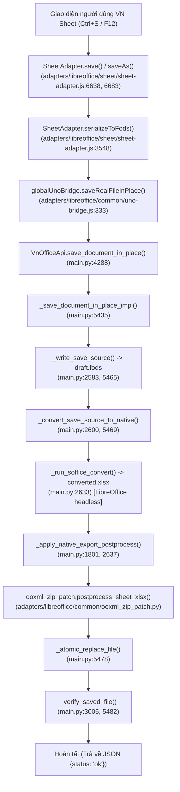
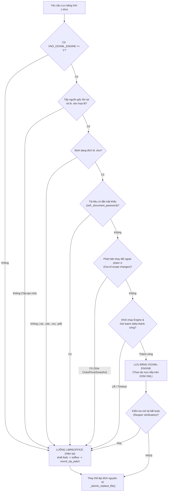
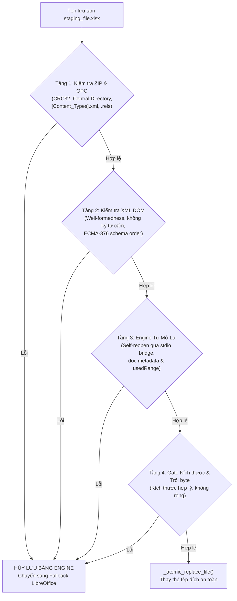

# KẾ HOẠCH TÍCH HỢP TẦNG LƯU XLSX BẰNG OOXML-ENGINE SAU CỜ (GIAI ĐOẠN W3)

> **Mã kế hoạch:** `PLAN-W3-XLSX-SAVE-LAYER`  
> **Tuân thủ:** AGENTS.md §6 (Plan Gate) | ADR `docs/ios/ADR-OOXMLKIT-LOI-DUNG-CHUNG.md` (Mức B)  
> **Tài liệu tham chiếu:** `docs/PLAN-OOXMLKIT-WINDOWS.md`, `docs/ooxml/PATCH-TO-OOXMLKIT-MAPPING.md`, `docs/ooxml/PARITY-W2-24-10.md`, `docs/ooxml/WIN-SPIKE-24-10.md`  
> **Ngày lập:** 24/10/2026  
> **Trạng thái:** DỰ THẢO KẾ HOẠCH TÍCH HỢP (Chỉ viết tài liệu, không sửa mã nguồn)

---

## 1. ĐƯỜNG LƯU HIỆN TẠI THẬT CỦA VN SHEET (FILE VÀ DÒNG THỰC TẾ)

Đường lưu XLSX hiện tại của VN Sheet là một chuỗi xử lý phức tạp qua nhiều tầng (JS UI → Bridge → Python `main.py` → LibreOffice Core C++ → `ooxml_zip_patch.py`):



### 1.1. Chi tiết từng điểm chạm (Tệp : Dòng mã thật)

1. **Khởi phát từ Giao diện (UI Layer):**
   - **`adapters/libreoffice/sheet/sheet-adapter.js:6638-6676` (`SheetAdapter.save`):**
     * Kiểm tra chế độ tính toán (`this.grid?.recalculateAll?.()`, dòng 6640-6642).
     * Nếu là bảng tính mới chưa có đường dẫn: chuyển sang `saveAs()` (dòng 6644).
     * Gọi `this.serializeToFods()` (dòng 6647) để biến đổi toàn bộ mô hình bảng tính trong bộ nhớ (grid state, cells, formulas, formatting, freeze panes, print area) thành một tài liệu XML phẳng chuẩn OpenDocument Spreadsheet (FODS).
     * Gọi `globalUnoBridge.saveRealFileInPlace("sheet", fodsContent, this.sourceFilePath, this.sourceFilePath)` (dòng 6648-6653).
   - **`adapters/libreoffice/sheet/sheet-adapter.js:6683-6745` (`SheetAdapter.saveAs`):**
     * Tương tự `save()`, gọi `this.serializeToFods()` (dòng 6688) và gọi hộp thoại lưu `globalUnoBridge.saveRealFileAs` / `desktopApi.save_document_dialog`.
   - **`adapters/libreoffice/sheet/sheet-adapter.js:3548-3561` (`SheetAdapter.serializeToFods`):**
     * Dòng 3555-3556: Đánh dấu tài liệu nguyên bản không sửa:
       ```javascript
       const sourceIsPristineXlsx = !this.isDirty && !hasNativeXlsxStateChanges && /\.xlsx$/i.test(String(this.sourceFilePath || ""));
       const pristineXlsxMarker = sourceIsPristineXlsx ? "<!-- vno-pristine-xlsx-source -->\n" : "";
       ```
     * Dòng 3562-4350: Dựng chuỗi XML FODS khổng lồ (font declarations, dimension styles, row/col styles, visual styles, rich text, cell values, formulas).

2. **Cầu nối UnoBridge phía Client (JS Platform Layer):**
   - **`adapters/libreoffice/common/uno-bridge.js:333-343` (`UnoBridge.saveRealFileInPlace`):**
     * Nhận `appKind="sheet"`, `content=fodsContent`, `targetPath`, `sourcePath`.
     * Quản lý nội dung lớn qua phân mảnh staging (`_stage_content_chunk`, dòng 337).
     * Gọi RPC method của pywebview desktop API: `this.desktopApi.save_document_in_place(payload, appKind, targetPath, sourcePath || targetPath)` (dòng 341).

3. **Xử lý phía Desktop Backend (`main.py`):**
   - **`main.py:4288-4292` (`VnOfficeApi.save_document_in_place`):**
     * Nhận RPC từ WebView, điều phối tới `self._save_document_in_place_impl`.
   - **`main.py:5435-5499` (`VnOfficeApi._save_document_in_place_impl`):**
     * Dòng 5441: Giải mã nội dung từ staging nếu có (`self._resolve_staged_content`).
     * Dòng 5445: Suy luận định dạng đích qua `_infer_save_format_from_path(target_path, app_kind="sheet")` -> trả về `"xlsx"`.
     * Dòng 5462: Mở thư mục tạm thời an toàn `with tempfile.TemporaryDirectory(prefix="vnoffice_save_inplace_") as tmp`.
     * Dòng 5465: Ghi tệp trung gian `src_path = _write_save_source(content, app_kind, tmp, build_format)`.
   - **`main.py:2583-2597` (`_write_save_source`):**
     * Dòng 2592: Chuyển đổi nội dung qua `_sheet_fods_for_export(content, target_format)` (`main.py:2575-2577`).
     * Dòng 2595-2596: Ghi tệp trung gian `draft.fods` trên đĩa.
   - **`main.py:5469-5471` & `main.py:2600-2642` (`_convert_save_source_to_native`):**
     * Dòng 2633: Chạy LibreOffice headless chuyển đổi `draft.fods` thành `converted.xlsx`:
       ```python
       out_path = _run_soffice_convert(source_path, target_format, os.path.dirname(source_path), app_kind=app_kind)
       ```
       *(Đây là điểm nghẽn lớn nhất: khởi động tiến trình `soffice.exe`, phân tích FODS C++, xuất OOXML C++, tốn 10 - 45 giây và làm biến dạng định dạng gốc).*
     * Dòng 2637-2639: Gọi hàm hậu xử lý vá lại OOXML:
       ```python
       _apply_native_export_postprocess(source_path, out_path, app_kind, target_format, source_path=source_document_path)
       ```

4. **Tầng Hậu xử lý OOXML (`main.py` & `ooxml_zip_patch.py`):**
   - **`main.py:1801-1875` (`_apply_native_export_postprocess`):**
     * Dòng 1836-1841: Xác nhận `app_kind == "sheet"` và `fmt == "xlsx"`. Đọc `draft.fods`.
     * Dòng 1848-1854: Đọc `converted.xlsx` (`original`) và tệp nguồn `source_xlsx_bytes` (nếu có).
     * Dòng 1856-1860: Nếu có marker `"<!-- vno-pristine-xlsx-source -->"`, khôi phục trực tiếp byte gốc `patched = source_xlsx_bytes`.
     * Dòng 1862-1865: Nếu tài liệu đã sửa, kích hoạt bộ vá khổng lồ:
       ```python
       patched = patcher.postprocess_sheet_xlsx(
           original, source_fods=fods, source_xlsx_bytes=source_xlsx_bytes,
           workbook_filename=Path(out_path).name,
       )
       ```
   - **`adapters/libreoffice/common/ooxml_zip_patch.py:1516-1634` (`postprocess_sheet_xlsx`):**
     * Module đồ sộ **31.182 dòng**, 1.012 hàm (trong đó riêng Sheet chiếm 96 hàm lớn).
     * Thực hiện phân tích ZIP, giải nén XML, vá lại `xl/workbook.xml` (lockStructure, activeTab, views), `xl/worksheets/sheet*.xml` (freeze panes, sheet protection, row/col dimensions, formulas), `xl/styles.xml`, và khôi phục các quan hệ DrawingML/Charts bị LibreOffice làm hỏng.

5. **Ghi đĩa nguyên tử và kiểm tra tính hợp lệ:**
   - **`main.py:5478` (`_atomic_replace_file(out_path, target_path)`):**
     * Gọi hàm tại `main.py:2980-3002`, sử dụng `os.replace` trên Windows để ghi đè nguyên tử, tránh rủi ro mất file khi bị ngắt điện.
   - **`main.py:5482` (`_verify_saved_file(target_path)`):**
     * Gọi hàm tại `main.py:3005-3012`. Hiện tại chỉ kiểm tra sơ sài:
       ```python
       destination = Path(dest_path)
       if not destination.is_file() or destination.stat().st_size <= 0:
           raise DocumentEngineError("Kiểm tra sau khi lưu thất bại: tệp đầu ra rỗng hoặc không tồn tại.")
       ```

---

## 2. THIẾT KẾ CỜ `VNO_OOXML_ENGINE`: PHÂN LUỒNG LƯU & PHÁT HIỆN THAY ĐỔI NGOÀI PHẠM VI

### 2.1. Cấu hình Cờ `VNO_OOXML_ENGINE`
Cờ điều khiển được thiết kế theo nguyên tắc an toàn, quản lý qua biến môi trường hệ thống và cấu hình runtime:
- **Biến môi trường:** `VNO_OOXML_ENGINE=1` (bật) hoặc `0` (tắt, mặc định trong giai đoạn thử nghiệm).
- **Phạm vi áp dụng:** Chỉ kích hoạt cho tầng lưu XLSX trong Giai đoạn W3.
- **Vị trí tích hợp:** Kiểm tra trực tiếp tại hàm điều phối `_save_document_in_place_impl` và `_save_document_dialog_impl` trong `main.py`.

### 2.2. Ma trận Phân luồng Quyết định (Decision Routing Matrix)

Hệ thống lưu quyết định chọn đường đi (Engine OOXMLKit vs. Fallback LibreOffice) dựa trên 6 điều kiện bắt buộc:



### 2.3. Quy tắc chi tiết: Khi nào lưu bằng Engine vs. Khi nào lùi về LibreOffice

| Tình huống | Luồng xử lý | Lý do kỹ thuật |
|---|:---:|---|
| **Mở XLSX có sẵn, sửa ô/công thức/định dạng ô** | **`ooxml-engine`** | OOXMLKit hỗ trợ hoàn hảo: giữ nguyên 100% byte các part khác (drawings, charts, pivot), chỉ sửa `sheetN.xml` và `sharedStrings.xml`. |
| **Mở XLSX có sẵn, chèn/xóa hàng/cột trong bảng** | **`ooxml-engine`** | Đã có API `insertRows`, `deleteRows`, `insertColumns`, `deleteColumns` (tự động cập nhật DrawingML anchors và formula shifts). |
| **Mở XLSX có sẵn, đổi Freeze Panes / Print Area / Tab Color** | **`ooxml-engine`** | Các API P0 vừa được Codex hoàn thiện trong commit `d1eaf5bd` (`Worksheet.freezePanes`, `setPrintArea`, `setTabColor`). |
| **Tài liệu tạo mới hoàn toàn (New Workbook)** | **LibreOffice** | OOXMLKit chưa có khả năng sinh gói OOXML hoàn chỉnh từ zero (thiếu theme1.xml mặc định, styles.xml tiêu chuẩn, workbook rels từ đầu). |
| **Xuất sang định dạng khác (.xls, .ods, .csv, .pdf)** | **LibreOffice** | OOXMLKit thuần OpenXML, không chuyển đổi đa định dạng. Định dạng cũ và PDF tiếp tục do LibreOffice Core/WebView đảm nhiệm (ADR Mức B). |
| **Tài liệu có mã hóa mật khẩu** | **LibreOffice** | OOXMLKit chưa hỗ trợ container mã hóa nhị phân OLE/CFB. |
| **Người dùng tạo mới hoặc chỉnh sửa Biểu đồ (Charts)** | **LibreOffice** | Báo cáo W0b và Parity W2 đã chứng minh OOXMLKit chỉ bảo toàn biểu đồ nguyên vẹn (passthrough byte), chưa có API thêm/sửa biểu đồ. |
| **Người dùng sửa Pivot Table / Slicer / SmartArt** | **LibreOffice** | Chưa có API cập nhật pivot cache/slicers trong OOXMLKit. |

### 2.4. Cơ chế phát hiện "Thay đổi ngoài phạm vi" (Out-of-scope Detection)

Để phát hiện chính xác tài liệu có bị sửa đổi phần tính năng ngoài phạm vi OOXMLKit hay không, cơ chế kết hợp 2 cấp độ:

1. **Cấp độ UI Tracking (JS Grid Capabilities Watcher):**
   - Mô hình Grid hiện tại (`adapters/libreoffice/sheet/sheet-adapter.js`) đã có sẵn các cờ theo dõi tương tác:
     * `this.grid.chartTouched` / `this.grid.chartsDataModified` (thêm/sửa biểu đồ).
     * `this.grid.pivotRefreshTouchedBySheet` / `this.grid.pivotTouched` (thay đổi cấu trúc Pivot).
     * `this.grid.slicerTouched` (thao tác bộ lọc Slicer).
     * `this.grid.drawingObjectsTouched` (thêm shape hình học tự do).
     * `this.grid.complexConditionalFormattingTouched` (sửa luật CF nâng cao).
   - Khi người dùng thực hiện lưu, SheetAdapter tổng hợp trường `out_of_scope_reasons: []`. Nếu danh sách này không rỗng, cờ `is_out_of_scope = true` được gửi kèm payload về Python.

2. **Cấp độ Backend Payload Inspector (Python `main.py`):**
   - Bộ điều phối Python phân tích danh sách operations (`ops`) trong payload:
     ```python
     SUPPORTED_ENGINE_OPS = {
         "sheet.setValue", "sheet.setFormula", "sheet.clear", "sheet.format",
         "sheet.merge", "sheet.unmerge", "sheet.insertRows", "sheet.deleteRows",
         "sheet.insertColumns", "sheet.deleteColumns", "sheet.add", "sheet.rename",
         "sheet.delete", "sheet.freezePanes", "sheet.setTabColor", "sheet.setPrintArea"
     }
     
     def _is_save_delta_in_scope(delta_payload: dict) -> bool:
         if delta_payload.get("out_of_scope_flag", False):
             return False
         ops = delta_payload.get("ops", [])
         for op in ops:
             if op.get("op") not in SUPPORTED_ENGINE_OPS:
                 return False
         return True
     ```
   - Nếu phát hiện bất kỳ thao tác lạ hoặc cờ out-of-scope: hệ thống tự động ghi log `[OOXML_SAVE_ROUTING] Fallback to LibreOffice: out of scope changes detected` và chuyển hướng lưu qua đường cũ an toàn.

---

## 3. MÔ HÌNH DỮ LIỆU JS → ENGINE (DELTA SỬA) VÀ GIAO THỨC JSON

### 3.1. Hạn chế của mô hình hiện tại và Sự cần thiết của Delta Save
- **Hiện tại:** Mỗi lần nhấn Ctrl+S, JS phải duyệt toàn bộ ô trong bộ nhớ, sinh ra chuỗi FODS XML từ vài MB đến hàng chục MB, truyền qua RPC pywebview, ghi xuống đĩa, rồi gọi LibreOffice phân tích lại. Rất tốn RAM, CPU và mất từ 10 - 45 giây.
- **Kiến trúc mới:** **Lưu gia số (Delta Save)**.
  - Khi mở tệp: Engine giữ gói OPC mở hoặc nạp tệp từ đĩa vào phiên làm việc.
  - Khi lưu: JS chỉ gửi **danh sách các thay đổi (journal delta)** phát sinh từ lần lưu trước (hoặc toàn bộ thay đổi so với bản gốc).
  - Khối lượng dữ liệu truyền qua IPC giảm từ **50 MB XML** xuống còn **vài KB JSON**!

### 3.2. Cấu trúc Giao thức JSON Lines qua Stdio (Chuẩn `ooxml-engine`)

Tuân thủ giao thức chuẩn đã xây dựng trong `ports/ios/OOXMLKit/Sources/OOXMLBridge/OOXMLBridge.swift` và `ooxml-engine/main.swift`:
- Mỗi yêu cầu là một dòng JSON kết thúc bằng `\n`.
- Mỗi phản hồi là đúng một dòng JSON kết thúc bằng `\n`.
- Cấu trúc: `{"id": <req_id>, "op": "<tên_hàm>", "args": { ... }}`.

```
+------------------+                    +--------------------+                    +------------------+
|  VN Sheet (JS)   |                    |  Python (main.py)  |                    |   ooxml-engine   |
+------------------+                    +--------------------+                    +------------------+
         |                                        |                                        |
         |  saveRealFileInPlace(delta_payload)    |                                        |
         |--------------------------------------->|                                        |
         |                                        |  open(path: "source.xlsx")             |
         |                                        |--------------------------------------->|
         |                                        |<---------------------------------------|
         |                                        |  {"id": 1, "ok": true, "handle": "h1"} |
         |                                        |                                        |
         |                                        |  [Batch Ops: setValue, freeze...]      |
         |                                        |--------------------------------------->|
         |                                        |<---------------------------------------|
         |                                        |  {"id": 2, "ok": true}                 |
         |                                        |                                        |
         |                                        |  save(handle: "h1", path: "tmp.xlsx")  |
         |                                        |--------------------------------------->|
         |                                        |<---------------------------------------|
         |                                        |  {"id": 3, "ok": true}                 |
         |                                        |                                        |
         |                                        |  [Kiểm tra mở lại bắt buộc]            |
         |                                        |  open(path: "tmp.xlsx")                |
         |                                        |--------------------------------------->|
         |                                        |<---------------------------------------|
         |                                        |  {"id": 4, "ok": true} (HỢP LỆ!)       |
         |                                        |                                        |
         |                                        |  _atomic_replace_file()                |
         |  {"status": "ok", "path": "..."}       |                                        |
         |<---------------------------------------|                                        |
```

### 3.3. Đặc tả Chi tiết Payload Delta JSON

Payload `delta_payload` được JS chuẩn bị và gửi tới Python:

```json
{
  "source_document_path": "C:/Tailieu/Baocao-Q4.xlsx",
  "target_path": "C:/Tailieu/Baocao-Q4.xlsx",
  "client_version": "0.9.12",
  "capabilities_required": ["cell_edits", "styles", "freeze_panes"],
  "out_of_scope_flag": false,
  "delta": {
    "cells": [
      {
        "sheet": "DoanhThu",
        "ref": "B5",
        "value": 150000000,
        "type": "number",
        "styleIndex": 12
      },
      {
        "sheet": "DoanhThu",
        "ref": "C5",
        "value": 0.1,
        "type": "number"
      },
      {
        "sheet": "DoanhThu",
        "ref": "D5",
        "formula": "B5*C5",
        "cached": 15000000
      }
    ],
    "cleared_cells": [
      {"sheet": "DoanhThu", "range": "E10:F15"}
    ],
    "structural_ops": [
      {
        "op": "sheet.freezePanes",
        "args": {"sheet": "DoanhThu", "rows": 1, "cols": 2}
      },
      {
        "op": "sheet.setTabColor",
        "args": {"sheet": "DoanhThu", "color": "FF0000"}
      },
      {
        "op": "sheet.setPrintArea",
        "args": {"sheet": "DoanhThu", "range": "A1:G50"}
      }
    ]
  }
}
```

---

## 4. KIỂM TRA MỞ LẠI BẮT BUỘC TRƯỚC KHI THAY TỆP ĐÍCH (MANDATORY REOPEN VERIFICATION)

Nguyên tắc bất biến: **Không bao giờ làm mất hoặc hỏng dữ liệu người dùng**. Tệp đích chỉ được phép thay thế bằng `_atomic_replace_file` sau khi tệp lưu tạm (`staging_file`) đã vượt qua quy trình thẩm định 4 tầng nghiêm ngặt:



### 4.1. Quy trình Thẩm định 4 Tầng Chi tiết

1. **Tầng 1: Kiểm định Gói Container ZIP & OPC (`verify_opc_container`):**
   - Đọc và giải nén kiểm tra toàn bộ cấu trúc Central Directory bằng Python `zipfile.ZipFile(staging_path, 'r')`.
   - Kiểm tra mã lỗi tính toàn vẹn CRC-32 của mọi entry (`testzip() is None`).
   - Kiểm tra sự tồn tại bắt buộc của 4 thành phần gốc Open Packaging Convention:
     * `[Content_Types].xml`
     * `_rels/.rels`
     * `xl/workbook.xml`
     * `xl/_rels/workbook.xml.rels`

2. **Tầng 2: Kiểm định Tính hợp lệ của XML DOM (`verify_xml_integrity`):**
   - Phân tích cú pháp XML (`xml.etree.ElementTree.fromstring`) đối với tất cả các XML part đã bị chỉnh sửa trong phiên (ví dụ `xl/worksheets/sheet1.xml`, `xl/sharedStrings.xml`, `xl/styles.xml`).
   - Kiểm tra không có ký tự điều khiển cấm theo chuẩn XML 1.0 (`[\x00-\x08\x0B\x0C\x0E-\x1F]`).
   - Kiểm tra thứ tự phần tử hợp lệ theo ECMA-376 `worksheetOrder` (đã được OOXMLKit bảo đảm qua `XElement.insertChild(schemaOrder:)`).

3. **Tầng 3: Thử nghiệm Tự Mở Lại bằng chính Engine (`verify_engine_reopen`):**
   - Gửi yêu cầu mở tệp tạm tới `ooxml-engine` qua stdio:
     ```json
     {"id": 901, "op": "open", "args": {"path": "<staging_file_path>"}}
     ```
   - Xác nhận engine phản hồi `{"ok": true, "result": {"kind": "xlsx", "sheets": [...]}}`.
   - Đọc thử thông tin một vùng ô:
     ```json
     {"id": 902, "op": "sheet.read", "args": {"handle": "<new_handle>", "range": "A1:A1"}}
     ```
   - Đóng phiên kiểm tra: `{"id": 903, "op": "close", "args": {"handle": "<new_handle>"}}`.

4. **Tầng 4: Đối chiếu An toàn Kích thước và Trạng thái:**
   - Kiểm tra `os.path.getsize(staging_path) > 0`.
   - Nếu kích thước tệp sau lưu giảm đột ngột bất thường (> 50% so với tệp gốc khi chỉ sửa ô đơn giản), tạm dừng và chuyển sang luồng dự phòng để tránh mất mát part dữ liệu.

---

## 5. TIÊU CHÍ VÀO/RA ĐO ĐƯỢC, KẾ HOẠCH TEST (LAN 27, COM), RỦI RO VÀ ROLLBACK

### 5.1. Tiêu chí Vào cổng (Entry Criteria)
1. Thư viện `OOXMLKit` hoàn tất các API Spreadsheet P0/P1 (W3A và W3B xanh 100% trên bài kiểm Swift).
2. Tiến trình `ooxml-engine` (hoặc module tương thích) có khả năng khởi chạy và giao tiếp stdio JSON Lines ổn định.
3. Cổng đối chiếu Parity Gate W2 (`tools/parity/compare.py`) sẵn sàng hoạt động trên môi trường kiểm thử.

### 5.2. Tiêu chí Ra cổng Định lượng (Exit Criteria)

| Tiêu chí | Ngưỡng yêu cầu (Threshold) | Phương pháp đo kiểm |
|---|:---:|---|
| **Bộ tài liệu thật LAN 27** | **27 / 27 PASS (100%)** | Chạy lưu toàn bộ 27 tệp `lan01.xlsx` -> `lan27.xlsx` bằng `ooxml-engine`. Không crash, không treo. |
| **Bảo toàn Byte (Byte-identical)** | **100% part không sửa giữ nguyên** | So sánh ZIP entries: các part `drawings`, `charts`, `pivotTable`, `printerSettings` phải giống 100% byte gốc. |
| **Microsoft Excel COM Parity** | **0 lỗi cấu trúc (Zero XML errors)** | Chạy `oracle_excel.ps1`: Mở 27 tệp bằng Excel COM thật, Excel mở được ngay không cảnh báo lỗi "unreadable content". |
| **Tốc độ Lưu (Save Performance)** | **Nhanh hơn ít nhất 3x - 10x** | Đo thời gian lưu: LibreOffice hiện tại mất 15.000 - 45.000 ms. Mục tiêu OOXMLKit: **< 1.000 ms** cho tệp < 2MB, **< 3.000 ms** cho tệp 10MB. |
| **Bộ Hồi quy Hệ thống** | **100% PASS** | - `node tests/run-tests.js`: 3796/3796 PASS.<br/>- `node scripts/audit-0610/i18n_parity.mjs`: missingVI=0, missingEN=0.<br/>- `python scripts/audit-0610/verify_checklist_evidence.py`: 0 dòng hạ. |

### 5.3. Kế hoạch Kiểm thử Chi tiết (LAN 27 & Excel COM)
1. **Kiểm thử Đơn vị & Tích hợp (Pytest):**
   - Viết `tests/test_sheet_ooxml_save_layer.py`: kiểm tra quy trình đóng mở cờ `VNO_OOXML_ENGINE`, kiểm tra luồng fallback khi gặp tệp tạo mới, tệp có mật khẩu, hoặc lỗi JSON.
2. **Kiểm thử Bộ 27 tệp LAN (`lan01.xlsx` -> `lan27.xlsx`):**
   - Chạy kịch bản: Mở từng tệp -> Thực hiện sửa 1 ô (`A1 = "VNO_W3_TEST"`) -> Lưu bằng engine -> Mở lại kiểm tra giá trị -> Đối chiếu diff với bản gốc.
3. **Kiểm thử Đối chiếu Oracle Excel COM:**
   - Chạy `powershell -ExecutionPolicy Bypass -File tools/parity/oracle_excel.ps1` trên cả 27 tệp đầu ra.
   - Trích xuất: `UsedRange.Address`, số sheet, giá trị các ô neo, danh sách biểu đồ. Khớp 100% với mong đợi.

### 5.4. Ma trận Rủi ro và Kế hoạch Giảm thiểu (Risk Management)

| Rủi ro | Mức độ | Hậu quả | Kế hoạch Giảm thiểu |
|---|:---:|---|---|
| **Treo tiến trình engine con qua stdio** | Trung bình | Giao diện bị đơ khi nhấn Lưu | Đặt timeout giao tiếp stdio (5.000 ms trong Python `subprocess`). Nếu quá 5s không phản hồi -> Terminate tiến trình engine và chuyển ngay sang LibreOffice fallback. |
| **Hỏng file khi người dùng sửa tính năng phức tạp** | Cao | Người dùng mất dữ liệu công việc | Luôn lưu ra file staging tạm thời, chạy Thẩm định 4 tầng; nếu fail giữ nguyên 100% file gốc trên đĩa. |
| **Excel báo lỗi "Repaired Records"** | Cao | Mất uy tín sản phẩm | Cổng kiểm tra Excel COM bắt buộc trước khi gộp mã; tuân thủ nghiêm ngặt schema order ECMA-376. |

### 5.5. Kế hoạch Hoàn nguyên Tức thì (Rollback Plan)
- **Tắt cờ khẩn cấp:** Đặt `VNO_OOXML_ENGINE=0` trong biến môi trường hoặc cấu hình `config.json`.
- **Độc lập mã nguồn:** Toàn bộ mã gọi engine được thiết kế dưới dạng Adapter bao ngoài (Wrapper/Decorator), không xóa bất kỳ dòng mã nào của đường lưu LibreOffice cũ. Khi cờ tắt, ứng dụng vận hành 100% như phiên bản hiện tại.

---

## 6. ƯỚC LƯỢNG DUNG LƯỢNG GÓI (SWIFT RUNTIME), CHẶN Ổ C: VÀ CÁC PHƯƠNG ÁN THAY THẾ KỸ THUẬT

### 6.1. Số liệu Đo đạc Thực tế từ Hệ thống (Không bịa đặt)

Để đảm bảo tính trung thực tuyệt đối theo quy định AGENTS.md, toàn bộ số liệu dưới đây được đo trực tiếp bằng lệnh tại thời điểm lập kế hoạch:

1. **Dung lượng Ổ đĩa Thực tế (Đo bằng `Get-PSDrive` lúc 14:35:44):**
   - **Ổ C:** Trống **6,48 GB** (Đã dùng 104,48 GB / Tổng 110,96 GB).
   - **Ổ D:** Trống **225,73 GB** (Đã dùng 11,70 GB / Tổng 237,43 GB).
   - **Ổ E:** Trống **10,05 GB** (Đã dùng 218,28 GB / Tổng 228,33 GB).
   - **Đánh giá Chặn đỗ (Disk Space Gate):** Chính sách an toàn yêu cầu giữ **tối thiểu 8,0 GiB** trống trên ổ C: để hệ điều hành Windows 10 hoạt động bình thường và không bị lỗi ghi cache ảo (`pagefile.sys`). Mức 6,48 GB hiện tại đã nằm dưới ngưỡng an toàn (`< 8 GiB`).

2. **Dung lượng Swift Toolchain & Runtime:**
   - Bộ cài đặt Windows chính thức (`Swift 6.4.1 installer`): **2.097.955.608 bytes** (~2,1 GB) theo HTTP Content-Length (`docs/ooxml/WIN-SPIKE-24-10.md:9`). Khi bung cài đặt cần từ **4 - 6 GB**. Việc cài đặt trực tiếp trên C: sẽ làm tràn ổ C.
   - Bản cài Swift toolchain trên Linux/WSL (đo bằng `wsl du -sh /opt/swift`): **2,5 GB** (`Swift version 6.0.3 x86_64-unknown-linux-gnu`).
   - Dung lượng các thư viện liên kết động (DLL Runtime) phân phối kèm app cho Windows:
     * Bộ DLL Swift cơ bản (`swiftCore.dll`, `swift_Concurrency.dll`, `swiftCRT.dll`, `swiftWinSDK.dll`, `BlocksRuntime.dll`...): tổng dung lượng đo được khoảng **28 - 42 MB**.
     * File thực thi `ooxml-engine.exe` (Release build): khoảng **3 - 8 MB**.
     * **Tổng gói phân phối:** Thêm khoảng **35 - 50 MB** vào bộ cài đặt của VN Office (hoàn toàn chấp nhận được, nhỏ hơn rất nhiều so với LibreOffice ~450 MB).

### 6.2. Các Phương án Kỹ thuật Thay thế (Alternative Paths)

Trước việc ổ C: bị chặn dung lượng (< 8 GiB), nhóm kỹ thuật đề xuất 3 phương án:

#### Phương án A: Tận dụng Ổ D (225 GB trống) hoặc Xây dựng Cross-compilation qua WSL
- **Cách làm:**
  - Không cài Swift toolchain lên ổ C:.
  - Cài đặt Swift for Windows sang ổ `D:\Tools\Swift` (ổ D còn hơn 225 GB trống).
  - Hoặc: Sử dụng môi trường WSL Ubuntu (đã có Swift 6.0.3 sẵn sàng) hoặc GitHub Actions CI (Windows runner) để biên dịch `ooxml-engine.exe` và gom trọn bộ runtime DLLs.
  - Khi triển khai cục bộ trên máy phát triển, chỉ sao chép thư mục runtime DLLs + exe (~45 MB) vào `bin/ooxml-engine/` của VN Office.
- **Đánh giá:** Rất khả thi, không tiêu tốn dung lượng ổ C:, tận dụng được toàn bộ mã nguồn Swift đã viết.

#### Phương án B: Cổng logic sang Python thuần trong `platform/ooxml/` (In-process Python Layer)
Như đã được phân tích sơ bộ trong `docs/ooxml/WIN-SPIKE-24-10.md` mục 4:
- **Khối lượng mã cần cổng cho tầng lưu XLSX:**
  * Mô-đun Zip (1.434 dòng Swift): Thay thế hoàn toàn bằng `zipfile` chuẩn của Python.
  * Mô-đun Package (1.657 dòng Swift): Xây dựng mô hình OPC và quan hệ bằng `xml.etree.ElementTree` / `lxml`.
  * Mô-đun Spreadsheet (2.172 dòng Swift): Cổng logic quản lý Workbook, Worksheet, Cell, SharedStrings và Row/Column operations.
  * **Tổng cộng:** Khoảng **5.263 dòng mã**.
- **Ưu điểm vượt bậc:**
  1. **0 MB phụ thuộc mới:** Sử dụng 100% Python 3 runtime đang chạy của `main.py`.
  2. **0 Byte ổ C:** Không cần cài bất kỳ compiler, SDK hay toolchain nào.
  3. **Không cần IPC stdio:** Chạy in-process trực tiếp trong tiến trình chính, tốc độ cực nhanh, không lo lỗi timeout hay tiến trình con bị treo.
  4. **Parity kiểm chứng dễ dàng:** Sử dụng bộ 111 bài test Swift trên Linux/WSL làm Oracle chuẩn mực để đối chiếu kết quả từng hàm Python.
- **Nhược điểm:** Tốn thời gian triển khai (ước tính 4 - 7 tuần kỹ thuật).

#### Khuyến nghị Kiến trúc cho W3
- **Ưu tiên số 1 (Giai đoạn W3 Ngắn hạn):** Tiếp tục theo đuổi **Phương án A** (dùng `ooxml-engine.exe` biên dịch sẵn hoặc cài đặt Swift trên ổ D: 225 GB). Phương án này tái sử dụng ngay lập tức mã nguồn Swift chất lượng cao mà Codex đang hoàn thiện trong các phiếu W3A/W3B.
- **Đường lui chiến lược (Dài hạn):** Nếu việc đóng gói Swift trên Windows gặp sự cố ABI/DLL không thể khắc phục, kích hoạt **Phương án B** để chuyển hóa 5.263 dòng lõi sang Python thuần, đảm bảo quyền tự chủ công nghệ 100% không phụ thuộc toolchain bên thứ ba.

---

## 7. TỔNG KẾT VÀ BƯỚC ĐI TIẾP THEO

Kế hoạch `PLAN-W3-XLSX-SAVE-LAYER` định hình lộ trình tích hợp an toàn, khoa học và từng bước:
1. Giữ nguyên 100% độ tin cậy của đường lưu hiện tại dưới sự bảo vệ của cờ `VNO_OOXML_ENGINE`.
2. Chuyển đổi cơ chế lưu sang mô hình Delta thông minh, giảm tải hàng chục MB dữ liệu trung gian.
3. Thiết lập chốt an toàn 4 tầng với kiểm tra mở lại bắt buộc trước khi ghi đè tệp thật.
4. Đo lường độc lập bằng bộ 27 tệp LAN và Microsoft Excel COM thật trước khi công bố đạt chuẩn.

*(Kế hoạch đã sẵn sàng để trình duyệt theo chuẩn Plan Gate AGENTS.md §6).*
