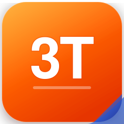

# 3T Office Website (`server/3t-web`)

Trang web tĩnh chính thức giới thiệu bộ ứng dụng văn phòng **3T Office** (gồm Doc, Sheet và Slide), phục vụ tên miền `https://office.3tcomputer.com`.

---

## 1. Sơ đồ cấu trúc thư mục (Folder Map)

```text
server/3t-web/
├── index.html                 # Trang chủ: Hero tương tác, Bento grid 6 thẻ, Stepper cập nhật 3 bước, Định dạng, CTA
├── tinh-nang.html             # Danh mục tính năng: Ma trận lọc động Sẵn sàng vs Sắp có theo từng ứng dụng
├── tai-ve.html                # Tải bộ cài: Phiên bản 0.9.7, dung lượng 502 MB, mã băm SHA-256 kèm nút copy, stepper cài đặt
├── co-gi-moi.html             # Nhật ký cập nhật: Dòng thời gian trực quan (Timeline) từ bản 0.9.1 đến 0.9.7
├── huong-dan.html             # Hướng dẫn sử dụng: 8 bài viết, tìm kiếm thời gian thực (live search), mục lục bám dính
├── ban-quyen.html             # Bản quyền & Gói dùng: Dùng thử 30 ngày, Gói vĩnh viễn, Thuê bao, cơ chế 30 ngày ngoại tuyến
├── lien-he.html               # Liên hệ: Kênh liên lạc chính thống và các trường chờ phê duyệt (TODO-CONFIRM)
├── trang-thai.html            # Giám sát dịch vụ: Truy vấn thời gian thực điểm cuối /health, hỗ trợ cả offline và HTTP
├── 404.html                   # Trang báo lỗi 404: Thiết kế đồng bộ, liên kết điều hướng nhanh về các trang trọng tâm
├── robots.txt                 # Cấu hình robot thu thập dữ liệu tìm kiếm
├── sitemap.xml                # Sơ đồ trang web XML cho office.3tcomputer.com
├── favicon.svg                # Biểu trưng vector 3T
├── favicon.ico                # Biểu trưng định dạng ico
├── css/
│   └── style.css              # Bảng kiểu CSS: Tokens, 12-cột, 8px grid, Sáng/Tối, responsive 360-1920px, reduced-motion
├── js/
│   └── main.js                # Vanilla JS: Theme toggle, Hero switcher, live filter, live search, health check, copy SHA
├── data/
│   └── releases.json          # Nguồn sự thật duy nhất (Single Source of Truth) về các bản phát hành
└── assets/
    ├── icons/                 # Biểu tượng SVG sản phẩm: 3t-mark.svg, writer.svg, sheet.svg, slides.svg, vnoffice.svg
    └── screenshots/           # Ảnh chụp màn hình thật từ ứng dụng desktop: doc-preview, sheet-preview, slide-preview
```

---

## 2. Hệ thống thiết kế VIP (Design System & Tokens)

Trang web sử dụng hệ thống thiết kế nhất quán được xây dựng hoàn toàn bằng CSS Custom Properties (biến CSS), đảm bảo hiệu năng tối đa, không cần bất kỳ framework hay thư viện ngoài.

### 2.1. Bảng màu thương hiệu (Brand Palette)
- **Màu nhận diện 3T (Cam & Xanh hoàng gia)**:
  - `--color-primary-500`: `#f97316` (Cam 3T rực rỡ)
  - `--color-primary-600`: `#ea580c` (Cam tương tác hover)
  - `--color-primary-700`: `#c2410c` (Cam nhấn active)
  - `--color-navy-900`: `#0f172a` (Xanh đen nền tảng)
  - `--color-navy-800`: `#1e293b` (Xanh đen thẻ / container)
  - `--color-navy-700`: `#334155` (Xanh đen viền / tương phản)
- **Màu sắc sản phẩm**:
  - Doc (Văn bản): `#2563eb` (Xanh dương)
  - Sheet (Bảng tính): `#16a34a` (Xanh lá cây)
  - Slide (Trình chiếu): `#ea580c` (Cam đỏ)

### 2.2. Chủ đề Sáng & Tối (Light & Dark Themes)
Hệ thống hỗ trợ 2 chế độ màu với chuẩn độ tương phản WCAG AA:
- **Tự động nhận diện**: Dựa trên thuộc tính hệ thống `@media (prefers-color-scheme: dark)`.
- **Chuyển đổi thủ công**: Nút chuyển đổi tại góc trên thanh điều hướng, ghi nhớ trạng thái vào `localStorage` an toàn trong khối `try/catch`.
- **Chống chớp giao diện (Anti-flicker)**: Một đoạn mã JavaScript nội tuyến ngắn trong `<head>` áp dụng ngay thuộc tính `data-theme` trước khi DOM hiển thị lần đầu.

### 2.3. Hệ thống khoảng cách 8 px (Spacing System)
Mọi lề, đệm, khoảng cách lưới đều tuân theo bội số 8 px:
- `--space-1`: 4px
- `--space-2`: 8px (đơn vị cơ sở)
- `--space-3`: 12px
- `--space-4`: 16px
- `--space-5`: 20px
- `--space-6`: 24px
- `--space-8`: 32px
- `--space-10`: 40px
- `--space-12`: 48px
- `--space-16`: 64px
- `--space-20`: 80px
- `--space-24`: 96px
- `--space-32`: 128px

### 2.4. Bậc kiểu chữ (Typography Scale)
Sử dụng bộ phông chữ hệ thống tối ưu tốc độ nạp (0 KB download), hiển thị tiếng Việt sắc nét và tương thích hoàn hảo trên Windows, macOS, Linux, iOS, Android:
```css
font-family: -apple-system, BlinkMacSystemFont, "Segoe UI", Roboto, "Helvetica Neue", Arial, sans-serif;
```
- Thang cỡ chữ: `--font-xs` (12px), `--font-sm` (14px), `--font-base` (16px), `--font-lg` (18px), `--font-xl` (20px), `--font-2xl` (24px), `--font-3xl` (30px), `--font-4xl` (36px), `--font-5xl` (48px), `--font-hero` (clamp(36px, 5vw, 56px)).
- Tỉ lệ chiều cao dòng: 1.15 cho tiêu đề lớn đến 1.7 cho nội dung văn bản dài.

### 2.5. Đổ bóng phân lớp (Layered Soft Shadows)
Tạo chiều sâu không gian (Elevation) tinh tế:
- `--shadow-sm`: `0 1px 2px 0 rgba(0, 0, 0, 0.05)`
- `--shadow-md`: `0 4px 6px -1px rgba(0, 0, 0, 0.1), 0 2px 4px -2px rgba(0, 0, 0, 0.1)`
- `--shadow-lg`: `0 10px 15px -3px rgba(0, 0, 0, 0.1), 0 4px 6px -4px rgba(0, 0, 0, 0.1)`
- `--shadow-xl`: `0 20px 25px -5px rgba(0, 0, 0, 0.1), 0 8px 10px -6px rgba(0, 0, 0, 0.1)`
- `--shadow-glow`: Vầng sáng màu cam tinh tế khi tương tác nút bấm.

### 2.6. Tuân thủ giảm chuyển động (Prefers-Reduced-Motion)
Khi người dùng kích hoạt thiết lập giảm chuyển động trong hệ điều hành:
- Khối `@media (prefers-reduced-motion: reduce)` trong `style.css` tự động thiết lập thời gian diễn hoạt và chuyển tiếp về `0.001ms !important`.
- Vô hiệu hóa hiệu ứng nghiêng 3D con trỏ (parallax tilt) và hiệu ứng nổi (floating animation).
- Cuộn trang chuyển về chế độ tức thì (`scroll-behavior: auto !important`).

---

## 3. Hướng dẫn thêm trang mới (How to Add a New Page)

Khi cần bổ sung một trang mới vào `server/3t-web/`, lập trình viên cần tuân thủ cấu trúc chuẩn sau đây:

### 3.1. Khung mẫu HTML cơ bản (Boilerplate)
```html
<!DOCTYPE html>
<html lang="vi">
<head>
  <meta charset="UTF-8">
  <meta name="viewport" content="width=device-width, initial-scale=1.0">
  <title>Tiêu đề trang — 3T Office</title>
  <meta name="description" content="Mô tả ngắn gọn nội dung trang (dưới 160 ký tự).">
  <!-- Biểu trưng -->
  <link rel="icon" type="image/svg+xml" href="favicon.svg">
  <link rel="alternate icon" href="favicon.ico">
  <!-- Bảng kiểu chuẩn -->
  <link rel="stylesheet" href="css/style.css">
  <!-- Mã chống giật chủ đề (Bắt buộc) -->
  <script>
    (function(){
      try {
        var s = localStorage.getItem('vnoffice_theme');
        var d = window.matchMedia('(prefers-color-scheme: dark)').matches;
        var t = s ? s : (d ? 'dark' : 'light');
        document.documentElement.setAttribute('data-theme', t);
      } catch(e) {}
    })();
  </script>
</head>
<body>
  <!-- Liên kết trợ năng nhảy tới nội dung chính (Bắt buộc) -->
  <a href="#main-content" class="skip-link">Chuyển đến nội dung chính</a>

  <!-- Thanh điều hướng đầu trang (Header chuẩn) -->
  <header class="site-header" role="banner">
    <div class="header-inner container">
      <a href="index.html" class="brand-logo" aria-label="3T Office Trang chủ">
        
        <div class="brand-text">
          <span class="brand-title">3T Office</span>
          <span class="brand-subtitle">Bộ ứng dụng văn phòng</span>
        </div>
      </a>
      <nav class="desktop-nav" aria-label="Điều hướng chính">
        <a href="tinh-nang.html">Tính năng</a>
        <a href="tai-ve.html">Tải về</a>
        <a href="huong-dan.html">Hướng dẫn</a>
        <a href="ban-quyen.html">Bản quyền</a>
        <a href="co-gi-moi.html">Có gì mới</a>
        <a href="lien-he.html">Liên hệ</a>
      </nav>
      <div class="header-actions">
        <button id="theme-toggle" class="theme-toggle-btn" aria-label="Đổi giao diện Sáng / Tối" title="Chuyển đổi giao diện Sáng / Tối">
          <span class="theme-icon light-icon" aria-hidden="true">☀️</span>
          <span class="theme-icon dark-icon" aria-hidden="true">🌙</span>
        </button>
        <a href="tai-ve.html" class="btn btn-primary btn-sm nav-cta-btn">Tải bản 0.9.7</a>
        <button class="mobile-menu-btn" aria-label="Mở trình đơn di động" aria-expanded="false" aria-controls="mobile-nav">
          <span class="bar"></span>
          <span class="bar"></span>
          <span class="bar"></span>
        </button>
      </div>
    </div>
    <!-- Menu di động dạng trượt -->
    <div id="mobile-nav" class="mobile-nav-drawer" hidden>
      <nav aria-label="Điều hướng di động">
        <a href="index.html">Trang chủ</a>
        <a href="tinh-nang.html">Tính năng</a>
        <a href="tai-ve.html">Tải về</a>
        <a href="huong-dan.html">Hướng dẫn</a>
        <a href="ban-quyen.html">Bản quyền</a>
        <a href="co-gi-moi.html">Có gì mới</a>
        <a href="lien-he.html">Liên hệ</a>
        <a href="trang-thai.html">Trạng thái</a>
      </nav>
    </div>
  </header>

  <!-- Vùng nội dung chính (Bắt buộc chứa chính xác một thẻ h1) -->
  <main id="main-content">
    <div class="container section">
      <h1>Tiêu đề trang chuẩn ngữ nghĩa</h1>
      <p>Nội dung trang...</p>
    </div>
  </main>

  <!-- Chân trang chuẩn (Footer) -->
  <footer class="site-footer" role="contentinfo">
    <!-- Nội dung footer 4 cột tương tự các trang hiện có -->
  </footer>

  <!-- Kịch bản điều khiển chung -->
  <script src="js/main.js" defer></script>
</body>
</html>
```

### 3.2. Bộ quy tắc bắt buộc khi thêm trang mới
1. **Trợ năng & Ngữ nghĩa**:
   - Thuộc tính `lang="vi"` bắt buộc có tại thẻ `<html>`.
   - Có liên kết bỏ qua trợ năng `<a href="#main-content" class="skip-link">Chuyển đến nội dung chính</a>`.
   - Trang phải chứa **chính xác một thẻ `<h1>`**.
   - Mọi ảnh phải có thuộc tính `alt`, `width`, và `height` rõ ràng.
2. **Khắc phục tràn viền ngang (Horizontal Overflow Prevention)**:
   - Các bảng dữ liệu (`<table>`) hoặc khối mã (`<pre>`, `<code>`) dài phải được bọc trong thẻ có lớp `.table-responsive` hoặc container có `overflow-x: auto`.
   - Các chuỗi ký tự dài không ngắt (như đường dẫn tệp mạng, mã băm SHA-256) phải có lớp `.text-break` hoặc quy tắc `overflow-wrap: anywhere; word-break: break-all;`.
   - Không đặt chiều rộng cố định bằng pixel vượt quá 320 px cho các phần tử con.
3. **Ngân sách tải trang (Page Weight Budget)**:
   - Toàn bộ tài nguyên của một trang (HTML + CSS + JS + Ảnh + Icon) **không được vượt quá 700 KB**.
   - Ảnh chụp hoặc hình ảnh minh họa phải ưu tiên định dạng `.webp` kèm bản dự phòng `.png`, dung lượng mỗi ảnh dưới 250 KB.
4. **Không phụ thuộc thư viện ngoài**:
   - Tuyệt đối không dùng CDN, Google Fonts, Bootstrap, Tailwind, jQuery, v.v.
   - 100% mã nguồn JavaScript là Vanilla JS và CSS thuần túy.
5. **Kiểm tra tự động trước khi bàn giao**:
   - Chạy lệnh kiểm tra bố cục đáp ứng: `node scripts/test-web-layout.mjs` để xác nhận trang mới đạt PASS tại 360 px, 390 px, 768 px, 1280 px.
   - Chạy bộ kiểm tra tổng thể: `node tests/run-tests.js`.

---

## 4. Hướng dẫn xem trước cục bộ (Local Preview)

Do trang web được xây dựng bằng công nghệ thuần túy, bạn có thể xem trước theo 2 cách:

### Cách 1: Xem trực tiếp từ tệp (Offline / file://)
- Nhấp đúp trực tiếp vào tệp `server/3t-web/index.html` trong File Explorer.
- Trang web hoạt động hoàn hảo khi không có kết nối Internet nhờ dữ liệu dự phòng nội tuyến.

### Cách 2: Xem qua máy chủ HTTP cục bộ của Python
Chạy lệnh sau từ thư mục gốc của repository:
```bash
python -m http.server 8090 -d server/3t-web
```
Sau đó mở trình duyệt và truy cập: `http://localhost:8090`.

---

## 5. Cách thức máy chủ API gắn kết sau này (Production Static Mount)

Khi triển khai lên máy chủ dịch vụ đám mây 3T Cloud (`office.3tcomputer.com`):
1. **Nginx Reverse Proxy / Static Serve:**
   Nginx sẽ cấu hình thư mục `server/3t-web` làm `root` tĩnh phục vụ trực tiếp cho các yêu cầu tại `/`.
   Các yêu cầu API (như `/api/v1/*` và `/health`) được chuyển tiếp ngược (proxy_pass) về tiến trình `3t-api` (FastAPI).
2. **FastAPI Static Mount (Tùy chọn):**
   Trong trường hợp phục vụ trực tiếp qua FastAPI, người phụ trách dịch vụ đám mây sẽ gắn kết thư mục qua:
   ```python
   app.mount("/", StaticFiles(directory="server/3t-web", html=True), name="static_web")
   ```

---

## 6. Danh sách các hạng mục cần chủ quản duyệt (TODO-CONFIRM)

Tuân thủ nghiêm ngặt nguyên tắc trung thực và không bịa đặt số liệu:

1. **TODO-CONFIRM: Ngày mở tải công khai bản Setup 0.9.7:**
   Hiện tại nút tải công khai trên trang `tai-ve.html` và `index.html` được tạm khóa và hiển thị thông báo. Cần quyết định thời điểm mở tải công khai sau khi máy chủ hoàn tất cấu hình.
2. **TODO-CONFIRM: Giá chính thức cho các gói bản quyền:**
   - Đơn giá cho Gói vĩnh viễn (sở hữu trọn đời + 1 năm cập nhật).
   - Đơn giá cho Gói thuê bao (theo tháng / theo năm).
   Đang được hiển thị dưới dạng nhãn `TODO-CONFIRM` trên trang `ban-quyen.html` và `index.html`.
3. **TODO-CONFIRM: Thông tin liên hệ chính thức của 3T Computer:**
   - Địa chỉ trụ sở văn phòng giao dịch chính thức.
   - Số điện thoại đường dây nóng / tổng đài hỗ trợ.
   - Hộp thư điện tử (email) tiếp nhận hỗ trợ khách hàng.
   - Khung giờ trực kỹ thuật tiếp nhận yêu cầu.
   Đang được hiển thị dưới dạng các khối thông báo nổi bật trên trang `lien-he.html`.
